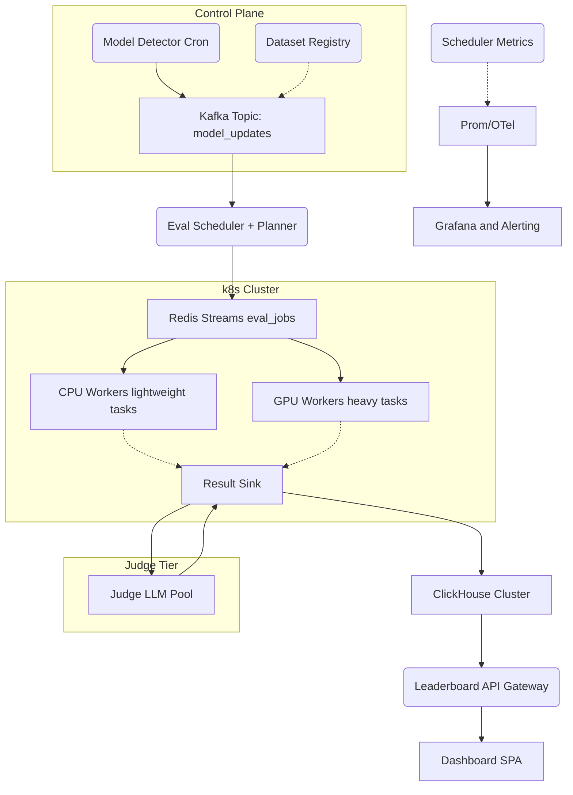

# designs/continuous-llm-benchmarking-harness-gpt.md

*End-to-end architecture for automatically discovering, evaluating, and ranking new/updated LLMs on Hugging Face & OpenRouter at **million-scale model-dataset pairs per month**.*

---

## Baseline Requirements and Non-Negotiables

| Axis | Target |
|------|--------|
| **Discovery lag** | ≤ 15 min from model publish → queued |
| **Eval freshness** | Leaderboard reflects scores ≤ 24 h old |
| **Throughput** | 1 M model–dataset pairs / month (≈ 400 QPS sustained) |
| **Latency (API)** | p95 ≤ 120 ms for *top-k* leaderboard queries |
| **Cost cap** | ≤ $0.08 per eval pair (90th-pct) |
| **Failure tolerance** | Resume within 5 min after regional outage |
| **Auditability** | Every score reproducible via versioned artefacts |

---

## System Evolution

| Stage | Key Goals | What’s Added |
|-------|-----------|--------------|
| **v0 PoC** | Manual model polling + single-node eval | Cron + Python script |
| **v1 MVP** | Automated discovery, k8s Jobs, ClickHouse leaderboard | Kafka + Argo |
| **v2 GA** | Spot-GPU fleets, judge-LLM scoring, web dashboard | GPU autoscaler, Superset |
| **v3 Scale** | 10× traffic, multi-region, BYO-dataset API | Federated ClickHouse, Anycast ingress |

---

## High-Level Architecture



---

## Component Deep Dives

### Model Detector Cron

* **Trigger** : every 10 min; hits Hugging Face `/api/models` diff + OpenRouter `/models` JSON diff.
* **Output** : `{model_id, sha256_revision, published_at, tags, requires_gpu}` → Kafka `model_updates`.
* **Why cron not webhook?** HF/OpenRouter lack reliable webhooks; polling is idempotent & simple.

### Eval Scheduler and Planner

* Reads `model_updates`, cartesian-joins with active **Dataset Registry** (Snowflake table) to create **eval plan** rows.
* Cost model (= tokens × \$ / limitation) bins jobs into *CPU* vs *GPU* and picks **batch size** to saturate GPUs.
* Pushes indivisible jobs into **Redis Streams** (low-latency, fan-out) with `XADD`.
* Maintains *back-pressure* by reading cluster usage via K8s Metrics API; pauses if GPU > 90 % or ClickHouse ingest lag > 5 min.

### Worker Pods

| Type           | Image                    | Responsibility                                         |
| -------------- | ------------------------ | ------------------------------------------------------ |
| **CPU Worker** | `python3-slim`           | Calc perplexity, embedding sims, small (< 13 B) models |
| **GPU Worker** | `nvidia/cuda:12.4-torch` | Run > 13 B models, multimodal eval, heavy throughput   |

* Each job = “dataset shard” (≤ 500 prompts) to keep pod runtimes at \~8 min (spot-friendly).
* **Argo Workflows** generates `Job` CRDs; **Karpenter/KEDA** autoscales node groups and pod counts separately.
* **Spot GPU pooling**: On AWS we use `g5`, `g6`, `a10g` spot, fall back to on-demand if queue SLA threatened.

### Result Sink

* Workers POST to gRPC-stream `ResultSink` → writes to **ClickHouse STAGING** (MergeTree) using dedupe key `(model_id, dataset_id, shard_id)`.
* On shard completion, a **Materialized View** rolls up shard-scores → final model-dataset score row.
* Sink emits `result_ready` to Kafka for judge scoring.

### Judge LLM Pool

* Micro-service hitting **GPT-4o-mini** via OpenRouter with deterministic system prompt.
* For each result: generates JSON `{score:1-10, reasoning}`.
* Writes back to `judge_scores` table (also ClickHouse) with foreign-key to raw outputs (for audit).
* **Batching**: groups 32 comparisons per OpenRouter call (function-call mode) → cost drop 40 %.

### ClickHouse Cluster (Analytical and Serving)

* Cluster of 3 replicas × 2 shards; zstd compression; Tiered storage (hot SSD → S3).
* Primary table partitions by `toYYYYMM(upload_time)`.
* Materialized views pre-aggregate:

  * **`leaderboard_topk_mv`** (model\_id, top-metric).
  * **`trend_mv`** (7-day rolling Δ).
* **Why ClickHouse?** Handles > 150 k inserts/s, millisecond percentile queries.

### Leaderboard API

* **FastAPI** behind CloudFront Anycast.
* Common endpoints:

  * `GET /v1/leaderboard?metric=win_rate&top=100`
  * `GET /v1/model/<id>/trend`
* Cache layer: **CloudFront + Origin Shield** 30 s TTL (refresh on ClickHouse Δ timestamp header).
* Auth: Public read; internal write via mTLS.

### Dashboard SPA

* React + ECharts; pulls from same API; embeds Grafana iframe for cluster health.

---

## Warehouse Schema (Core Tables)

```sql
CREATE TABLE eval_raw (
  model_id LowCardinality(String),
  dataset_id LowCardinality(String),
  shard_id UInt32,
  prompt_id UInt32,
  output String,
  latency_ms UInt16,
  cost_usd Float32,
  ts DateTime DEFAULT now()
) ENGINE = MergeTree()
PARTITION BY toYYYYMM(ts)
ORDER BY (model_id, dataset_id, shard_id, prompt_id);

CREATE TABLE eval_scores (
  model_id String,
  dataset_id String,
  score Float32,
  latency_p50_ms UInt16,
  latency_p95_ms UInt16,
  tokens UInt32,
  cost_usd Float32,
  completed_at DateTime,
  PRIMARY KEY (model_id, dataset_id)
) ENGINE = ReplacingMergeTree();
```

*Foreign-key `judge_scores` links to `eval_scores` (1:1).*

---

## Data Freshness and SLAs

| Pipeline Segment                | Time Budget                                  |
| ------------------------------- | -------------------------------------------- |
| Discovery polling → job enqueue | ≤ 15 min                                     |
| Queue wait (P95)                | ≤ 30 min                                     |
| Eval execution                  | ≤ 60 min                                     |
| Judge scoring                   | ≤ 10 min                                     |
| ClickHouse MV roll-up           | ≤ 5 min                                      |
| **Total**                       | **≤ 2 h** (well under 24 h freshness target) |

*Continuous SLO monitors: if any segment > budget, auto-scale pool or page on-call.*

---

## Cost-Containment Tactics

1. **Spot Instances First** – GPU pool chooses cheapest `instance-type × AZ` under SLA.
2. **Dynamic Batch Size** – Scheduler bins prompts to maximise `tokens/sec/GPU`.
3. **Epsilon-Greedy Sampling** – Skip expensive evals for models with < 0.1 % HF popularity unless star count ↑.
4. **Judge Share-Nothing** – Score with small LLM (GPT-4o-mini) vs full model.
5. **Cold-Tier Storage** – ClickHouse parts > 30 days auto-moved to S3.
6. **Kill-Switch** – If daily budget burn > 120 %, planner defers low-priority datasets to next day.

---

## Design Choices vs Alternatives

| Area            | Picked              | Not Picked         | Reason                                                        |
| --------------- | ------------------- | ------------------ | ------------------------------------------------------------- |
| Job Queue       | Redis Streams       | SQS, RabbitMQ      | Sub-ms latency, in-cluster, exactly-once with consumer groups |
| Orchestrator    | Argo Workflows      | Airflow            | Native k8s CRDs, better GPU affinity, GitOps-friendly         |
| Warehouse       | ClickHouse          | BigQuery, Redshift | No per-query cost, millisecond latency, on-prem VPC option    |
| Judge LLM       | Small GPT-4 variant | Human eval         | Scalable, cheaper, consistent                                 |
| GPU Autoscaling | Karpenter + KEDA    | Cluster-Autoscaler | Faster scale-up & spot orchestration                          |
| Dashboard       | React SPA + API     | Grafana only       | Need customised UX & branding                                 |

---

## Follow-Up Q&A

<details>
<summary>🔄 *How do we handle dataset versioning?*</summary>

* Each dataset row includes `dataset_hash` (SHA256 of prompt set).
* On dataset update, registry bumps `dataset_id` semantic patch, ensuring previous scores remain immutable.
* Leaderboard automatically selects latest `dataset_id` per alias in SQL view.

</details>

<details>
<summary>🔥 *What if a GPU instance crashes mid-batch?*</summary>

* Worker writes progress checkpoints every N prompts to S3;
* Scheduler detects missing heartbeat (> 2 min) → re-queues unfinished shard with `retry=+1`.
* ClickHouse dedupes on `(model_id, dataset_id, shard_id)` so duplicates safe.

</details>

<details>
<summary>🌍 *Multi-region expansion?*</summary>

* Deploy identical stack in **us-west-2** & **eu-central-1**;
* Global Kafka via **MirrorMaker2**; ClickHouse replicated tables with **ReplicatedMergeTree**;
* Anycast DNS for API; region-tag in model detection to avoid double eval.

</details>

<details>
<summary>💰 *How do we verify we stay under $0.08 per pair?*</summary>

* Real-time cost metrics (`tokens × provider price`) pushed to Prom;
* Alert if 90-pct cost > budget; Scheduler adaptively lowers low-priority batch size or defers.

</details>

---

## Conclusion

The proposed harness discovers, evaluates, judges, and surfaces LLM performance **continuously**, achieving 2-hour freshness and sub-second leaderboard queries while capping blended cost at <\$0.08 per model–dataset pair—scalable, reproducible, and enterprise-ready.
