# Continuous LLM Benchmarking Harness: System Design

## Problem Statement

The LLM ecosystem is rapidly evolving with new models being released daily on platforms like Hugging Face and OpenRouter. Organizations need to continuously evaluate these models to:
- Identify the best performing models for their use cases
- Track performance improvements over time
- Make informed decisions about model selection and cost optimization
- Stay competitive in a fast-moving landscape

Manual evaluation is impossible at scale, and existing benchmarks become stale quickly. We need an automated system that continuously discovers, evaluates, and ranks models while providing real-time insights through APIs and dashboards.

## Requirements Analysis

### Functional Requirements
- Automatically detect new/updated models on Hugging Face and OpenRouter
- Execute comprehensive evaluation jobs across multiple datasets
- Score model outputs using LLM-as-Judge methodology
- Store time-series performance metrics
- Provide low-latency leaderboard API and dashboard
- Support multiple evaluation frameworks and metrics
- Enable custom evaluation criteria and datasets

### Non-Functional Requirements
- **Latency**: <100ms for leaderboard API responses (95th percentile)
- **Throughput**: 10,000+ model evaluations per day
- **Availability**: 99.9% uptime for API and dashboard
- **Data Freshness**: <5 minutes for new model detection, <1 hour for evaluation completion
- **Scalability**: Support millions of model-dataset pairs per month
- **Cost Efficiency**: Optimize GPU/CPU usage and minimize evaluation costs
- **Accuracy**: Reliable and consistent evaluation results

## Architecture Evolution

### Phase 1: Basic Model Discovery and Evaluation

We start with a simple polling-based system that periodically checks for new models:

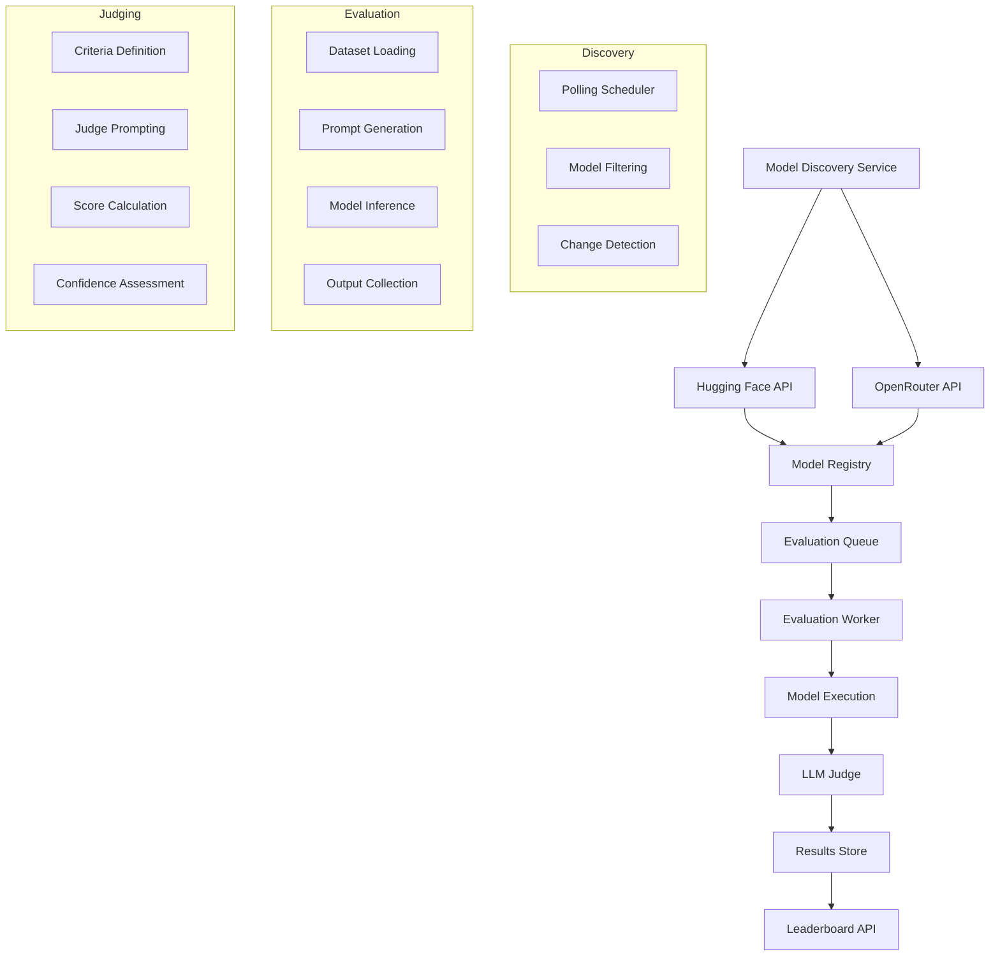

**Why polling-based discovery?** Simple to implement, reliable, and doesn't require webhook infrastructure from external APIs. We can optimize polling frequency based on platform update patterns.

**Why not webhook-based?** Many platforms don't provide reliable webhooks, and we'd need to handle webhook failures and retries. Polling gives us more control over discovery timing and reliability.

### Phase 2: Advanced Job Orchestration and Resource Management

As we scale, we need sophisticated job orchestration and resource management:

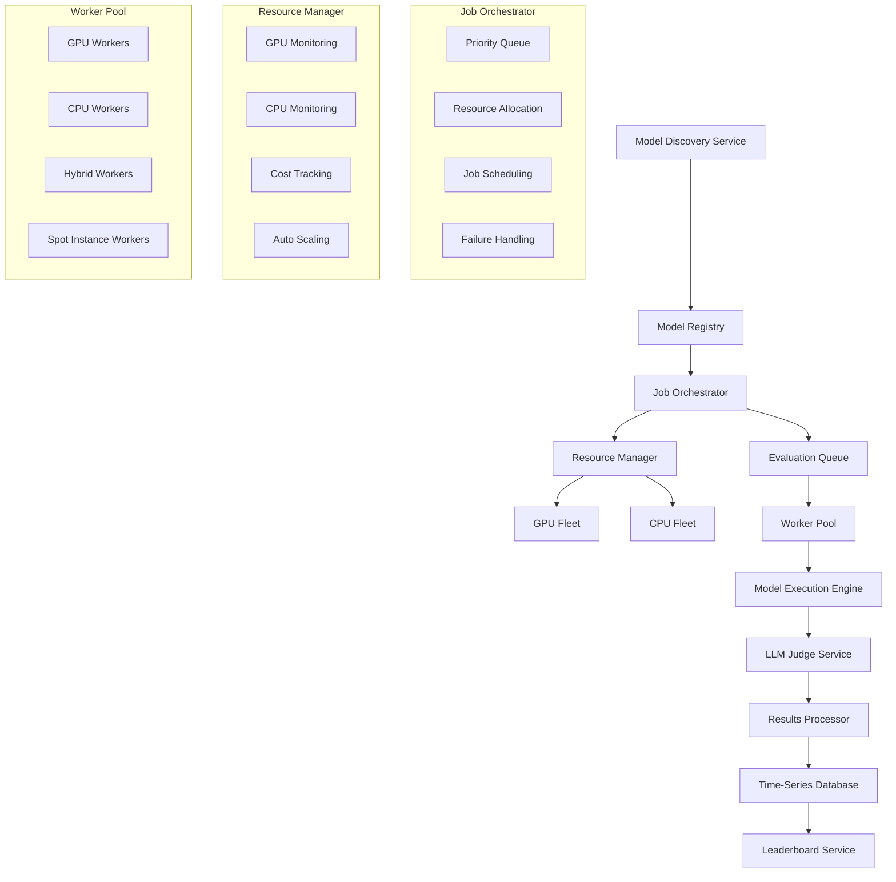

**Job Orchestration Strategy:**
- **Priority-based scheduling**: New models get higher priority than re-evaluations
- **Resource-aware allocation**: Match job requirements to available resources
- **Batch processing**: Group similar evaluations for efficiency
- **Spot instance utilization**: Use cheaper spot instances for non-critical jobs

**Why Kubernetes-based orchestration?** Provides built-in resource management, auto-scaling, and job scheduling. Alternative solutions like custom schedulers would require significant development effort.

### Phase 3: Distributed Evaluation and Advanced Analytics

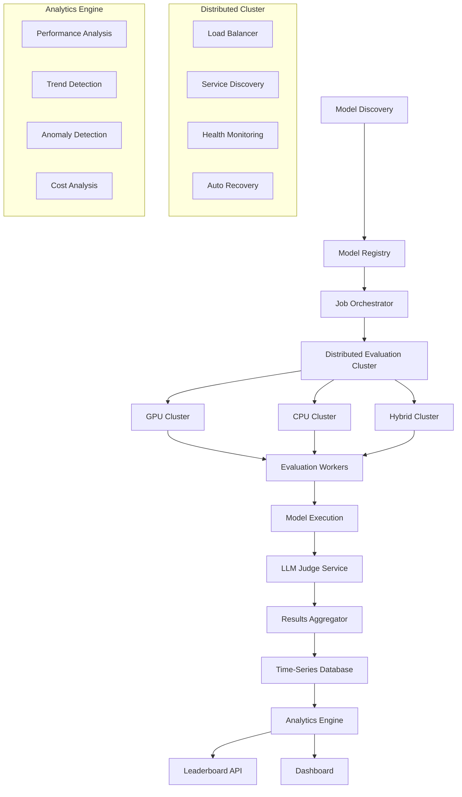

**Distributed Evaluation Benefits:**
- **Geographic distribution**: Reduce latency for global model access
- **Fault tolerance**: Continue operation if some nodes fail
- **Resource optimization**: Distribute load across available resources
- **Cost efficiency**: Use region-specific pricing and spot instances

## Detailed Architecture

### Core Components

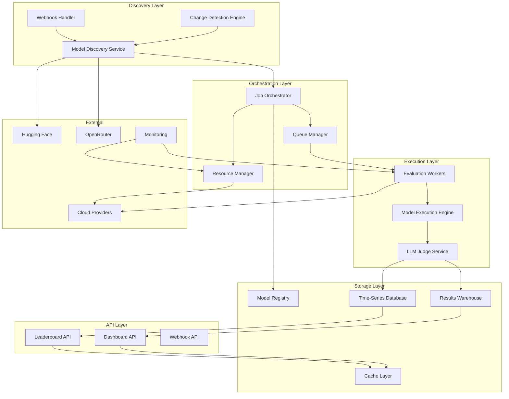

### Model Discovery Service

**Discovery Strategies:**
1. **API Polling**: Regular checks of Hugging Face and OpenRouter APIs
2. **Webhook Integration**: Real-time notifications when available
3. **RSS/Atom Feeds**: Monitor model release feeds
4. **Community Monitoring**: Track social media and forums for new releases

**Model Filtering Criteria:**
- Model size and architecture
- License compatibility
- Performance benchmarks
- Community adoption
- Update frequency

**Change Detection:**
- Hash-based change detection for model files
- Metadata comparison for configuration changes
- Version tracking for incremental updates
- Dependency analysis for related model changes

### Job Orchestration System

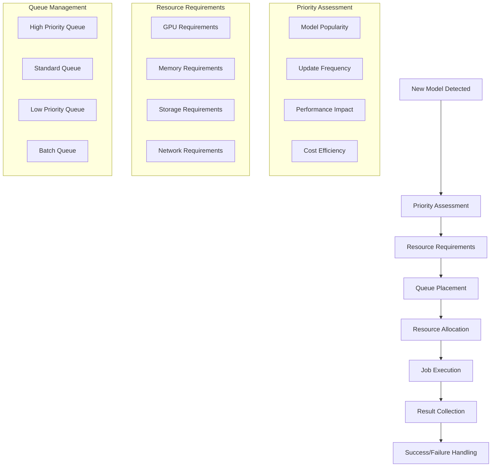

**Queue Management Strategy:**
- **High Priority**: New models, critical updates, paid evaluations
- **Standard**: Regular re-evaluations, performance tracking
- **Low Priority**: Historical analysis, experimental evaluations
- **Batch**: Similar models, cost-optimized evaluations

### Resource Management

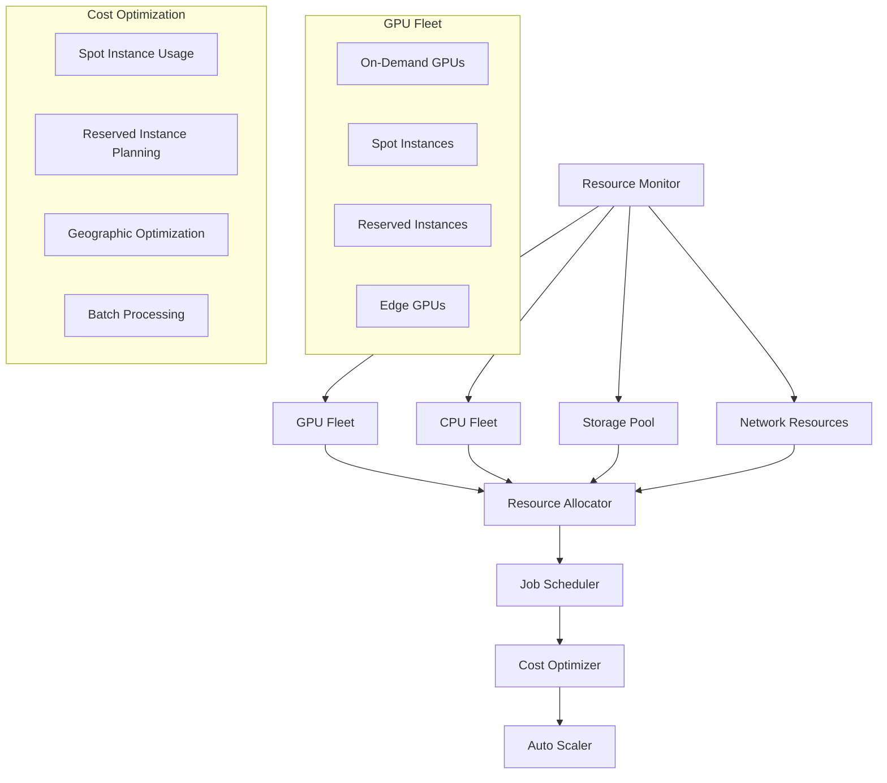

**Resource Optimization Strategies:**
1. **Spot Instance Utilization**: Use spot instances for non-critical jobs
2. **Geographic Distribution**: Deploy resources in cost-effective regions
3. **Batch Processing**: Group similar evaluations to maximize resource utilization
4. **Auto Scaling**: Scale resources based on queue length and job priority

### LLM-as-Judge System

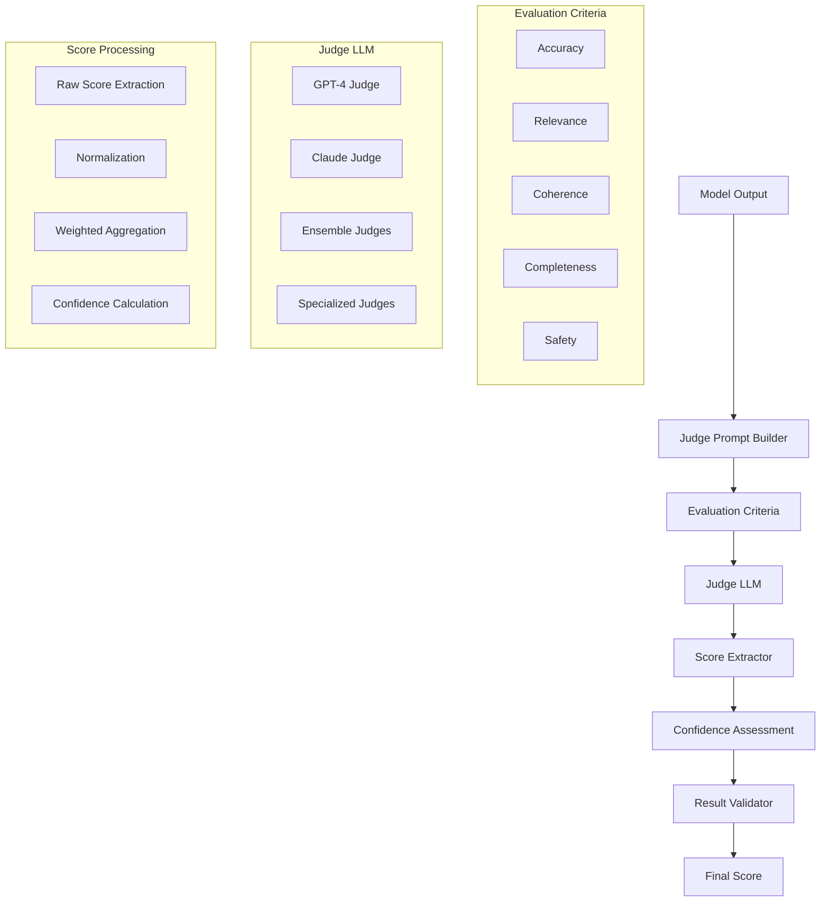

**Judge System Design:**
- **Multi-Judge Ensemble**: Use multiple judge models for reliability
- **Criteria-Specific Judges**: Specialized judges for different evaluation criteria
- **Confidence Scoring**: Assess reliability of judge decisions
- **Bias Mitigation**: Use diverse judge models and prompt engineering

## Data Architecture

### Time-Series Database Schema

```mermaid
erDiagram
    MODEL {
        string model_id PK
        string name
        string provider
        string architecture
        integer parameter_count
        timestamp created_at
        timestamp updated_at
        boolean active
    }
    
    EVALUATION_JOB {
        string job_id PK
        string model_id FK
        string dataset_id FK
        string status
        timestamp created_at
        timestamp started_at
        timestamp completed_at
        json configuration
    }
    
    EVALUATION_RESULT {
        string result_id PK
        string job_id FK
        string metric_name
        float score
        float confidence
        json metadata
        timestamp created_at
    }
    
    DATASET {
        string dataset_id PK
        string name
        string category
        integer sample_count
        json schema
        timestamp created_at
    }
    
    LEADERBOARD_ENTRY {
        string entry_id PK
        string model_id FK
        string dataset_id FK
        float overall_score
        json detailed_scores
        integer rank
        timestamp last_updated
    }
    
    MODEL ||--o{ EVALUATION_JOB
    EVALUATION_JOB ||--o{ EVALUATION_RESULT
    DATASET ||--o{ EVALUATION_JOB
    MODEL ||--o{ LEADERBOARD_ENTRY
    DATASET ||--o{ LEADERBOARD_ENTRY
```

**Database Design Considerations:**
- **Time-series optimization**: Efficient storage and querying of historical data
- **Partitioning**: Partition by date and model for performance
- **Indexing**: Optimize for leaderboard queries and time-range searches
- **Compression**: Compress historical data to reduce storage costs

### Results Warehouse Schema

```sql
-- Models table
CREATE TABLE models (
    model_id VARCHAR(255) PRIMARY KEY,
    name VARCHAR(255) NOT NULL,
    provider VARCHAR(100) NOT NULL,
    architecture VARCHAR(100),
    parameter_count BIGINT,
    created_at TIMESTAMP DEFAULT CURRENT_TIMESTAMP,
    updated_at TIMESTAMP DEFAULT CURRENT_TIMESTAMP,
    active BOOLEAN DEFAULT TRUE
);

-- Evaluation jobs table
CREATE TABLE evaluation_jobs (
    job_id VARCHAR(255) PRIMARY KEY,
    model_id VARCHAR(255) REFERENCES models(model_id),
    dataset_id VARCHAR(255) REFERENCES datasets(dataset_id),
    status VARCHAR(50) NOT NULL,
    created_at TIMESTAMP DEFAULT CURRENT_TIMESTAMP,
    started_at TIMESTAMP,
    completed_at TIMESTAMP,
    configuration JSONB,
    resource_usage JSONB,
    cost_estimate DECIMAL(10,4)
);

-- Time-series results table
CREATE TABLE evaluation_results (
    result_id VARCHAR(255) PRIMARY KEY,
    job_id VARCHAR(255) REFERENCES evaluation_jobs(job_id),
    metric_name VARCHAR(100) NOT NULL,
    score DECIMAL(5,4) NOT NULL,
    confidence DECIMAL(5,4),
    metadata JSONB,
    created_at TIMESTAMP DEFAULT CURRENT_TIMESTAMP
) PARTITION BY RANGE (created_at);

-- Leaderboard cache table
CREATE TABLE leaderboard_cache (
    entry_id VARCHAR(255) PRIMARY KEY,
    model_id VARCHAR(255) REFERENCES models(model_id),
    dataset_id VARCHAR(255) REFERENCES datasets(dataset_id),
    overall_score DECIMAL(5,4) NOT NULL,
    detailed_scores JSONB,
    rank INTEGER,
    last_updated TIMESTAMP DEFAULT CURRENT_TIMESTAMP
);
```

## API Design

### Leaderboard API

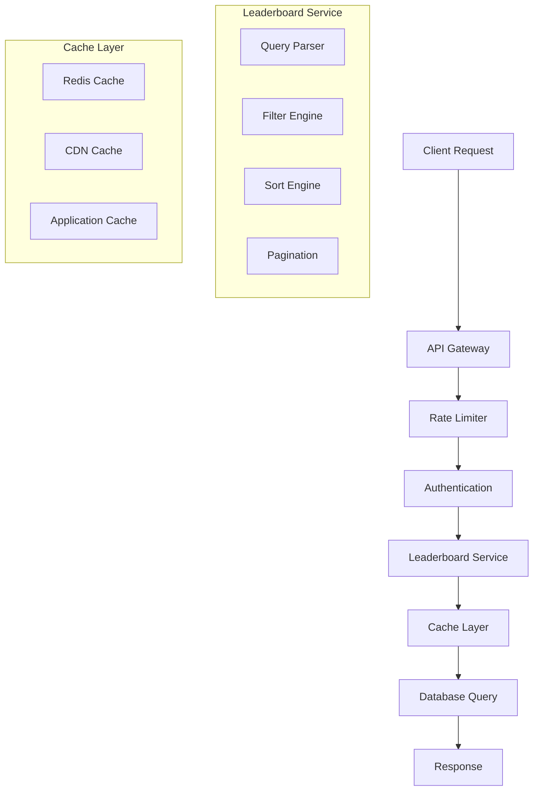

**API Endpoints:**
```
GET  /v1/leaderboard
GET  /v1/leaderboard/{dataset}
GET  /v1/models/{model_id}/performance
GET  /v1/datasets/{dataset_id}/results
POST /v1/evaluations/request
GET  /v1/evaluations/{job_id}/status
GET  /v1/metrics/trends
```

**Request/Response Schema:**
```json
{
  "request": {
    "dataset": "string?",
    "category": "string?",
    "limit": "integer?",
    "offset": "integer?",
    "sort_by": "score|speed|cost",
    "filters": {
      "parameter_count_min": "integer?",
      "parameter_count_max": "integer?",
      "provider": "string?",
      "architecture": "string?"
    }
  },
  "response": {
    "entries": [{
      "rank": "integer",
      "model": {
        "id": "string",
        "name": "string",
        "provider": "string",
        "architecture": "string"
      },
      "scores": {
        "overall": "float",
        "accuracy": "float",
        "speed": "float",
        "cost": "float"
      },
      "metadata": {
        "last_evaluated": "timestamp",
        "evaluation_count": "integer",
        "confidence": "float"
      }
    }],
    "pagination": {
      "total": "integer",
      "limit": "integer",
      "offset": "integer"
    }
  }
}
```

## Cost Containment Strategies

### Resource Optimization

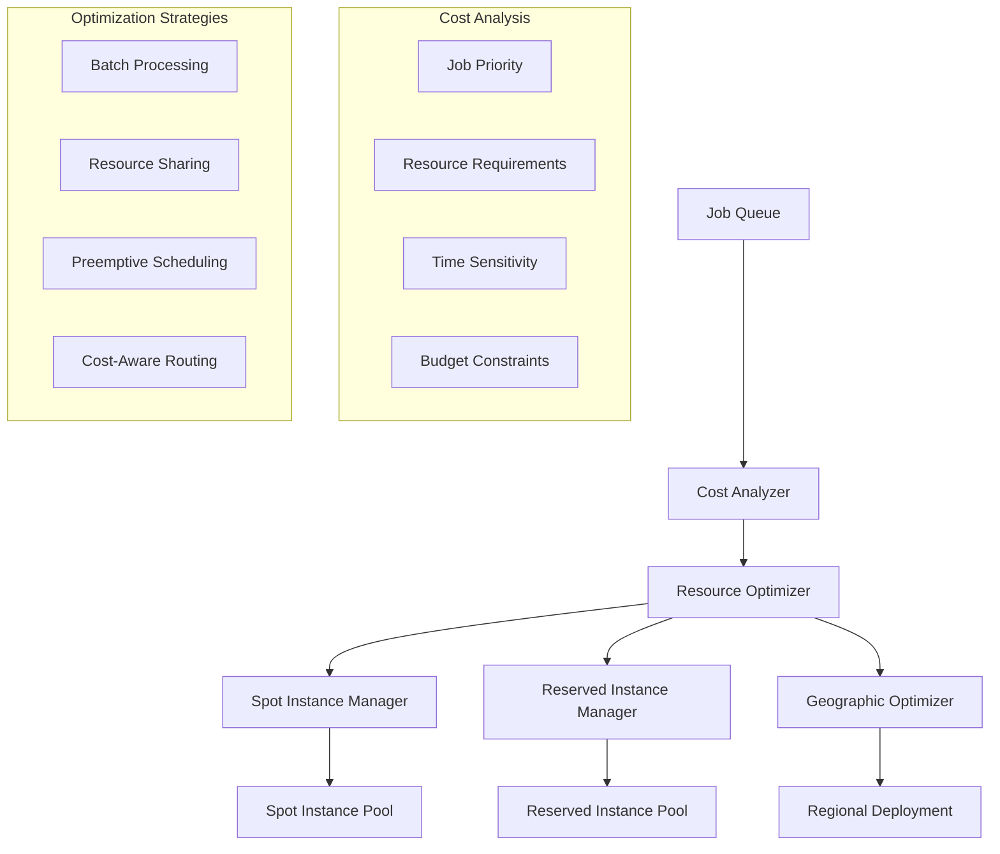

**Cost Optimization Techniques:**
1. **Spot Instance Usage**: Use spot instances for 70% of non-critical jobs
2. **Batch Processing**: Group similar evaluations to maximize resource utilization
3. **Geographic Optimization**: Deploy in cost-effective regions
4. **Resource Sharing**: Share expensive resources across multiple jobs
5. **Preemptive Scheduling**: Cancel low-priority jobs when high-priority ones arrive

### Budget Management

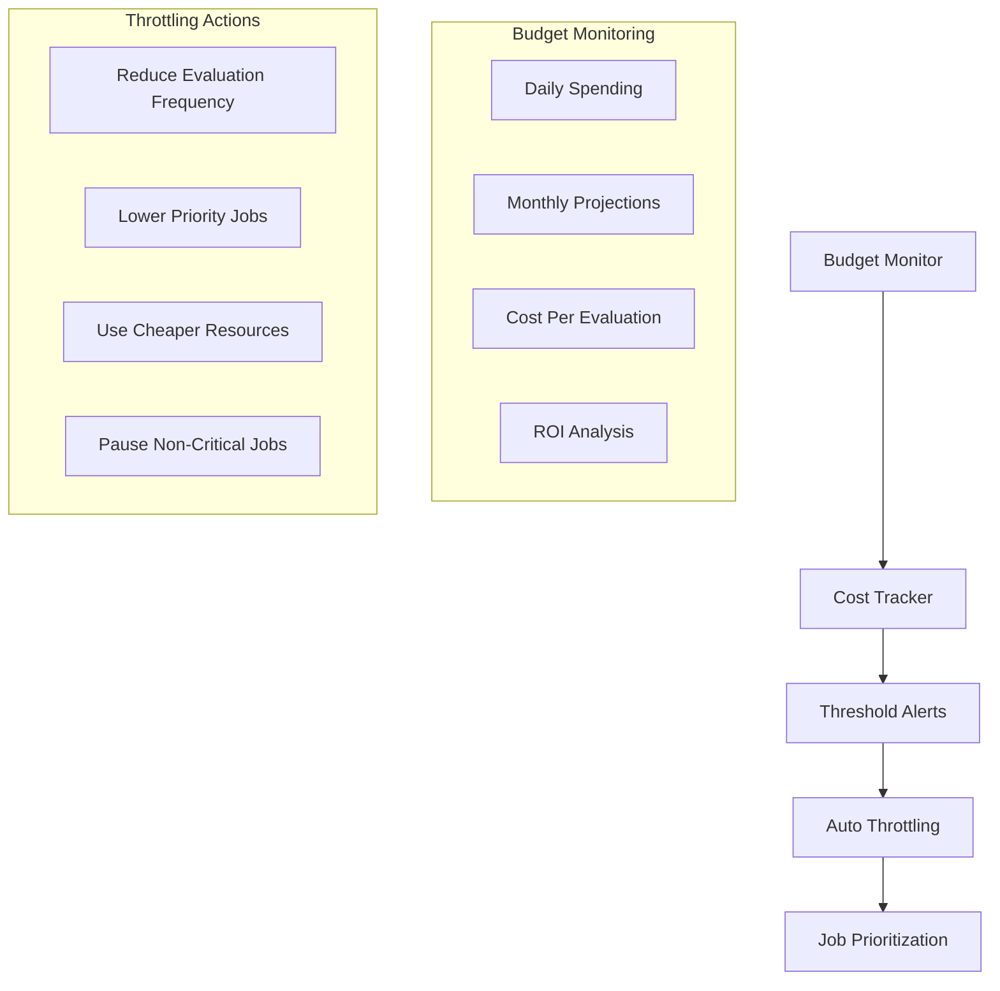

## Monitoring and Observability

### Metrics and Alerting

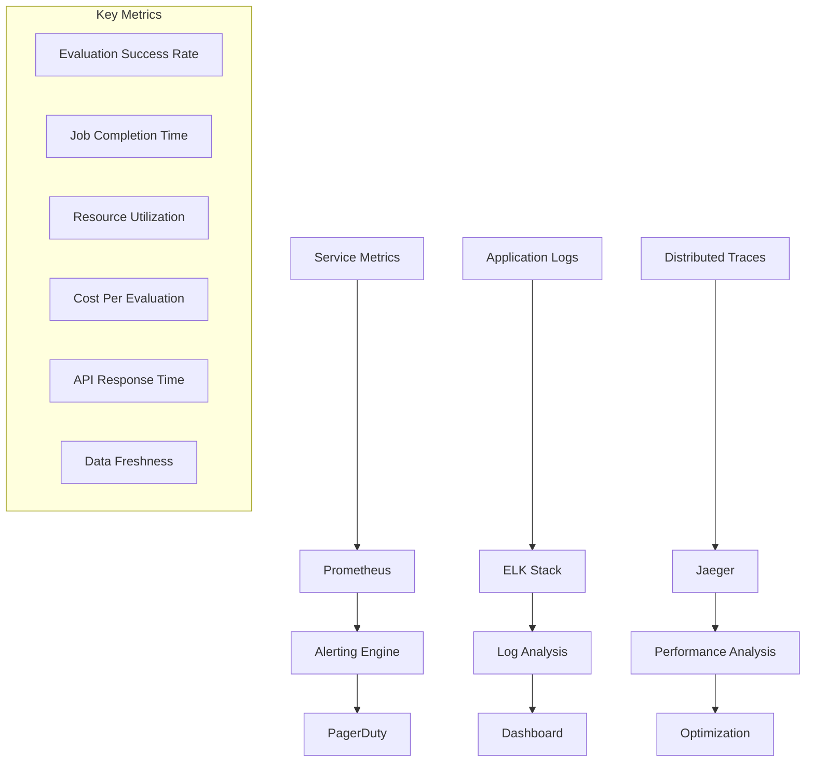

**Key Metrics:**
- **Evaluation Success Rate**: Track successful vs failed evaluations
- **Job Completion Time**: Monitor evaluation duration and identify bottlenecks
- **Resource Utilization**: Optimize GPU/CPU usage
- **Cost Per Evaluation**: Track and optimize evaluation costs
- **API Response Time**: Ensure leaderboard API performance
- **Data Freshness**: Monitor time from model detection to evaluation completion

**Alerting Rules:**
- Evaluation success rate < 95% for 10 minutes
- Job completion time > 2x average for 15 minutes
- Resource utilization < 60% for 30 minutes (underutilization)
- Cost per evaluation > 20% above average for 1 hour
- API response time > 200ms for 5 minutes

## Scaling Strategy

### Horizontal Scaling

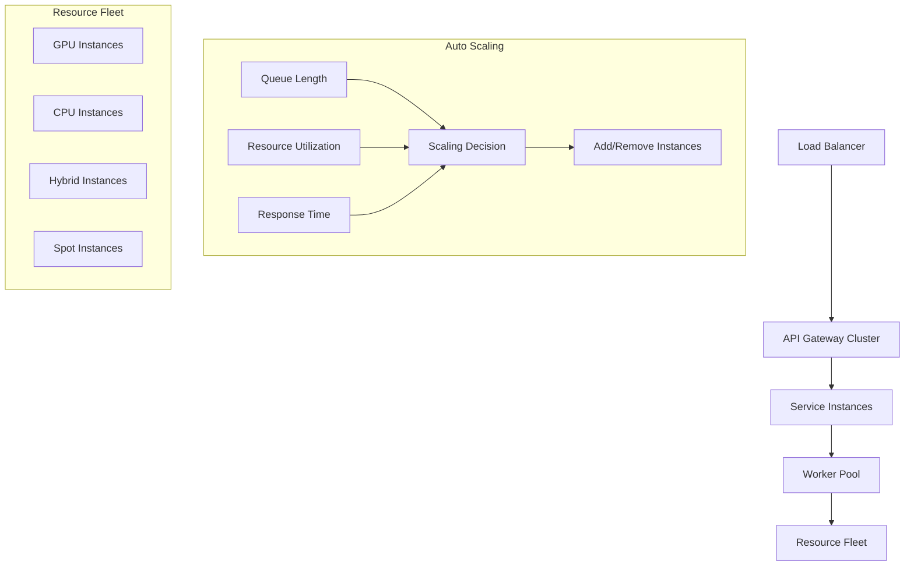

**Scaling Triggers:**
- Queue length > 100 jobs for 5 minutes
- Resource utilization > 80% for 10 minutes
- API response time > 100ms for 5 minutes
- Error rate > 2% for 5 minutes

### Data Scaling

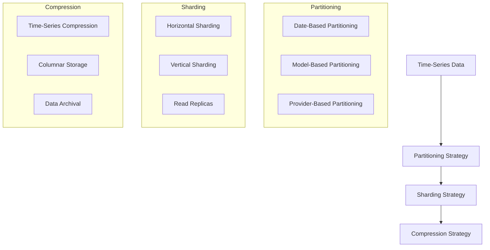

## Follow-up Questions and Answers

### Q: How do you handle model API rate limits and failures?

**A:** Multi-layered approach:
1. **Rate Limit Management**: Implement token bucket algorithm with per-model quotas
2. **Retry Logic**: Exponential backoff with jitter for transient failures
3. **Circuit Breaker**: Stop requests to failing models to prevent cascading failures
4. **Fallback Strategies**: Use alternative models or cached results when primary fails
5. **Queue Management**: Prioritize jobs based on model availability and rate limits

### Q: How do you ensure evaluation consistency across different runs?

**A:** Rigorous consistency measures:
1. **Deterministic Execution**: Use fixed random seeds and deterministic algorithms
2. **Standardized Prompts**: Maintain consistent prompt templates across evaluations
3. **Judge Calibration**: Regular calibration of judge models against human evaluations
4. **Statistical Validation**: Use confidence intervals and statistical significance testing
5. **Cross-Validation**: Run evaluations multiple times to assess consistency

### Q: How do you handle the cold start problem for new models?

**A:** Efficient cold start strategy:
1. **Model Caching**: Pre-download popular models to reduce startup time
2. **Warm-up Jobs**: Run lightweight evaluations to warm up model instances
3. **Resource Pooling**: Maintain a pool of pre-warmed instances for common model types
4. **Progressive Loading**: Load models in background while other jobs run
5. **Predictive Preloading**: Predict which models will be needed based on trends

### Q: How do you ensure the leaderboard is fair and unbiased?

**A:** Fairness and bias mitigation:
1. **Diverse Datasets**: Use multiple datasets across different domains and languages
2. **Multiple Judges**: Use ensemble of judge models to reduce individual biases
3. **Statistical Significance**: Only show results with sufficient statistical power
4. **Transparency**: Publish evaluation methodology and criteria
5. **Regular Auditing**: Periodic review of evaluation results for bias detection

### Q: How do you handle the cost explosion when scaling to millions of evaluations?

**A:** Aggressive cost optimization:
1. **Smart Sampling**: Use statistical sampling for large datasets
2. **Incremental Evaluation**: Only evaluate changed parts of models
3. **Community Contributions**: Allow community to contribute evaluations
4. **Tiered Evaluation**: Different evaluation depths based on model importance
5. **Cost-Aware Scheduling**: Schedule expensive evaluations during off-peak hours

### Q: How do you handle model security and safety concerns?

**A:** Security-first approach:
1. **Sandboxed Execution**: Run models in isolated containers
2. **Input Validation**: Sanitize all inputs to prevent prompt injection
3. **Output Filtering**: Filter potentially harmful outputs
4. **Access Control**: Limit model access based on security clearance
5. **Audit Logging**: Comprehensive logging of all model interactions

## Conclusion

The Continuous LLM Benchmarking Harness provides a comprehensive solution for automated model evaluation at scale. By combining intelligent job orchestration, efficient resource management, and sophisticated evaluation methodologies, we create a system that:

- **Automates Discovery**: Continuously monitors and detects new models
- **Ensures Quality**: Uses LLM-as-Judge methodology for reliable evaluation
- **Optimizes Costs**: Implements aggressive cost containment strategies
- **Scales Efficiently**: Supports millions of evaluations with horizontal scaling
- **Provides Insights**: Real-time leaderboards and analytics dashboards

The architecture prioritizes production readiness, cost efficiency, and scalability while maintaining evaluation quality and system reliability. The system is designed to evolve with the rapidly changing LLM landscape and provide continuous value to users making model selection decisions. 