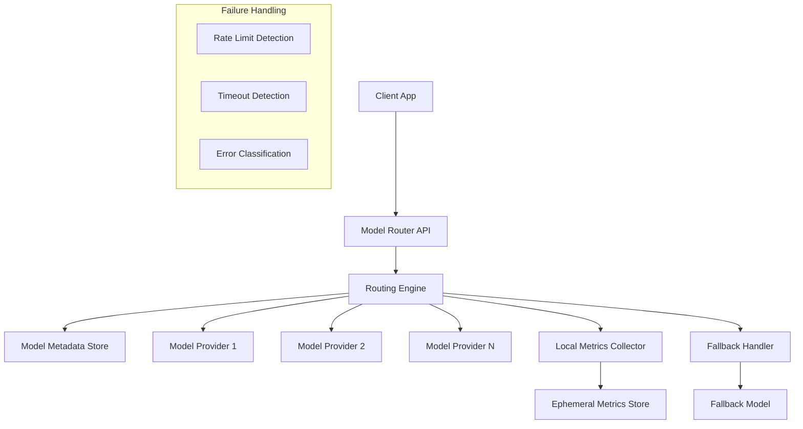
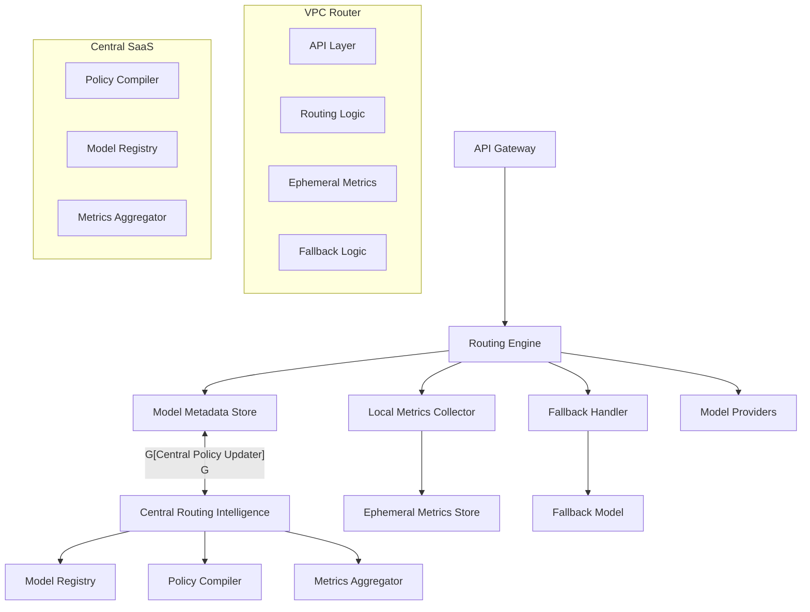
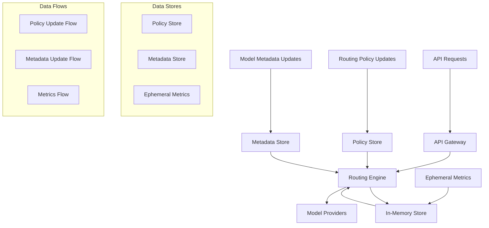

# Enterprise Model Router with VPC Support: System Design

## Problem Statement

Enterprises require a model routing service that can be deployed within their own VPCs for compliance and data privacy, but still benefit from centralized, continuously improving routing intelligence. The system must:

- Route queries to optimal models based on content, cost, and performance
- Support zero-data-retention for enterprise compliance
- Maintain routing intelligence without accessing or retaining customer data
- Handle model provider rate limits and failures gracefully
- Scale from single-tenant to multi-tenant deployments
- Allow centralized updates to routing logic without direct access to customer data

## P2: Requirements Analysis

### Functional Requirements
- **Content-Aware Routing**: Analyze query content to select the best model
- **Cost and Performance Optimization**: Route based on real-time cost and latency
- **Zero Data Retention**: No customer data leaves the VPC or is stored
- **Centralized Intelligence**: Routing logic and model metrics are centrally managed and updated
- **Rate Limit and Failure Handling**: Graceful degradation and fallback strategies
- **Multi-Tenancy**: Support both single-tenant and multi-tenant deployments
- **API and SDK**: Expose REST/gRPC API and SDKs for integration

### Non-Functional Requirements
- **Latency**: <100ms added routing overhead (p95)
- **Scalability**: 10,000+ QPS per deployment
- **Availability**: 99.99% uptime
- **Security**: No customer data leaves VPC; strong isolation between tenants
- **Extensibility**: Add new models/providers and update routing logic centrally
- **Compliance**: SOC-2, GDPR, and enterprise requirements

## P3: Architecture Evolution

### Phase 1: Basic VPC Router with Static Rules

Start with a simple router deployed in the customer VPC, using static rules and centrally distributed model metadata.

```mermaid
graph TD
    A[Client App] --> B[Model Router API]
    B --> C[Routing Engine]
    C --> D[Model Metadata Store]
    C --> E[Model Provider 1]
    C --> F[Model Provider 2]
    C --> G[Model Provider N]
    
    subgraph "VPC Deployment"
        B1[API Gateway]
        C1[Routing Engine]
        D1[Metadata Store]
    end
    
    subgraph "Central Control (SaaS)
        H1[Model Registry]
        H2[Routing Policy Store]
    end
    
    D1 <-- H1
    D1 <-- H2
```

**Why start with static rules?**
- Simple to deploy and audit
- No customer data leaves the VPC
- Allows fast iteration and feedback

**Why not centralized routing first?**
- Enterprises require data residency and control
- Static rules are easier to validate for compliance

### Phase 2: Centralized Intelligence with Zero Data Retention

Add a mechanism for the router to receive regular, privacy-preserving updates to routing logic and model metrics from a central service, without sending customer data out.

```mermaid
graph TD
    A[Client App] --> B[Model Router API]
    B --> C[Routing Engine]
    C --> D[Model Metadata Store]
    C --> E[Model Provider]
    
    D <-- F[Central Routing Intelligence]
    F -.->|Policy Update| D
    F -.->|Model Metrics| D
    
    subgraph "Central SaaS"
        F1[Routing Policy Compiler]
        F2[Model Metrics Aggregator]
    end
    
    F1 --> F
    F2 --> F
```

**Why privacy-preserving updates?**
- Ensures no customer data leaves the VPC
- Central service can aggregate metrics from non-sensitive sources (e.g., public benchmarks, opt-in telemetry)
- Updates can be cryptographically signed and versioned

**Why not federated learning?**
- Even anonymized data can risk leakage; policy/code updates are safer

### Phase 3: Real-Time Metrics and Fallback Handling

Add local metrics collection (without data retention) and robust fallback strategies for rate limits and provider failures.



**Why local ephemeral metrics?**
- Enables real-time routing decisions (e.g., avoid overloaded models)
- Metrics are not persisted or exported outside the VPC
- Supports compliance and zero-retention requirements

**Why fallback handler?**
- Ensures high availability and graceful degradation
- Can be tuned per tenant or deployment

### Phase 4: Multi-Tenancy and Policy Isolation

Add support for multi-tenant deployments, with strict policy and data isolation.

```mermaid
graph TD
    A[Client App Tenant A] --> B[Router API Tenant A]
    A2[Client App Tenant B] --> B2[Router API Tenant B]
    B --> C[Routing Engine Tenant A]
    B2 --> C2[Routing Engine Tenant B]
    C --> D[Model Metadata Store A]
    C2 --> D2[Model Metadata Store B]
    
    C --> E[Model Providers]
    C2 --> E[Model Providers]
    
    D <-- F[Central Routing Intelligence]
    D2 <-- F
    
    subgraph "Tenant Isolation"
        C1[Policy Isolation]
        C2[Ephemeral Metrics Isolation]
        C3[API Key/Token Isolation]
    end
```

**Why multi-tenancy?**
- Reduces operational overhead for SaaS vendors
- Enables cost-effective scaling
- Ensures strict isolation for compliance

**Why not shared policy store?**
- Each tenant may have custom routing policies, models, or compliance needs

## P4: Detailed Architecture

### Core Components



### Routing Engine

- **Content Analysis**: Lightweight NLP or rules to classify query type
- **Policy Evaluation**: Apply centrally-updated routing policy (e.g., cost, latency, model compatibility)
- **Local Metrics**: Use ephemeral, in-memory metrics for real-time decisions
- **Fallback Logic**: Detect rate limits, timeouts, or errors and reroute as needed

### Centralized Intelligence

- **Policy Compiler**: Converts high-level routing policies into deployable rules/code
- **Model Registry**: Maintains metadata (cost, latency, capabilities) for all supported models
- **Metrics Aggregator**: Collects non-sensitive metrics from public sources, opt-in customers, and benchmarks
- **Policy Updater**: Publishes signed, versioned policy/model updates to VPC routers

### Zero Data Retention

- **No Logging of Prompts or Responses**: All customer data is processed in-memory only
- **Ephemeral Metrics**: Only aggregate, non-identifiable metrics are kept in memory for routing
- **Policy Updates Only**: Central service never receives or stores customer data

### Multi-Tenancy

- **Strict Policy/Data Isolation**: Each tenant has isolated routing logic, ephemeral metrics, and API keys
- **Custom Policies**: Tenants can have custom routing policies and model allow/block lists
- **Shared Model Providers**: Underlying model pool can be shared, but routing and metrics are isolated

### Failure and Rate Limit Handling

- **Rate Limit Detection**: Monitor error codes, latency spikes, and quota headers
- **Fallback Strategies**: Reroute to backup models, degrade gracefully, or return informative errors
- **Ephemeral Queues**: Optionally queue and retry failed requests within the VPC

## P5: Scaling Strategy



### Data Handling Principles

- **No Persistent Storage of Customer Data**: All sensitive data is processed in-memory only
- **Policy and Metadata Updates**: Pulled from central SaaS, cryptographically signed
- **Ephemeral Metrics**: Used only for real-time routing, never exported

## Scaling and Performance

- **Horizontal Scaling**: Stateless router instances can be scaled out in the VPC
- **Ephemeral Metrics**: In-memory, per-instance; no cross-instance sharing needed
- **Policy/Metadata Updates**: Pulled on schedule or via webhook; no runtime dependency on central SaaS
- **Multi-Tenancy**: Each tenant's router(s) can be independently scaled

## Security and Compliance

- **Zero Data Retention**: No customer data leaves the VPC or is stored
- **Policy Signing**: All updates are cryptographically signed and versioned
- **Role-Based Access**: API and admin endpoints protected by RBAC
- **Auditability**: All policy/model updates are logged and auditable (but not customer data)
- **Compliance**: Designed for SOC-2, GDPR, and enterprise requirements

## P10: Follow-up Questions and Answers

### Q1: How do you update routing intelligence without accessing customer data?
- Central SaaS compiles and signs new routing policies and model metadata
- Routers pull updates on schedule or via webhook
- No customer data is sent to the central service
- Updates can be rolled back or pinned to a specific version for auditability

### Q2: How do you handle model provider rate limits and failures?
- Local ephemeral metrics track error codes and latency
- Fallback logic reroutes to backup models or degrades gracefully
- Optionally queue and retry failed requests within the VPC
- Central SaaS can update policies to avoid problematic providers

### Q3: How do you support zero data retention for compliance?
- All customer data is processed in-memory only
- No logs, exports, or telemetry of prompts/responses
- Only non-sensitive, aggregate metrics are used for routing
- Policy and model updates are signed and auditable

### Q4: How do you scale from single-tenant to multi-tenant deployments?
- Each tenant has isolated routing logic, ephemeral metrics, and API keys
- Routers can be deployed per-tenant or as a shared multi-tenant service with strict isolation
- Central SaaS supports per-tenant policy/model updates

### Q5: How do you ensure high availability and low latency?
- Stateless router instances can be horizontally scaled
- All routing decisions are local; no runtime dependency on central SaaS
- Policy/model updates are pulled asynchronously
- Fallback logic ensures graceful degradation

## Conclusion

This Enterprise Model Router with VPC Support design enables organizations to deploy secure, compliant, and intelligent model routing within their own infrastructure, while benefiting from centralized, continuously improving routing intelligence. The architecture evolves from simple static rules to a robust, privacy-preserving, and scalable platform supporting both single-tenant and multi-tenant deployments, with strong guarantees for data privacy, compliance, and operational excellence. 