# Enterprise VPC Proxy with Usage-Based Billing: System Design

## Problem Statement

Enterprises need secure, compliant access to external LLM providers while maintaining data residency, enforcing SOC-2 controls, implementing per-team rate limits, and achieving fine-grained cost accounting. The solution must be self-hostable within customer VPCs, provide enterprise-grade availability, and support seamless upgrades without direct hardware management.

**Key Requirements:**
- **Data Residency**: All data must remain within customer VPC boundaries
- **SOC-2 Compliance**: Comprehensive audit trails and security controls
- **Multi-tenancy**: Isolate teams, projects, and cost centers
- **Usage Billing**: Precise metering and cost allocation
- **High Availability**: 99.999% uptime without direct hardware management
- **Self-hosted**: Deployable within customer VPC infrastructure
- **Upgrade Strategy**: Zero-downtime updates and rollbacks

## P2: Requirements Analysis

### Functional Requirements
- **Proxy Functionality**: Route requests to external LLM providers (OpenAI, Claude, Gemini, etc.)
- **Authentication**: Support API keys and OIDC integration
- **Rate Limiting**: Per-team, per-model, and per-endpoint limits
- **Usage Metering**: Track token usage, API calls, and costs
- **Billing Export**: Generate detailed billing reports and exports
- **Audit Logging**: Comprehensive request/response logging
- **Configuration Management**: Dynamic configuration updates
- **Health Monitoring**: Real-time health checks and alerting

### Non-Functional Requirements
- **Availability**: 99.999% uptime (five-nines)
- **Latency**: <50ms proxy overhead (95th percentile)
- **Throughput**: 10,000+ requests per second per instance
- **Security**: End-to-end encryption, zero-trust architecture
- **Scalability**: Horizontal scaling across multiple regions
- **Compliance**: SOC-2 Type II, GDPR, HIPAA ready
- **Cost Efficiency**: Minimal resource overhead and operational costs

## P3: Architecture Evolution

### Phase 1: Basic Proxy with Authentication

We start with a simple reverse proxy that handles basic routing and authentication:

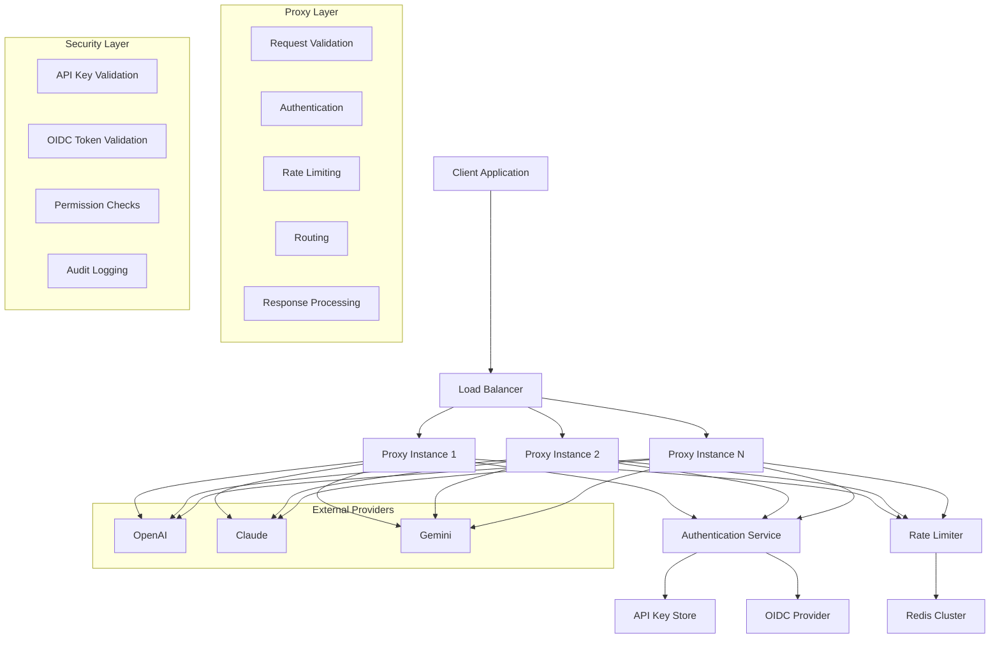

**Why start with basic proxy?** Simple to implement, validates core functionality, and provides immediate value. We can iterate on security, billing, and availability features.

**Why not jump to full enterprise solution?** Complex systems are harder to debug, test, and deploy. Starting simple allows us to validate assumptions and gather feedback.

### Phase 2: Enhanced Security and Multi-tenancy

As we scale, we need proper tenant isolation and enhanced security:

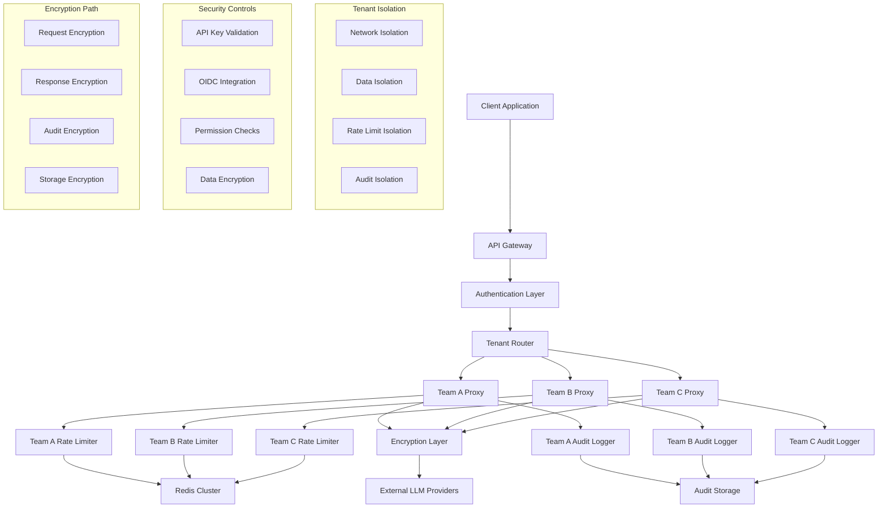

**Tenant Isolation Strategy:**
- **Network Level**: Separate proxy instances per tenant
- **Data Level**: Encrypted storage with tenant-specific keys
- **Rate Limiting**: Isolated counters per tenant
- **Audit Logging**: Tenant-specific audit trails

**Why tenant isolation?** Enterprises need to separate teams, projects, and cost centers for billing and compliance.

### Phase 3: Usage Metering and Billing

Now we add comprehensive usage tracking and billing capabilities:

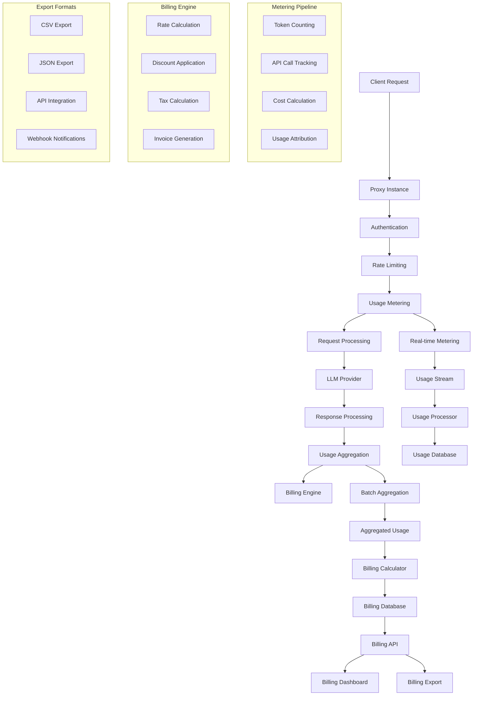

**Metering Strategy:**
- **Real-time**: Track usage as requests are processed
- **Batch**: Aggregate usage for billing calculations
- **Multi-dimensional**: Track by team, model, endpoint, time
- **Auditable**: All metering data is encrypted and tamper-proof

**Billing Features:**
- **Usage-based**: Pay per token, API call, or time
- **Multi-currency**: Support USD, EUR, and other currencies
- **Discounts**: Volume discounts and enterprise pricing
- **Taxes**: Automatic tax calculation and compliance

### Phase 4: Enterprise-Grade Availability

Finally, we implement high availability and zero-downtime operations:

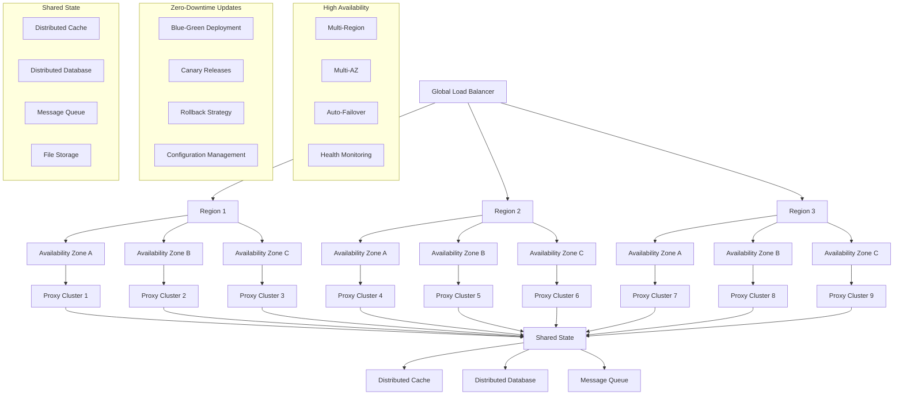

**High Availability Strategy:**
- **Multi-Region**: Deploy across multiple geographic regions
- **Multi-AZ**: Use multiple availability zones per region
- **Auto-Failover**: Automatic failover between regions and AZs
- **Health Monitoring**: Continuous health checks and alerting

**Why five-nines availability?** Enterprise customers require maximum uptime for critical AI workloads.

## P4: Detailed Architecture

### Core Components

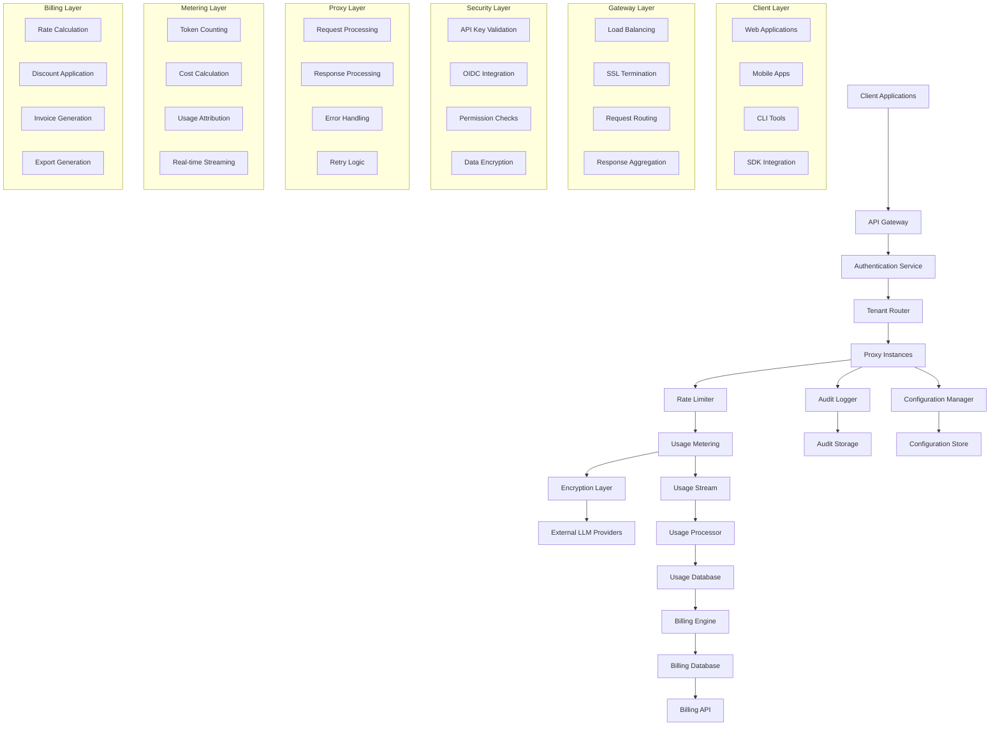

### Authentication Model

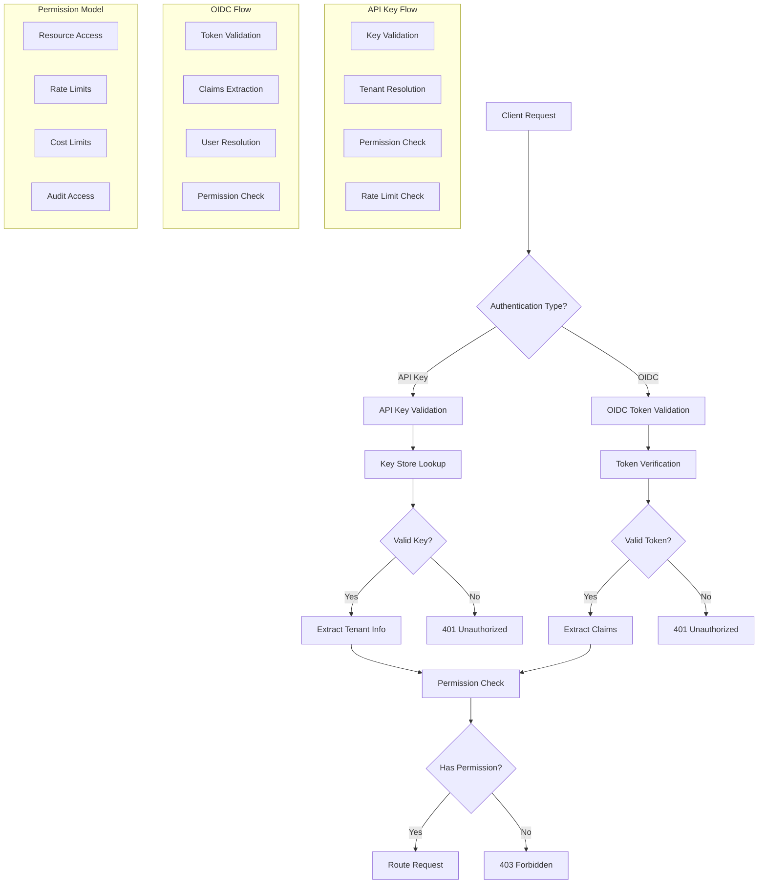

**Authentication Strategy:**
- **API Keys**: Simple, stateless authentication for service-to-service communication
- **OIDC**: Enterprise-grade authentication with SSO integration
- **Hybrid**: Support both authentication methods simultaneously
- **Permission-based**: Fine-grained access control per resource

**Why both API keys and OIDC?** Different use cases require different authentication methods. API keys are simpler for automated systems, while OIDC provides enterprise SSO integration.

### Request/Response Encryption Path

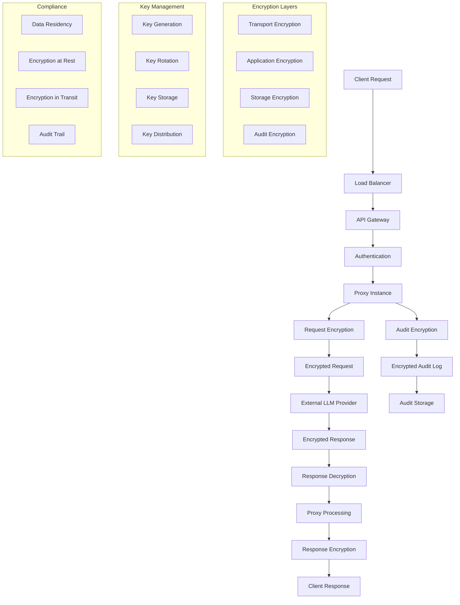

**Encryption Strategy:**
- **Transport**: TLS 1.3 for all external communications
- **Application**: AES-256 for sensitive data encryption
- **Storage**: Encrypted storage with customer-managed keys
- **Audit**: Encrypted audit logs with tamper detection

**Why multiple encryption layers?** Defense in depth ensures data protection even if one layer is compromised.

### Tenant Isolation Architecture

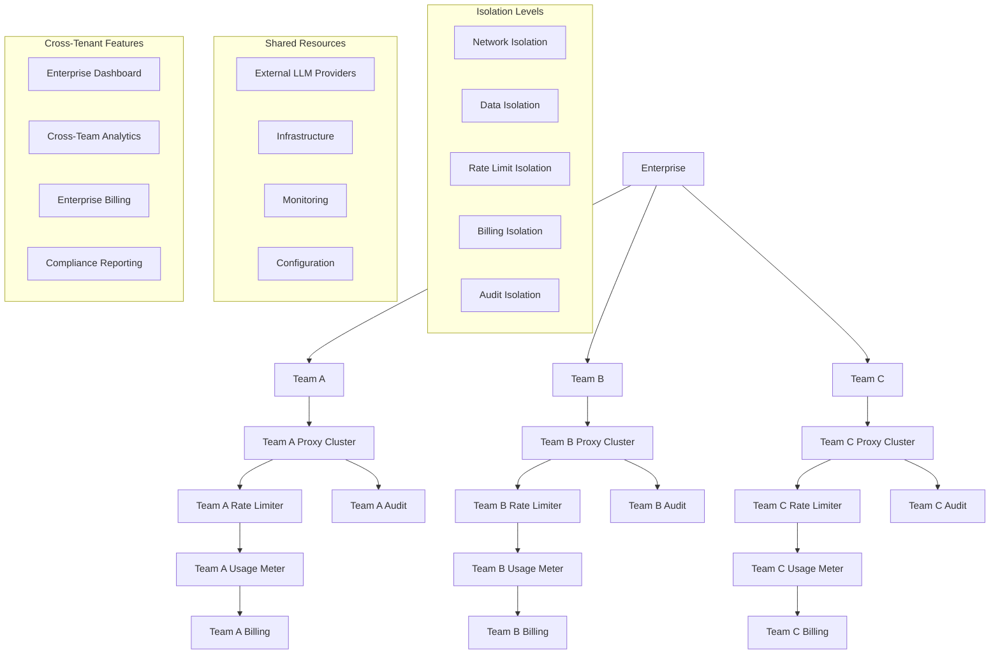

**Isolation Strategy:**
- **Network**: Separate proxy instances per tenant
- **Data**: Encrypted storage with tenant-specific keys
- **Rate Limiting**: Isolated counters and limits
- **Billing**: Separate billing accounts and reports
- **Audit**: Tenant-specific audit trails

**Why tenant isolation?** Enterprises need to separate teams for billing, compliance, and security reasons.

### Metering Pipeline

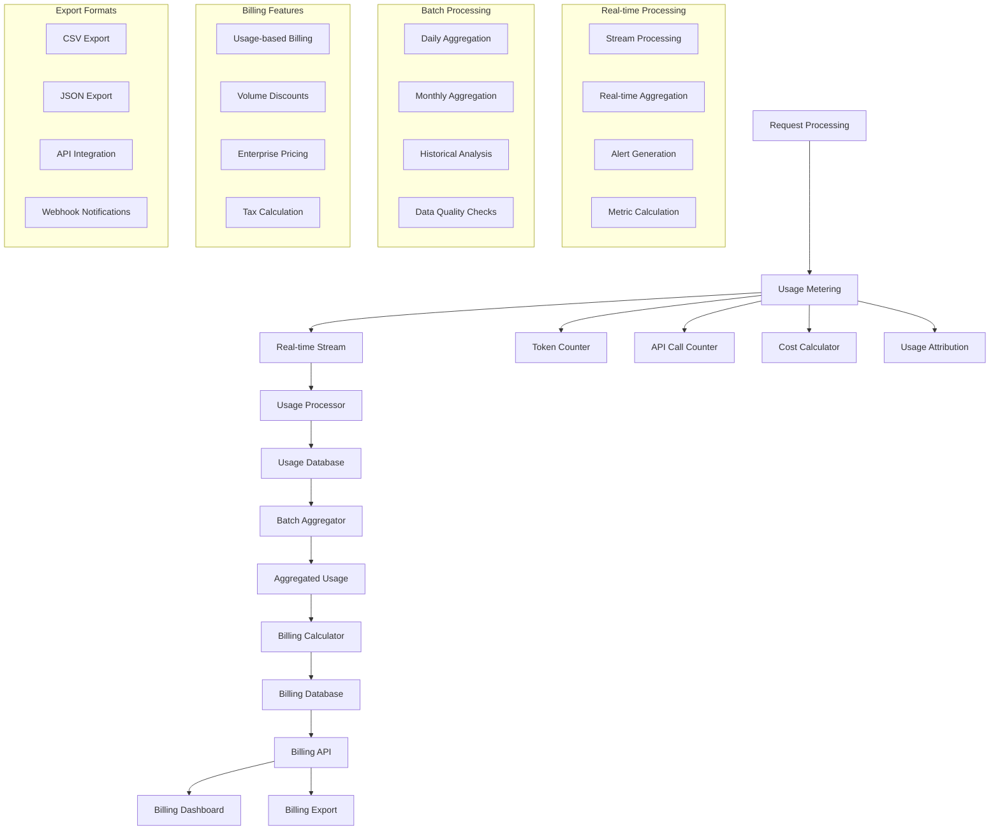

**Metering Strategy:**
- **Real-time**: Process usage as requests are handled
- **Batch**: Aggregate usage for billing calculations
- **Multi-dimensional**: Track by team, model, endpoint, time
- **Auditable**: All metering data is encrypted and tamper-proof

**Why real-time + batch?** Real-time provides immediate insights, while batch processing handles complex aggregations efficiently.

### Billing Export Format

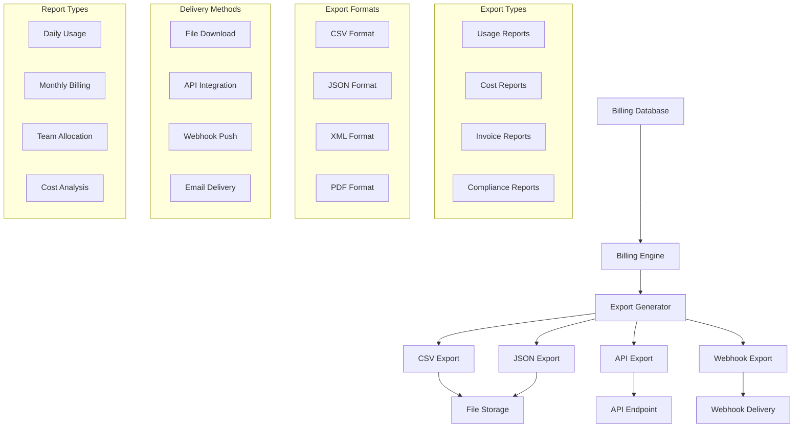

**Billing Export Features:**
- **Multiple Formats**: CSV, JSON, XML, PDF
- **Multiple Delivery**: File download, API, webhook, email
- **Granular Data**: Per-team, per-model, per-time-period
- **Compliance Ready**: SOC-2, GDPR, HIPAA compliant

**Why multiple export formats?** Different systems and use cases require different data formats.

### Upgrade Strategy

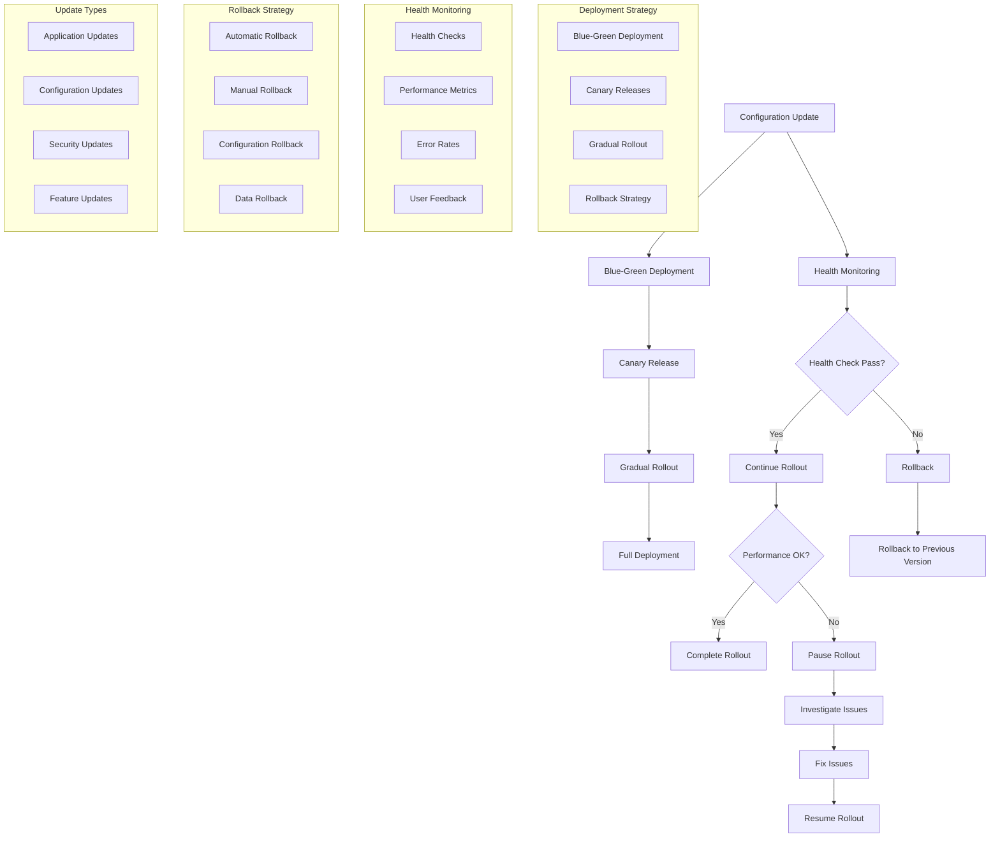

**Upgrade Strategy:**
- **Blue-Green**: Deploy new version alongside old version
- **Canary**: Release to small percentage of traffic first
- **Gradual Rollout**: Increase traffic gradually
- **Rollback**: Automatic rollback on health check failures

**Why zero-downtime upgrades?** Enterprise customers cannot tolerate service interruptions.

## P5: Scaling Strategy

### Storage Schema

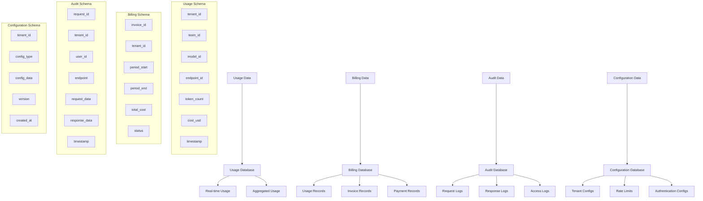

### Data Partitioning Strategy

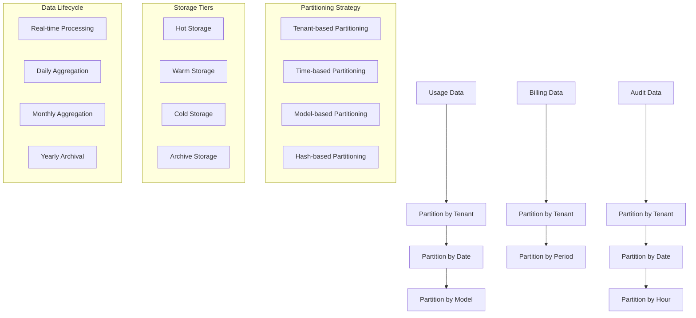

**Partitioning Strategy:**
- **Tenant-based**: Separate data per tenant for isolation
- **Time-based**: Partition by date for efficient queries
- **Model-based**: Partition by LLM model for analysis
- **Hash-based**: Distribute load across partitions

**Why partitioning?** Improves query performance and enables horizontal scaling.

## P5: Scaling Strategy

### Horizontal Scaling

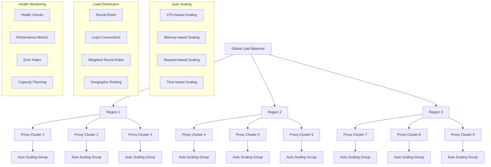

**Scaling Strategy:**
- **Auto Scaling**: Scale based on CPU, memory, and request volume
- **Load Balancing**: Distribute load across multiple instances
- **Geographic Distribution**: Deploy across multiple regions
- **Capacity Planning**: Proactive scaling based on usage patterns

**Why horizontal scaling?** Allows the system to handle increasing load without performance degradation.

### Data Scaling

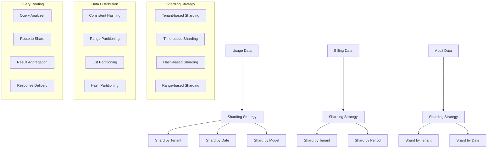

**Data Scaling Strategy:**
- **Sharding**: Distribute data across multiple databases
- **Replication**: Maintain multiple copies for availability
- **Caching**: Cache frequently accessed data
- **Compression**: Compress data to reduce storage costs

**Why data scaling?** Handles large volumes of usage and billing data efficiently.

## P6: Monitoring and Observability

### Metrics and Alerting

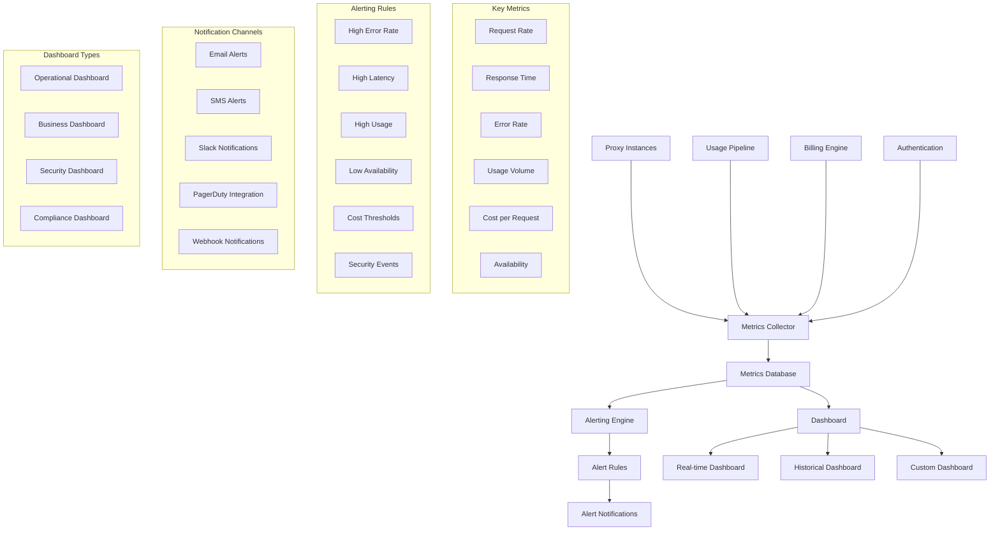

**Monitoring Strategy:**
- **Real-time Metrics**: Monitor system health in real-time
- **Historical Analysis**: Track trends and patterns over time
- **Alerting**: Proactive notification of issues
- **Dashboards**: Visual representation of system state

**Why comprehensive monitoring?** Enables proactive issue detection and resolution.

## Security and Compliance

### Security Architecture

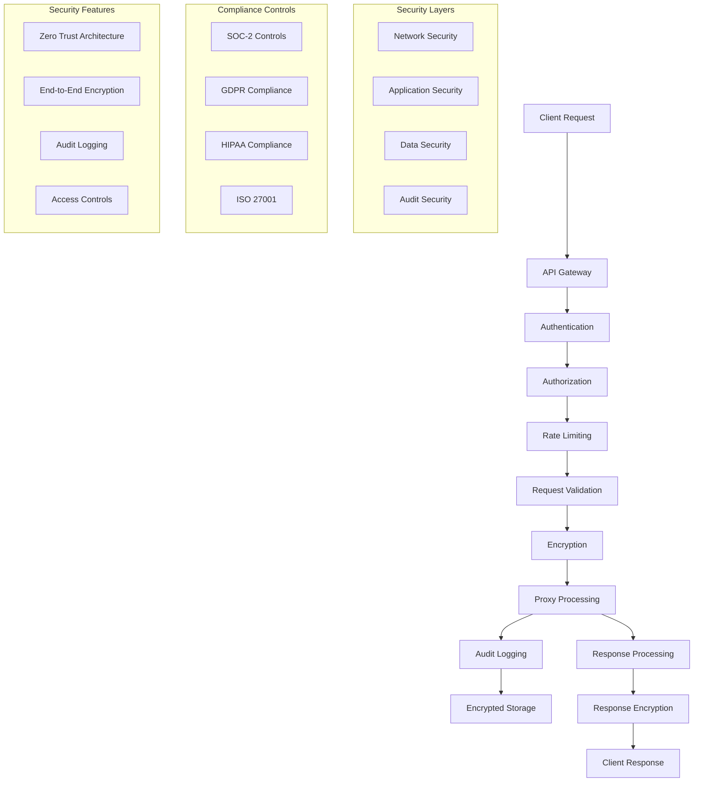

**Security Strategy:**
- **Zero Trust**: Verify every request and connection
- **Encryption**: Encrypt data at rest and in transit
- **Audit Logging**: Comprehensive audit trails
- **Access Controls**: Fine-grained permission management

**Why security-first?** Enterprise customers require enterprise-grade security.

## P10: Follow-up Questions and Answers

### Q1: How do you handle data residency requirements?

**A:** Data residency is enforced through multiple layers:

1. **Infrastructure Level**: All components are deployed within the customer's VPC
2. **Storage Level**: All data is stored in customer-managed storage
3. **Processing Level**: All data processing happens within customer boundaries
4. **Network Level**: All traffic stays within customer network

**Technical Implementation:**
- Deploy proxy instances in customer VPC
- Use customer-managed databases and storage
- Encrypt all data with customer-managed keys
- Route all traffic through customer network

**Why this approach?** Ensures complete control over data location and access.

### Q2: How do you achieve five-nines availability without managing customer hardware?

**A:** We achieve high availability through software-defined infrastructure:

1. **Multi-Region Deployment**: Deploy across multiple geographic regions
2. **Auto-Scaling**: Automatically scale based on demand
3. **Health Monitoring**: Continuous health checks and automatic failover
4. **Zero-Downtime Updates**: Blue-green deployments and canary releases

**Technical Implementation:**
- Use Kubernetes for container orchestration
- Implement auto-scaling groups
- Deploy across multiple availability zones
- Use load balancers for traffic distribution

**Why software-defined?** Allows us to achieve high availability without direct hardware management.

### Q3: How do you handle rate limiting across distributed systems?

**A:** Rate limiting is implemented using a distributed approach:

1. **Distributed Counters**: Use Redis or similar for distributed counters
2. **Token Bucket Algorithm**: Implement token bucket for rate limiting
3. **Sliding Window**: Use sliding window for accurate rate limiting
4. **Hierarchical Limits**: Support tenant, team, and user-level limits

**Technical Implementation:**
- Redis cluster for distributed counters
- Token bucket algorithm for rate limiting
- Sliding window for accurate tracking
- Hierarchical limit enforcement

**Why distributed rate limiting?** Ensures consistent limits across multiple proxy instances.

### Q4: How do you ensure billing accuracy in a distributed system?

**A:** Billing accuracy is ensured through multiple mechanisms:

1. **Idempotent Processing**: Ensure each request is counted exactly once
2. **Audit Trail**: Comprehensive audit trail for all transactions
3. **Reconciliation**: Regular reconciliation of usage and billing data
4. **Verification**: Multiple verification points in the pipeline

**Technical Implementation:**
- Use unique request IDs for deduplication
- Implement idempotent processing
- Regular reconciliation jobs
- Comprehensive audit logging

**Why multiple verification points?** Ensures billing accuracy even in distributed systems.

### Q5: How do you handle configuration updates without downtime?

**A:** Configuration updates are handled through a sophisticated update strategy:

1. **Blue-Green Deployment**: Deploy new configuration alongside old
2. **Canary Releases**: Test with small percentage of traffic
3. **Gradual Rollout**: Increase traffic gradually
4. **Rollback Strategy**: Automatic rollback on issues

**Technical Implementation:**
- Configuration management system
- Blue-green deployment strategy
- Health monitoring and alerting
- Automatic rollback mechanisms

**Why zero-downtime updates?** Enterprise customers cannot tolerate service interruptions.

### Q6: How do you handle tenant isolation in a shared infrastructure?

**A:** Tenant isolation is implemented at multiple levels:

1. **Network Level**: Separate proxy instances per tenant
2. **Data Level**: Encrypted storage with tenant-specific keys
3. **Rate Limiting**: Isolated counters per tenant
4. **Audit Logging**: Tenant-specific audit trails

**Technical Implementation:**
- Multi-tenant architecture
- Tenant-specific encryption keys
- Isolated rate limiting counters
- Tenant-specific audit logs

**Why multi-level isolation?** Ensures complete separation between tenants.

## Conclusion

This Enterprise VPC Proxy with Usage-Based Billing design provides:

1. **Security**: Enterprise-grade security with zero-trust architecture
2. **Compliance**: SOC-2, GDPR, and HIPAA compliance
3. **Scalability**: Horizontal scaling across multiple regions
4. **Availability**: Five-nines availability without hardware management
5. **Billing**: Precise usage-based billing with multiple export formats
6. **Isolation**: Complete tenant isolation for enterprise requirements

The architecture evolves from a simple proxy to a comprehensive enterprise solution, ensuring that each phase delivers value while building toward the final goal. The design prioritizes security, compliance, and availability while maintaining operational simplicity and cost efficiency.

Key architectural decisions focus on:
- **Security-first approach** with multiple encryption layers
- **Zero-downtime operations** through sophisticated deployment strategies
- **Distributed architecture** for high availability and scalability
- **Comprehensive monitoring** for proactive issue detection
- **Flexible billing** to meet diverse enterprise requirements

This solution enables enterprises to securely and efficiently use external LLM providers while maintaining complete control over their data, costs, and compliance requirements. 