# Comprehensive System Design Interview Guide

*A complete framework for approaching, structuring, and delivering system design interviews based on real-world patterns and best practices.*

---

## P1: Interview Preparation Framework

### Understanding the Interview Format

**Typical Structure:**
- **Duration**: 40-60 minutes
- **Format**: Whiteboard/online diagramming tool
- **Focus**: Architecture, scalability, trade-offs, not implementation
- **Expectation**: High-level design with key technical decisions

**What Interviewers Look For:**
- **Problem decomposition** and requirement analysis
- **Architecture evolution** from simple to complex
- **Technical depth** in chosen technologies
- **Trade-off awareness** and decision justification
- **Scalability thinking** and performance considerations
- **Operational awareness** (monitoring, failure handling)

### Pre-Interview Checklist

**Technical Knowledge:**
- [ ] **Databases**: SQL vs NoSQL, CAP theorem, consistency models
- [ ] **Caching**: Redis, CDN, cache invalidation strategies
- [ ] **Message Queues**: Kafka, RabbitMQ, SQS
- [ ] **Load Balancing**: Algorithms, health checks, failover
- [ ] **Microservices**: Service discovery, API gateways, circuit breakers
- [ ] **Monitoring**: Metrics, logging, alerting, distributed tracing
- [ ] **Cloud Services**: AWS/GCP/Azure equivalents for common patterns

**System Design Patterns:**
- [ ] **Event-driven architecture** and stream processing
- [ ] **CQRS** (Command Query Responsibility Segregation)
- [ ] **Saga pattern** for distributed transactions
- [ ] **Circuit breaker** and bulkhead patterns
- [ ] **Event sourcing** and audit trails
- [ ] **Sharding** and partitioning strategies

---

## P2: The 10-Step System Design Process

### Step 1: Clarify Requirements (5-10 minutes)

**Always start here!** Ask clarifying questions to understand the scope:

**Functional Requirements:**
- What are the core features?
- What are the input/output formats?
- What are the user workflows?
- What integrations are needed?

**Non-Functional Requirements:**
- **Scale**: Users, requests per second, data volume
- **Performance**: Latency, throughput requirements
- **Availability**: Uptime requirements, SLAs
- **Consistency**: Data consistency requirements
- **Security**: Authentication, authorization, compliance
- **Cost**: Budget constraints, cost optimization

**Example Questions:**
- "How many users do you expect?"
- "What's the expected request volume?"
- "What's the acceptable latency?"
- "What's the data retention policy?"
- "Are there any compliance requirements?"

### Step 2: Define System Boundaries (2-3 minutes)

**Scope Definition:**
- What's **in scope** vs **out of scope**
- External dependencies and integrations
- Third-party services to use
- What you'll build vs what you'll use

**Example Boundaries:**
- ✅ **In scope**: API design, data storage, caching, monitoring
- ❌ **Out of scope**: User authentication (use Auth0), payment processing (use Stripe)

### Step 3: High-Level Architecture (5-8 minutes)

**Start Simple - The Monolithic Approach:**

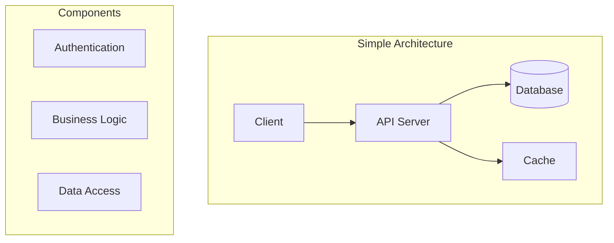

**Why start simple?**
- Establishes baseline understanding
- Identifies core components
- Provides foundation for evolution
- Demonstrates systematic thinking

### Step 4: Identify Bottlenecks (3-5 minutes)

**Analyze the simple architecture for problems:**

**Common Bottlenecks:**
- **Single point of failure**: One server, one database
- **Scalability limits**: Can't handle increased load
- **Performance issues**: No caching, slow queries
- **Data consistency**: No replication, no backups
- **Security gaps**: No authentication, no encryption

**Document the problems** - this justifies the evolution to more complex architectures.

### Step 5: Scale the Architecture (10-15 minutes)

**Evolve the design systematically:**

**Phase 1: Add Load Balancing**
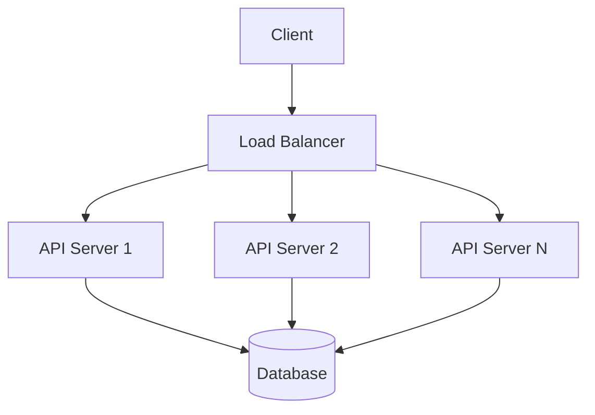

**Phase 2: Add Caching**
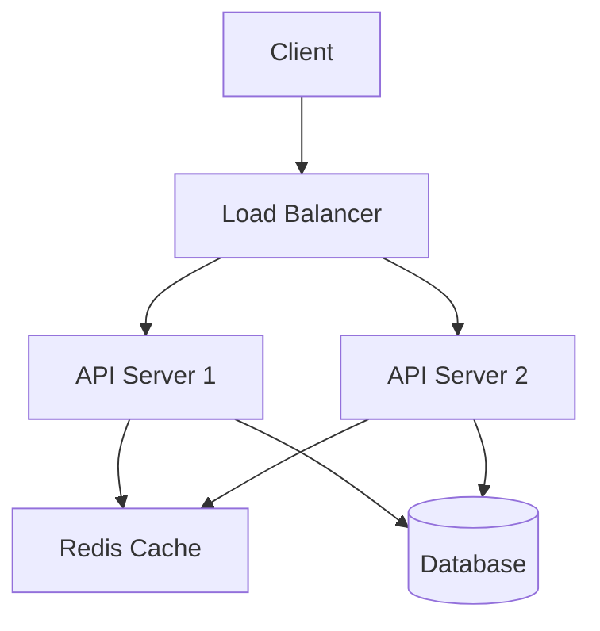

**Phase 3: Database Scaling**
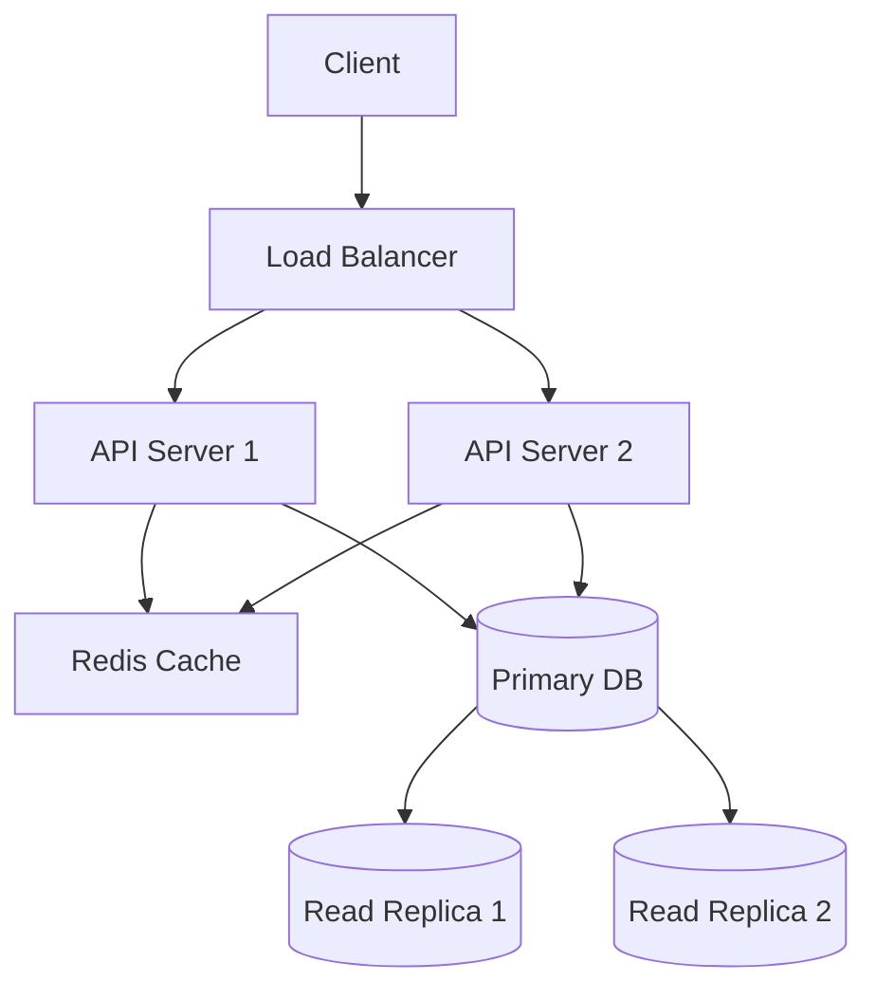

**Phase 4: Microservices**
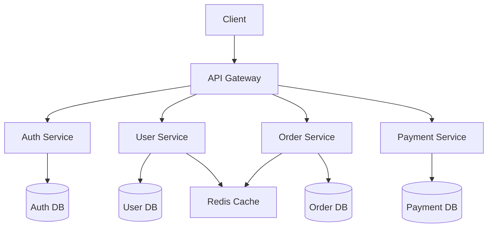

### Step 6: Data Design (5-8 minutes)

**Database Selection Strategy:**

**SQL Databases (PostgreSQL, MySQL):**
- ✅ **Use for**: ACID transactions, complex queries, structured data
- ✅ **When**: User data, financial transactions, reporting
- ❌ **Avoid for**: High-volume writes, unstructured data, real-time analytics

**NoSQL Databases:**
- **Document (MongoDB)**: Semi-structured data, flexible schemas
- **Key-Value (Redis)**: Caching, session storage, real-time data
- **Column (Cassandra)**: Time-series data, high write throughput
- **Graph (Neo4j)**: Relationships, social networks, recommendations

**Data Partitioning Strategies:**
- **Horizontal Partitioning (Sharding)**: Split by user ID, date, region
- **Vertical Partitioning**: Split by columns (hot vs cold data)
- **Functional Partitioning**: Split by business domain

### Step 7: API Design (3-5 minutes)

**RESTful API Principles:**
- **Resources**: Nouns, not verbs (`/users` not `/getUsers`)
- **HTTP Methods**: GET, POST, PUT, DELETE for CRUD operations
- **Status Codes**: 200, 201, 400, 401, 404, 500
- **Versioning**: `/v1/users` or header-based versioning

**API Design Patterns:**
```json
// Good API Response
{
  "data": {
    "id": "123",
    "name": "John Doe",
    "email": "john@example.com"
  },
  "meta": {
    "timestamp": "2024-01-01T00:00:00Z",
    "version": "v1"
  }
}

// Pagination
{
  "data": [...],
  "pagination": {
    "page": 1,
    "limit": 20,
    "total": 100,
    "has_next": true
  }
}
```

### Step 8: Security & Compliance (3-5 minutes)

**Security Layers:**
- **Authentication**: JWT, OAuth2, API keys
- **Authorization**: RBAC, ABAC, permission-based access
- **Encryption**: TLS in transit, encryption at rest
- **Audit Logging**: Request/response logging, access trails

**Compliance Considerations:**
- **GDPR**: Data privacy, right to be forgotten
- **SOC-2**: Security controls, audit trails
- **HIPAA**: Healthcare data protection
- **PCI-DSS**: Payment card data security

### Step 9: Monitoring & Observability (3-5 minutes)

**Three Pillars of Observability:**

**Metrics:**
- **Business Metrics**: User signups, conversion rates, revenue
- **Application Metrics**: Request rate, error rate, response time
- **Infrastructure Metrics**: CPU, memory, disk, network

**Logging:**
- **Structured Logging**: JSON format, consistent fields
- **Log Levels**: DEBUG, INFO, WARN, ERROR
- **Centralized Logging**: ELK stack, Splunk, CloudWatch

**Tracing:**
- **Distributed Tracing**: Jaeger, Zipkin, AWS X-Ray
- **Request Correlation**: Trace IDs across services
- **Performance Analysis**: Identify bottlenecks

### Step 10: Failure Handling & Resilience (3-5 minutes)

**Failure Scenarios:**
- **Service Failures**: Circuit breakers, retries, fallbacks
- **Database Failures**: Replication, failover, backups
- **Network Failures**: Timeouts, retries, health checks
- **Data Loss**: Backups, point-in-time recovery

**Resilience Patterns:**
- **Circuit Breaker**: Prevent cascade failures
- **Bulkhead**: Isolate failures between services
- **Retry with Exponential Backoff**: Handle transient failures
- **Dead Letter Queues**: Handle failed messages

---

## P3: Common System Design Patterns

### Event-Driven Architecture

**Use Cases:**
- Real-time data processing
- Microservices communication
- Asynchronous workflows
- Data streaming applications

**Components:**
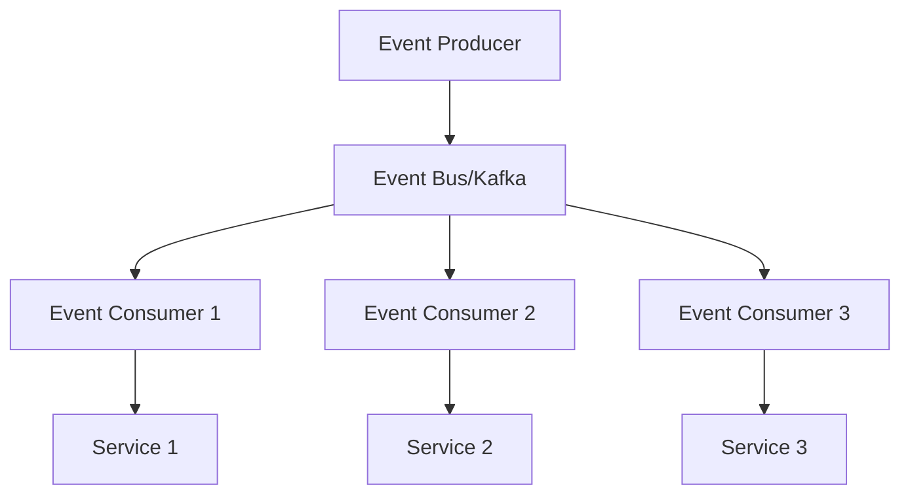

**Benefits:**
- Loose coupling between services
- Scalable event processing
- Real-time capabilities
- Fault tolerance

### CQRS (Command Query Responsibility Segregation)

**Pattern:**
- **Commands**: Write operations, change state
- **Queries**: Read operations, optimized for reading

**Architecture:**
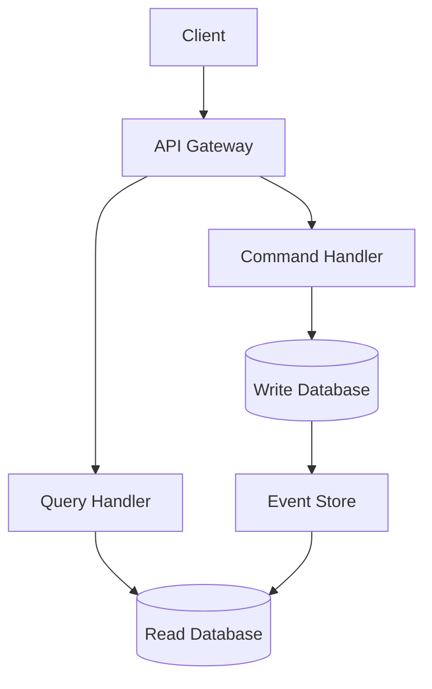

**Benefits:**
- Optimized read and write models
- Scalability for different access patterns
- Event sourcing capabilities
- Performance optimization

### Saga Pattern

**Use Cases:**
- Distributed transactions
- Microservices coordination
- Long-running workflows

**Types:**
- **Choreography**: Services communicate via events
- **Orchestration**: Central coordinator manages workflow

**Example - Order Processing:**
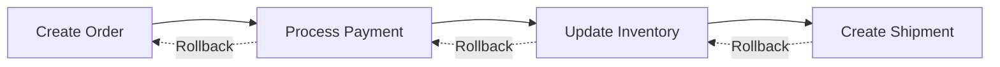

### Cache-Aside Pattern

**Strategy:**
1. Check cache for data
2. If cache miss, fetch from database
3. Store result in cache
4. Return data

**Implementation:**
```python
def get_user(user_id):
    # Check cache first
    user = cache.get(f"user:{user_id}")
    if user:
        return user
    
    # Cache miss - fetch from database
    user = database.get_user(user_id)
    if user:
        cache.set(f"user:{user_id}", user, ttl=3600)
    
    return user
```

---

## P4: Technology Selection Guidelines

### Database Selection Matrix

| Use Case | Primary Choice | Alternative | When to Consider Alternative |
|----------|----------------|-------------|------------------------------|
| **ACID Transactions** | PostgreSQL | MySQL | Simpler setup needed |
| **High Write Throughput** | Cassandra | MongoDB | Complex queries required |
| **Real-time Analytics** | ClickHouse | Druid | Cost constraints |
| **Caching** | Redis | Memcached | Memory constraints |
| **Search** | Elasticsearch | Solr | Simpler setup needed |
| **Graph Relationships** | Neo4j | ArangoDB | Cost constraints |

### Message Queue Selection

**Apache Kafka:**
- ✅ **Use for**: High-throughput, event streaming, data pipelines
- ✅ **When**: Need exactly-once delivery, stream processing
- ❌ **Avoid for**: Simple task queues, low volume

**RabbitMQ:**
- ✅ **Use for**: Traditional message queuing, complex routing
- ✅ **When**: Need flexible routing, priority queues
- ❌ **Avoid for**: High-throughput streaming

**Redis Pub/Sub:**
- ✅ **Use for**: Real-time notifications, simple messaging
- ✅ **When**: Low latency, simple patterns
- ❌ **Avoid for**: Persistent messaging, complex routing

### Cache Selection

**Redis:**
- ✅ **Use for**: Session storage, real-time data, complex data structures
- ✅ **When**: Need persistence, pub/sub, data structures
- ❌ **Avoid for**: Simple key-value caching only

**Memcached:**
- ✅ **Use for**: Simple caching, session storage
- ✅ **When**: Memory-only, simple patterns
- ❌ **Avoid for**: Complex data structures, persistence

**CDN (CloudFront/Akamai):**
- ✅ **Use for**: Static content, global distribution
- ✅ **When**: Global user base, static assets
- ❌ **Avoid for**: Dynamic content, real-time data

---

## P5: Scalability Strategies

### Horizontal vs Vertical Scaling

**Vertical Scaling (Scale Up):**
- Increase server resources (CPU, RAM, disk)
- **Pros**: Simple, no code changes needed
- **Cons**: Limited by hardware, single point of failure
- **Use for**: Small to medium scale, quick fixes

**Horizontal Scaling (Scale Out):**
- Add more servers/instances
- **Pros**: Unlimited scale, fault tolerance
- **Cons**: Complexity, distributed system challenges
- **Use for**: Large scale, production systems

### Database Scaling Patterns

**Read Replicas:**
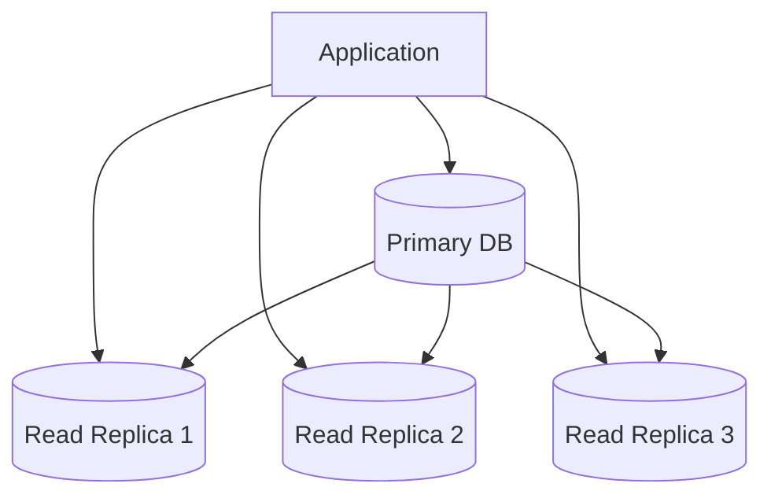

**Sharding:**
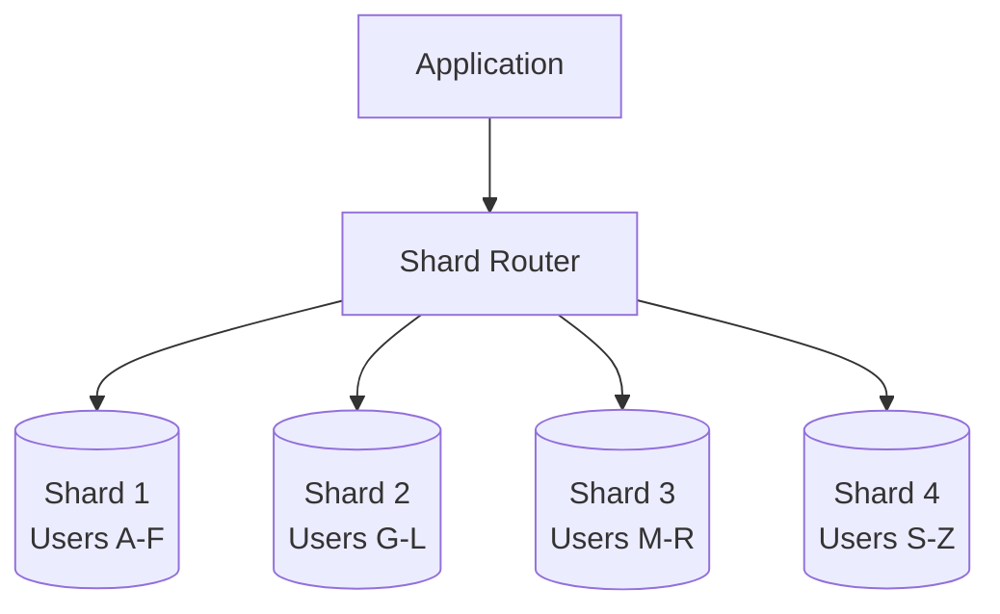

**Partitioning Strategies:**
- **Hash-based**: Distribute evenly, no locality
- **Range-based**: Maintain locality, potential hotspots
- **List-based**: Custom distribution rules

### Microservices Scaling

**Service Discovery:**
- **Client-side**: Service registry (Consul, Eureka)
- **Server-side**: Load balancer with service discovery
- **DNS-based**: Simple but limited

**API Gateway Patterns:**
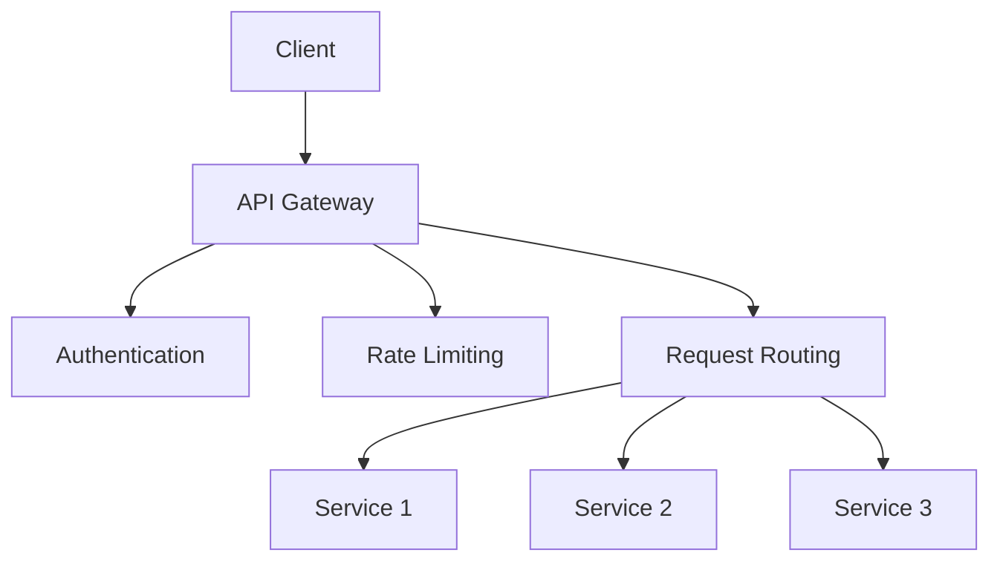

---

## P6: Performance Optimization

### Caching Strategies

**Cache Levels:**
1. **Application Cache**: In-memory cache (Redis, Memcached)
2. **Database Cache**: Query result caching
3. **CDN Cache**: Static content, global distribution
4. **Browser Cache**: Client-side caching

**Cache Patterns:**
- **Cache-Aside**: Application manages cache
- **Write-Through**: Write to cache and database simultaneously
- **Write-Behind**: Write to cache, batch to database
- **Refresh-Ahead**: Proactively refresh cache

### Database Optimization

**Query Optimization:**
- **Indexing**: B-tree, hash, composite indexes
- **Query Planning**: Analyze execution plans
- **Connection Pooling**: Reuse database connections
- **Read Replicas**: Distribute read load

**Schema Optimization:**
- **Normalization**: Reduce redundancy
- **Denormalization**: Improve read performance
- **Partitioning**: Split large tables
- **Archiving**: Move old data to cheaper storage

### Application Performance

**Code Optimization:**
- **Algorithm Selection**: Choose appropriate data structures
- **Memory Management**: Avoid memory leaks, optimize allocations
- **Concurrency**: Use appropriate threading models
- **I/O Optimization**: Async operations, batching

**Infrastructure Optimization:**
- **Load Balancing**: Distribute traffic evenly
- **Auto-scaling**: Scale based on demand
- **Resource Allocation**: Right-size instances
- **Network Optimization**: CDN, edge locations

---

## P7: Common Interview Questions & Answers

### Q: How would you design a URL shortener?

**Requirements Clarification:**
- How many URLs per day? (e.g., 100M)
- What's the acceptable latency? (e.g., <100ms)
- How long should URLs be valid? (e.g., 10 years)
- What characters should be used? (e.g., alphanumeric)

**High-Level Design:**
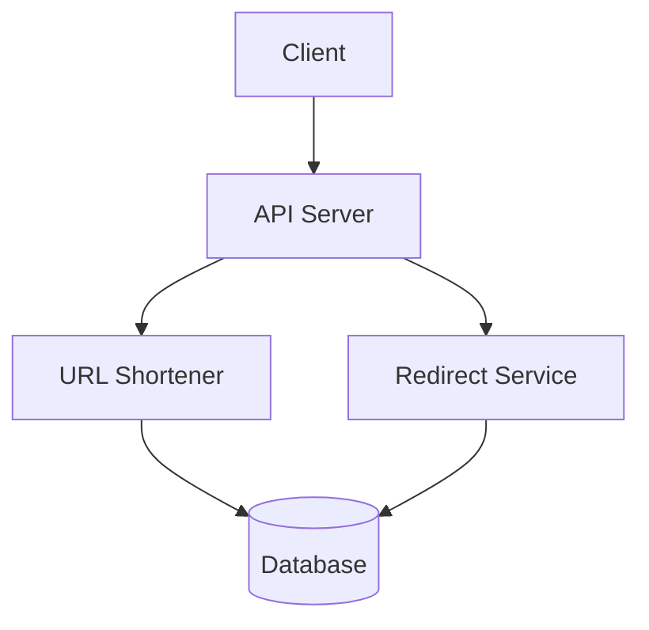

**Key Components:**
- **URL Shortening Service**: Generate short codes
- **Redirect Service**: Handle short URL requests
- **Database**: Store URL mappings
- **Cache**: Store frequently accessed URLs

**Scaling Considerations:**
- **Database**: Shard by short code
- **Caching**: Redis for hot URLs
- **CDN**: Global distribution for redirects
- **Encoding**: Base62 encoding for short codes

### Q: How would you design a chat application?

**Requirements Clarification:**
- How many concurrent users? (e.g., 1M)
- Message delivery guarantees? (e.g., at-least-once)
- Message persistence? (e.g., 1 year)
- Real-time requirements? (e.g., <100ms)

**Architecture:**
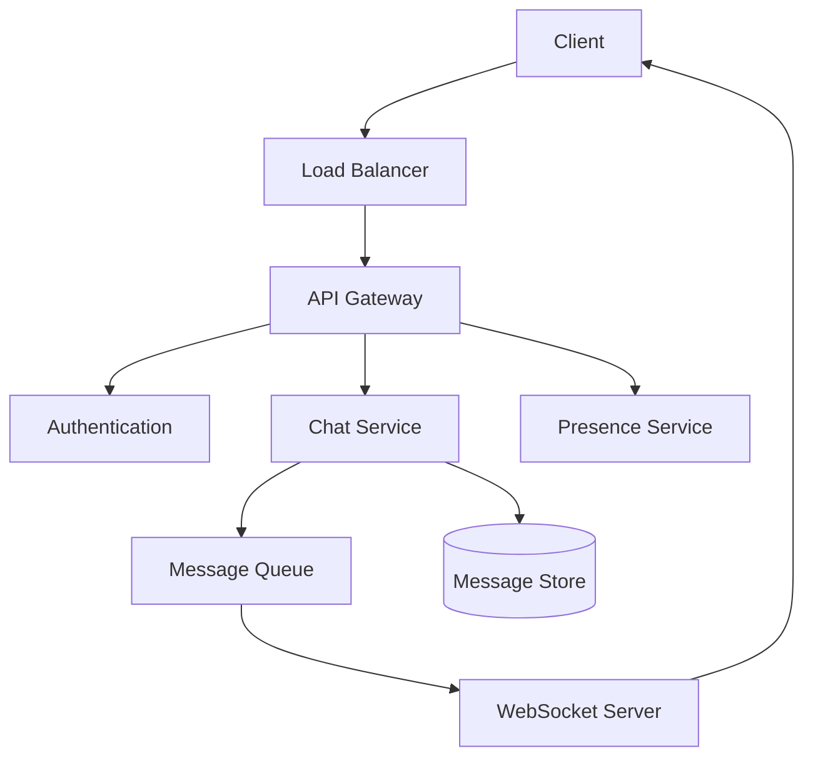

**Key Components:**
- **WebSocket Servers**: Real-time communication
- **Message Queue**: Reliable message delivery
- **Message Store**: Persistent message history
- **Presence Service**: Online/offline status

**Scaling Strategies:**
- **WebSocket Clustering**: Sticky sessions, message broadcasting
- **Message Partitioning**: Partition by chat room
- **Database Sharding**: Shard by user or chat room
- **Caching**: Recent messages, user sessions

### Q: How would you design a recommendation system?

**Requirements Clarification:**
- What type of recommendations? (e.g., products, content)
- How many items? (e.g., 1M products)
- How many users? (e.g., 10M users)
- Real-time requirements? (e.g., <200ms)

**Architecture:**
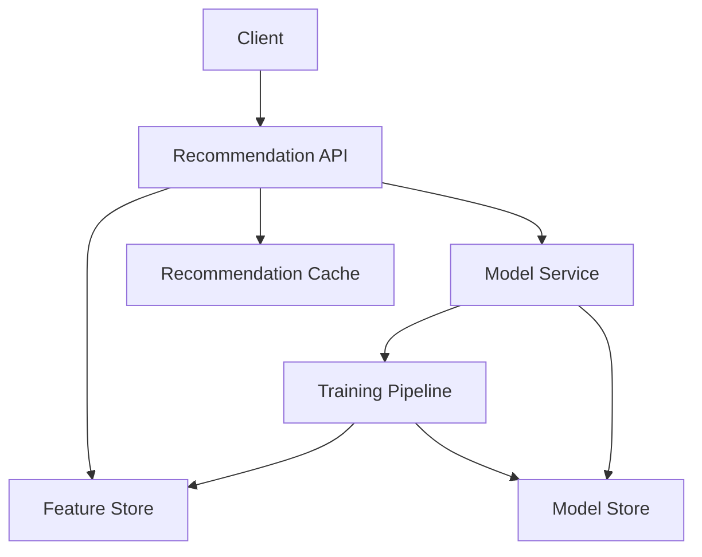

**Key Components:**
- **Feature Store**: User and item features
- **Model Service**: Recommendation algorithms
- **Training Pipeline**: Model training and updates
- **Cache**: Pre-computed recommendations

**Algorithm Types:**
- **Collaborative Filtering**: User-item interactions
- **Content-Based**: Item features
- **Hybrid**: Combine multiple approaches
- **Deep Learning**: Neural networks for complex patterns

### Q: How would you design a distributed cache?

**Requirements Clarification:**
- How much data? (e.g., 1TB)
- How many requests per second? (e.g., 100K)
- Consistency requirements? (e.g., eventual consistency)
- Availability requirements? (e.g., 99.9%)

**Architecture:**
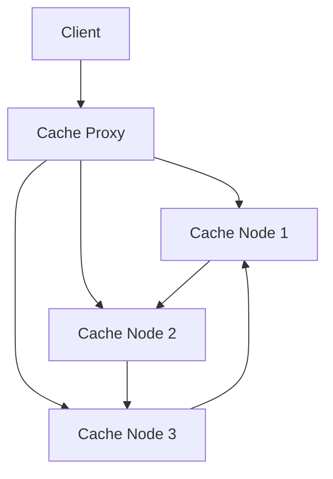

**Key Components:**
- **Consistent Hashing**: Distribute data across nodes
- **Replication**: Multiple copies for availability
- **Partitioning**: Split data across nodes
- **Failure Detection**: Health checks and failover

**Consistency Models:**
- **Strong Consistency**: All nodes see same data
- **Eventual Consistency**: Eventually converge
- **Read-Your-Writes**: See your own writes immediately

---

## P8: Red Flags to Avoid

### Common Mistakes

**❌ Jumping to Solutions Too Quickly**
- Start with requirements clarification
- Understand the problem before designing
- Ask clarifying questions

**❌ Ignoring Scale Requirements**
- Always consider scale implications
- Design for expected growth
- Plan for scaling bottlenecks

**❌ Over-Engineering**
- Start simple, evolve complexity
- Don't add components without justification
- Focus on core requirements first

**❌ Ignoring Failure Scenarios**
- Consider what can go wrong
- Plan for failure handling
- Design for resilience

**❌ Not Considering Trade-offs**
- Every decision has trade-offs
- Explain your reasoning
- Consider alternatives

**❌ Ignoring Operational Concerns**
- Consider monitoring and alerting
- Plan for deployment and updates
- Think about maintenance

### What Interviewers Hate

**❌ No Structure**
- Follow a systematic approach
- Use the 10-step process
- Organize your thoughts

**❌ No Communication**
- Explain your thinking
- Ask questions
- Discuss trade-offs

**❌ No Technical Depth**
- Know your chosen technologies
- Understand their limitations
- Consider alternatives

**❌ No Scale Thinking**
- Always consider scale
- Plan for growth
- Identify bottlenecks

**❌ No Operational Awareness**
- Consider monitoring
- Plan for failures
- Think about maintenance

---

## P9: Advanced Topics

### Distributed Systems Challenges

**Consistency Models:**
- **Strong Consistency**: All nodes see same data
- **Eventual Consistency**: Eventually converge
- **Causal Consistency**: Preserve causality
- **Read-Your-Writes**: See your own writes

**CAP Theorem:**
- **Consistency**: All nodes see same data
- **Availability**: System responds to requests
- **Partition Tolerance**: System works despite network failures
- **Choose 2 of 3**: Trade-off between properties

**Consensus Algorithms:**
- **Paxos**: Classic consensus algorithm
- **Raft**: Simplified consensus algorithm
- **ZAB**: ZooKeeper's consensus algorithm

### Data Consistency Patterns

**Eventual Consistency:**
- Accept temporary inconsistencies
- Use conflict resolution strategies
- Provide eventual convergence

**Strong Consistency:**
- Use distributed transactions
- Implement consensus algorithms
- Accept higher latency

**Causal Consistency:**
- Preserve cause-effect relationships
- Use vector clocks
- Balance consistency and performance

### System Design for AI/ML

**Model Serving:**
- **Online Serving**: Real-time predictions
- **Batch Serving**: Batch predictions
- **Hybrid**: Combine online and batch

**Feature Engineering:**
- **Feature Store**: Centralized feature management
- **Feature Pipelines**: Automated feature computation
- **Feature Serving**: Real-time feature access

**Model Training:**
- **Distributed Training**: Scale across multiple nodes
- **Hyperparameter Tuning**: Automated optimization
- **Model Versioning**: Track model versions

---

## P10: Practice Framework

### Daily Practice Routine

**Week 1-2: Fundamentals**
- Study system design patterns
- Understand scalability concepts
- Learn about databases and caching
- Practice basic architectures

**Week 3-4: Intermediate**
- Practice common interview questions
- Focus on trade-offs and decisions
- Improve communication skills
- Time your responses

**Week 5-6: Advanced**
- Practice complex scenarios
- Focus on edge cases
- Improve technical depth
- Mock interviews

### Practice Questions by Category

**Basic Systems:**
- URL shortener
- Chat application
- Social media feed
- File storage system

**Intermediate Systems:**
- Recommendation system
- Search engine
- Video streaming
- E-commerce platform

**Advanced Systems:**
- Distributed cache
- Message queue
- Real-time analytics
- Machine learning pipeline

### Mock Interview Checklist

**Before Interview:**
- [ ] Review system design patterns
- [ ] Practice common questions
- [ ] Prepare clarifying questions
- [ ] Set up diagramming tool

**During Interview:**
- [ ] Clarify requirements first
- [ ] Start with simple architecture
- [ ] Evolve systematically
- [ ] Explain trade-offs
- [ ] Consider scale and failure

**After Interview:**
- [ ] Review your performance
- [ ] Identify areas for improvement
- [ ] Practice weak areas
- [ ] Get feedback if possible

### Resources for Practice

**Books:**
- "Designing Data-Intensive Applications" by Martin Kleppmann
- "System Design Interview" by Alex Xu
- "Building Microservices" by Sam Newman

**Online Resources:**
- High Scalability blog
- System Design Primer (GitHub)
- InterviewBit system design section
- LeetCode system design problems

**Practice Platforms:**
- Pramp (mock interviews)
- InterviewBit
- LeetCode
- Grokking the System Design Interview

---

## Conclusion

System design interviews are about demonstrating your ability to think systematically about complex problems. The key is to:

1. **Start with requirements** - always clarify the scope
2. **Begin simple** - start with basic architecture
3. **Evolve systematically** - add complexity as needed
4. **Consider trade-offs** - every decision has implications
5. **Think about scale** - design for growth
6. **Plan for failure** - build resilient systems
7. **Communicate clearly** - explain your reasoning

Remember: There's no perfect solution. Focus on demonstrating your thought process, technical knowledge, and ability to make informed decisions under constraints.

**Good luck with your system design interviews!** 🚀 