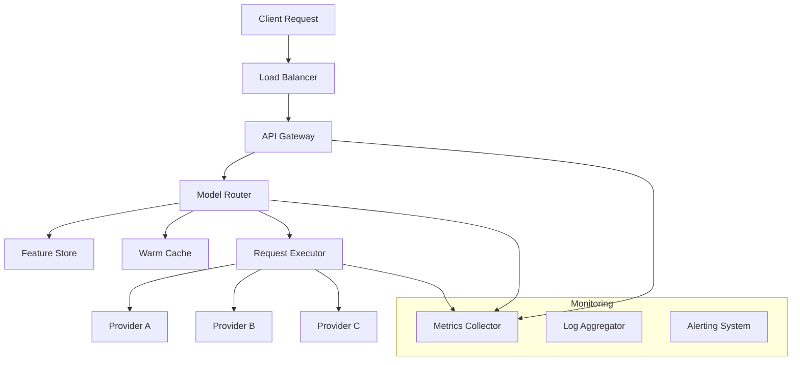
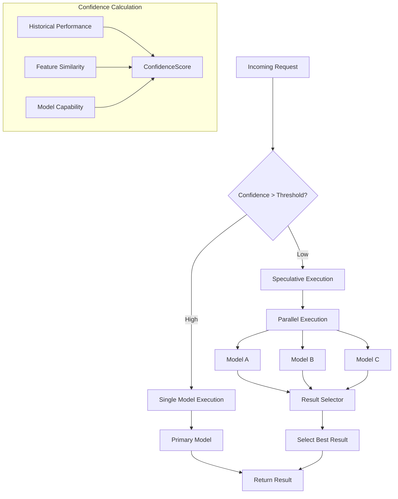
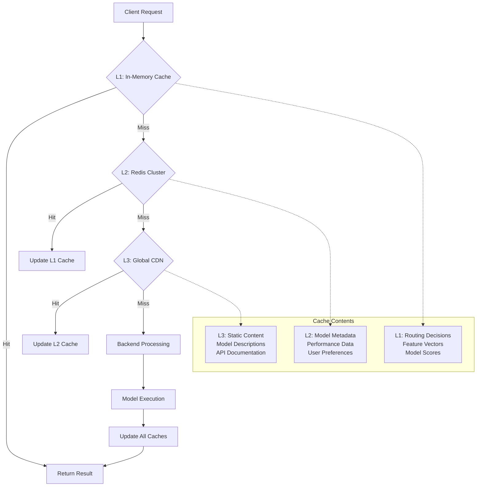
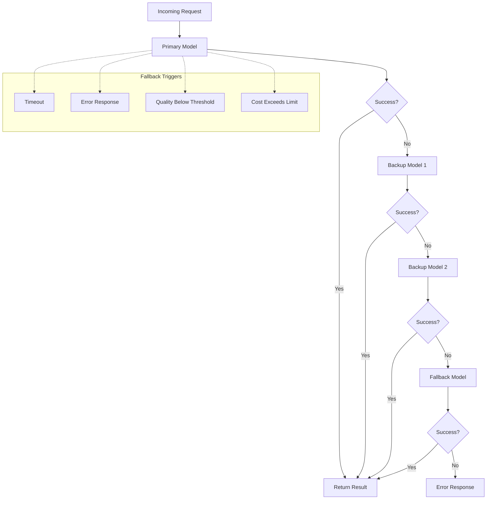
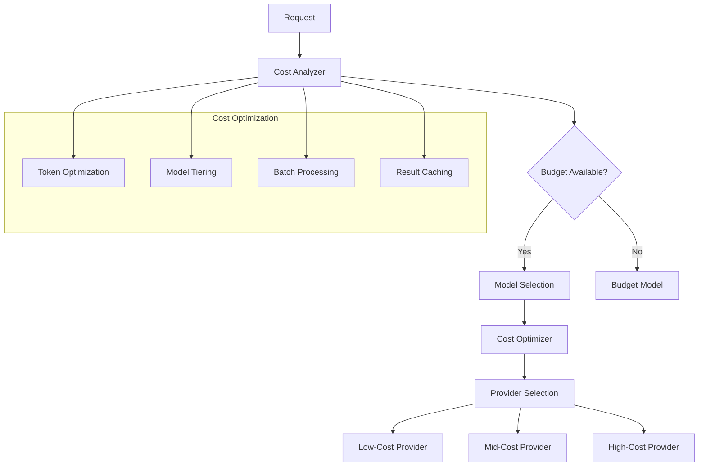
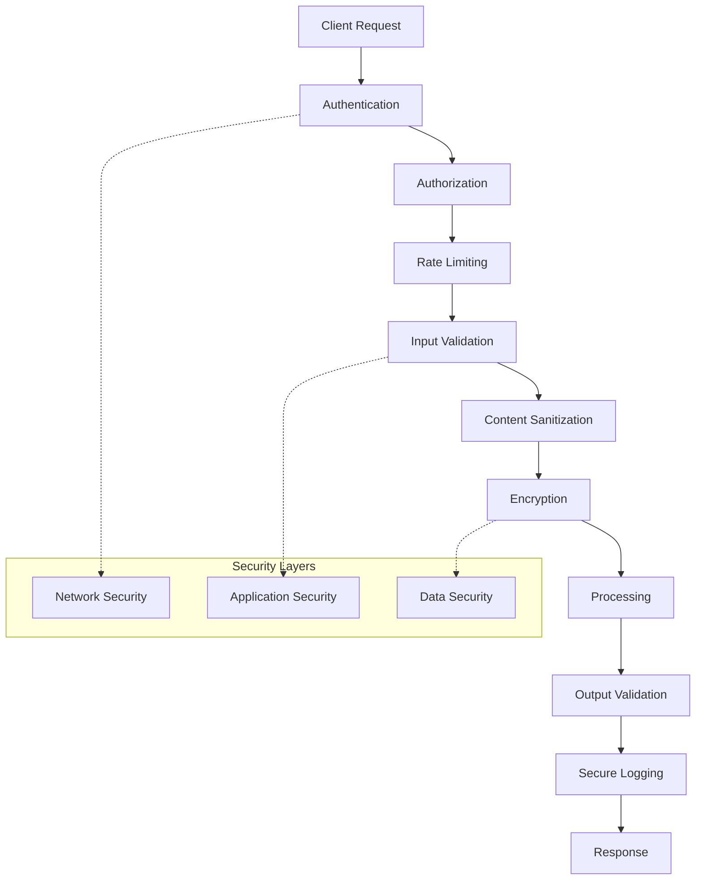

# Multi-Modal Routing Gateway: System Design

## Problem Statement

Design a globally distributed gateway that accepts text, code-generation, vision, and audio prompts, then selects and calls the "best" model among dozens of third-party LLM/LVM endpoints under a configurable latency ↔ cost ↔ quality objective. The system must:

- **Latency**: Keep median overhead below 60ms
- **Scale**: Serve thousands of concurrent requests
- **Modalities**: Support text, code, vision, and audio
- **Providers**: Route to dozens of third-party endpoints
- **Objectives**: Configurable latency/cost/quality trade-offs
- **Reliability**: Robust fallback behavior and observability

## P2: Requirements Analysis

### Functional Requirements
- Multi-modal input processing (text, code, vision, audio)
- Dynamic model selection based on content and objectives
- Real-time routing decisions
- Configurable quality/cost/latency objectives
- Fallback mechanisms for provider failures
- Comprehensive observability and SLOs

### Non-Functional Requirements
- **Latency**: < 60ms median overhead
- **Throughput**: Thousands of concurrent requests
- **Availability**: 99.9% uptime
- **Scalability**: Global distribution
- **Cost**: Optimize for cost efficiency
- **Accuracy**: Maintain quality standards

## P3: Architecture Evolution

### Phase 1: Basic Single-Region Architecture

Let's start with a simple, single-region design to establish the core concepts:



**Why this approach?**
- **Single region** simplifies initial complexity
- **Clear separation** of routing logic from execution
- **Basic monitoring** establishes observability foundation
- **Multiple providers** demonstrates routing capability

**Limitations:**
- No global distribution
- Single point of failure
- Limited scalability
- No speculative execution

### Phase 2: Enhanced Routing with Decision Engine

Now let's add the decision engine and real-time feature store:

```mermaid
graph TB
    Client[Client Request] --> LB[Load Balancer]
    LB --> Gateway[API Gateway]
    Gateway --> Preprocessor[Input Preprocessor]
    
    Preprocessor --> FeatureExtractor[Feature Extractor]
    FeatureExtractor --> FeatureStoreReal-time Feature Store
    
    Preprocessor --> DecisionEngine[Decision Engine]
    DecisionEngine --> FeatureStore
    DecisionEngine --> ModelRegistry[Model Registry]
    DecisionEngine --> Cache[Warm Cache]
    
    DecisionEngine --> Router[Model Router]
    Router --> Executor[Request Executor]
    
    Executor --> Provider1[OpenAI]
    Executor --> Provider2[Anthropic]
    Executor --> Provider3[Google]
    Executor --> Provider4[Mistral]
    
    subgraph "Decision Components"
        FeatureExtractor
        DecisionEngine
        ModelRegistry
        Cache
    end
    
    subgraph "Monitoring"
        Metrics[Metrics Collector]
        SLOs[SLO Dashboard]
        Alerts[Alerting]
    end
    
    Gateway --> Metrics
    DecisionEngine --> Metrics
    Executor --> Metrics
```

**Key Additions:**
- **Feature Extractor**: Analyzes input content and extracts relevant features
- **Decision Engine**: Makes routing decisions based on features and objectives
- **Model Registry**: Maintains provider capabilities and performance data
- **Real-time Feature Store**: Stores historical performance and routing decisions

**Why these components?**
- **Feature extraction** enables intelligent routing based on content
- **Decision engine** centralizes routing logic and objectives
- **Model registry** provides up-to-date provider information
- **Feature store** enables learning from historical decisions

### Phase 3: Global Distribution with Edge Caching

Now let's scale globally with edge caching and regional distribution:

```mermaid
graph TB
    Client[Client Request] --> CDN[Global CDN]
    CDN --> Edge[Edge Router]
    
    Edge --> Region1[Region 1 - US East]
    Edge --> Region2[Region 2 - US West]
    Edge --> Region3[Region 3 - EU]
    Edge --> Region4[Region 4 - Asia]
    
    subgraph "Region 1 - US East"
        LB1[Load Balancer]
        Gateway1[API Gateway]
        Router1[Model Router]
        Cache1[Regional Cache]
        Executor1[Request Executor]
        
        LB1 --> Gateway1
        Gateway1 --> Router1
        Router1 --> Cache1
        Router1 --> Executor1
    end
    
    subgraph "Region 2 - US West"
        LB2[Load Balancer]
        Gateway2[API Gateway]
        Router2[Model Router]
        Cache2[Regional Cache]
        Executor2[Request Executor]
        
        LB2 --> Gateway2
        Gateway2 --> Router2
        Router2 --> Cache2
        Router2 --> Executor2
    end
    
    subgraph "Global Services"
        GlobalFeatureStoreGlobal Feature Store
        GlobalModelRegistryGlobal Model Registry
        GlobalMetrics[Global Metrics]
    end
    
    Router1 --> GlobalFeatureStore
    Router2 --> GlobalFeatureStore
    Router1 --> GlobalModelRegistry
    Router2 --> GlobalModelRegistry
    
    Router1 --> GlobalMetrics
    Router2 --> GlobalMetrics
```

**Global Distribution Benefits:**
- **Reduced latency** through regional deployment
- **Improved availability** with regional failover
- **Better scalability** with regional load distribution
- **Edge caching** reduces backend load

**Why global distribution?**
- **Latency requirements** (60ms overhead) demand regional presence
- **Global user base** requires worldwide coverage
- **Provider diversity** benefits from regional access
- **Fault tolerance** improves with geographic distribution

### Phase 4: Advanced Features - Speculative Execution & Warm Cache

Now let's add speculative execution and sophisticated caching:

```mermaid
graph TB
    Client[Client Request] --> CDN[Global CDN]
    CDN --> Edge[Edge Router]
    Edge --> Region[Regional Gateway]
    
    Region --> Preprocessor[Input Preprocessor]
    Preprocessor --> FeatureExtractor[Feature Extractor]
    FeatureExtractor --> FeatureStoreReal-time Feature Store
    
    Preprocessor --> DecisionEngine[Decision Engine]
    DecisionEngine --> FeatureStore
    DecisionEngine --> ModelRegistryModel Registry
    DecisionEngine --> Cache[Warm Cache]
    
    DecisionEngine --> Router[Model Router]
    Router --> SpeculativeExecutor[Speculative Executor]
    
    SpeculativeExecutor --> PrimaryExecutor[Primary Executor]
    SpeculativeExecutor --> BackupExecutor[Backup Executor]
    
    PrimaryExecutor --> Provider1[Provider A]
    PrimaryExecutor --> Provider2[Provider B]
    BackupExecutor --> Provider3[Provider C]
    BackupExecutor --> Provider4[Provider D]
    
    subgraph "Caching Strategy"
        Cache
        subgraph "Cache Layers"
            L1[L1: In-Memory Cache]
            L2[L2: Redis Cluster]
            L3[L3: Global CDN]
        end
    end
    
    subgraph "Speculative Execution"
        SpeculativeExecutor
        subgraph "Execution Strategy"
            Primary[Primary Model]
            Backup[Backup Models]
            Fallback[Fallback Chain]
        end
    end
    
    subgraph "Monitoring & SLOs"
        Metrics[Real-time Metrics]
        SLOs[SLO Dashboard]
        Alerts[Alerting System]
        Tracing[Distributed Tracing]
    end
    
    Router --> Metrics
    SpeculativeExecutor --> Metrics
    PrimaryExecutor --> Metrics
    BackupExecutor --> Metrics
```

**Advanced Features:**
- **Speculative Execution**: Runs multiple models in parallel for confidence-based selection
- **Multi-layer Caching**: L1 (in-memory), L2 (Redis), L3 (CDN) for optimal performance
- **Fallback Chain**: Automatic failover to backup providers
- **Distributed Tracing**: End-to-end request tracking

## Decision Engine Architecture

### Core Components

```mermaid
graph TB
    Input[Input Request] --> FeatureExtractor[Feature Extractor]
    
    FeatureExtractor --> ContentFeatures[Content Features]
    FeatureExtractor --> ModalityFeatures[Modality Features]
    FeatureExtractor --> ContextFeatures[Context Features]
    
    ContentFeatures --> FeatureVector[Feature Vector]
    ModalityFeatures --> FeatureVector
    ContextFeatures --> FeatureVector
    
    FeatureVector --> DecisionEngine[Decision Engine]
    
    DecisionEngine --> ModelScorer[Model Scorer]
    DecisionEngine --> ObjectiveOptimizer[Objective Optimizer]
    DecisionEngine --> ConfidenceCalculator[Confidence Calculator]
    
    ModelScorer --> ModelRegistryModel Registry
    ObjectiveOptimizer --> ConfigStoreConfig Store
    ConfidenceCalculator --> HistoricalDataHistorical Data
    
    ModelScorer --> ScoredModels[Scored Models]
    ObjectiveOptimizer --> OptimizedSelection[Optimized Selection]
    ConfidenceCalculator --> ConfidenceScore[Confidence Score]
    
    ScoredModels --> FinalSelector[Final Selector]
    OptimizedSelection --> FinalSelector
    ConfidenceScore --> FinalSelector
    
    FinalSelector --> SelectedModel[Selected Model]
    FinalSelector --> SpeculativeModels[Speculative Models]
```

### Feature Extraction Strategy

**Content Features:**
- **Text**: Length, complexity, language, domain
- **Code**: Language, complexity, framework patterns
- **Vision**: Image size, format, content type
- **Audio**: Duration, format, language, quality

**Modality Features:**
- Input type (text/code/vision/audio)
- Required output format
- Processing requirements

**Context Features:**
- User preferences
- Historical performance
- Cost constraints
- Latency requirements

### Decision Algorithm

```python
# Pseudo-code for decision engine
def select_model(request, objectives):
    features = extract_features(request)
    candidates = get_candidate_models(features)
    
    # Score models based on objectives
    scored_models = []
    for model in candidates:
        score = calculate_score(model, features, objectives)
        confidence = calculate_confidence(model, features)
        scored_models.append((model, score, confidence))
    
    # Select primary and speculative models
    primary = select_primary(scored_models, objectives)
    speculative = select_speculative(scored_models, primary, objectives)
    
    return primary, speculative
```

## Speculative Execution Strategy

### Confidence-Based Execution



**Why Speculative Execution?**
- **Low confidence scenarios**: When routing decision is uncertain
- **Quality optimization**: Compare multiple model outputs
- **Fallback preparation**: Have backup results ready
- **Learning opportunity**: Gather performance data

**Trade-offs:**
- **Cost**: Higher due to multiple model calls
- **Latency**: May increase if waiting for all results
- **Complexity**: More complex result selection logic

## Data Storage & Caching Strategy

### Multi-Layer Caching Architecture



### Cache Invalidation Strategy

**Time-based Invalidation:**
- L1: 5-10 seconds (frequent updates)
- L2: 1-5 minutes (moderate updates)
- L3: 1-24 hours (rare updates)

**Event-based Invalidation:**
- Model performance changes
- Provider status updates
- Configuration changes
- User preference updates

## API Design

### Request Contract

```json
{
  "input": {
    "type": "text|code|vision|audio",
    "content": "string|base64|url",
    "format": "text|json|image|audio",
    "language": "en|es|fr|...",
    "domain": "general|coding|medical|..."
  },
  "objectives": {
    "latency": "low|medium|high",
    "cost": "low|medium|high", 
    "quality": "low|medium|high",
    "max_latency_ms": 1000,
    "max_cost_usd": 0.01
  },
  "context": {
    "user_id": "string",
    "session_id": "string",
    "preferences": {
      "preferred_providers": ["openai", "anthropic"],
      "excluded_providers": ["provider_x"]
    }
  }
}
```

### Response Contract

```json
{
  "result": {
    "content": "string",
    "model_used": "provider/model",
    "confidence": 0.95,
    "latency_ms": 45,
    "cost_usd": 0.005
  },
  "metadata": {
    "request_id": "uuid",
    "routing_decision": {
      "primary_model": "openai/gpt-4",
      "speculative_models": ["anthropic/claude-3"],
      "reasoning": "High confidence based on text complexity"
    },
    "performance": {
      "total_latency_ms": 67,
      "routing_overhead_ms": 12,
      "model_latency_ms": 55
    }
  },
  "pagination": {
    "next_page_token": "base64_encoded_token",
    "has_more": false
  }
}
```

## Observability & SLOs

### SLO Framework

```mermaid
graph TB
    subgraph "Latency SLOs"
        P50[P50 < 60ms]
        P95[P95 < 150ms]
        P99[P99 < 300ms]
    end
    
    subgraph "Availability SLOs"
        Uptime[99.9% Uptime]
        ErrorRate[< 0.1% Error Rate]
        SuccessRate[> 99.5% Success Rate]
    end
    
    subgraph "Quality SLOs"
        RoutingAccuracy[> 95% Routing Accuracy]
        ModelSelection[Optimal Model Selection]
        CostEfficiency[Cost within Budget]
    end
    
    subgraph "Monitoring Components"
        Metrics[Real-time Metrics]
        Logs[Structured Logging]
        Traces[Distributed Tracing]
        Alerts[Alerting System]
    end
    
    Metrics --> P50
    Metrics --> P95
    Metrics --> P99
    Metrics --> Uptime
    Metrics --> ErrorRate
    Metrics --> SuccessRate
    Metrics --> RoutingAccuracy
    Metrics --> ModelSelection
    Metrics --> CostEfficiency
    
    Logs --> Alerts
    Traces --> Alerts
```



### Key Metrics

**Latency Metrics:**
- End-to-end request latency
- Routing decision time
- Model execution time
- Cache hit/miss ratios

**Quality Metrics:**
- Routing accuracy (vs. ground truth)
- Model selection optimality
- User satisfaction scores
- Cost efficiency ratios

**Operational Metrics:**
- Request volume and throughput
- Error rates by provider
- Cache performance
- Resource utilization

## P5: Scaling Strategy

### Horizontal Scaling

```mermaid
graph TB
    subgraph "Global Load Balancer"
        GLB[Global Load Balancer]
    end
    
    subgraph "Regional Clusters"
        subgraph "US East"
            LB1[Load Balancer]
            Router1[Router Pool]
            Executor1[Executor Pool]
        end
        
        subgraph "US West"
            LB2[Load Balancer]
            Router2[Router Pool]
            Executor2[Executor Pool]
        end
        
        subgraph "EU"
            LB3[Load Balancer]
            Router3[Router Pool]
            Executor3[Executor Pool]
        end
        
        subgraph "Asia"
            LB4[Load Balancer]
            Router4[Router Pool]
            Executor4[Executor Pool]
        end
    end
    
    subgraph "Global Services"
        GlobalCacheGlobal Cache
        GlobalMetrics[Global Metrics]
        GlobalConfig[Global Config]
    end
    
    GLB --> LB1
    GLB --> LB2
    GLB --> LB3
    GLB --> LB4
    
    Router1 --> GlobalCache
    Router2 --> GlobalCache
    Router3 --> GlobalCache
    Router4 --> GlobalCache
    
    Router1 --> GlobalMetrics
    Router2 --> GlobalMetrics
    Router3 --> GlobalMetrics
    Router4 --> GlobalMetrics
```

### Database Sharding Strategy

**Sharding by Region:**
- Each region has its own database cluster
- Global data replicated across regions
- Local data stays in region for performance

**Sharding by User:**
- User-specific data sharded by user ID
- Enables user-specific optimizations
- Improves cache locality

## Fallback Behavior

### Multi-Level Fallback Strategy



**Fallback Triggers:**
- **Timeout**: Model doesn't respond within SLA
- **Error**: Model returns error response
- **Quality**: Response quality below threshold
- **Cost**: Response cost exceeds budget

**Fallback Chain:**
1. Primary model (optimal for objectives)
2. Backup model (similar capabilities)
3. Alternative model (different provider)
4. Fallback model (reliable but basic)

## Cost Optimization

### Cost Management Strategy



**Cost Optimization Techniques:**
- **Token optimization**: Minimize input/output tokens
- **Model tiering**: Use cheaper models for simple tasks
- **Batch processing**: Group similar requests
- **Result caching**: Cache expensive computations
- **Provider selection**: Choose cost-effective providers

## Security & Compliance

### Security Architecture



**Security Measures:**
- **Authentication**: API keys, OAuth, JWT tokens
- **Authorization**: Role-based access control
- **Rate limiting**: Prevent abuse and ensure fairness
- **Input validation**: Sanitize and validate all inputs
- **Encryption**: Encrypt data in transit and at rest
- **Audit logging**: Comprehensive security logging

## Follow-up Questions & Answers

### Q1: How do you handle model provider rate limits?

**A:** We implement a sophisticated rate limiting strategy:

1. **Provider-specific rate limiters**: Track limits per provider
2. **Token bucket algorithm**: Smooth out request distribution
3. **Queue management**: Queue requests when limits are hit
4. **Automatic fallback**: Route to alternative providers
5. **Circuit breakers**: Temporarily disable problematic providers

### Q2: How do you ensure data privacy and compliance?

**A:** Multi-layered privacy approach:

1. **Zero-data-retention option**: Don't store sensitive data
2. **Data encryption**: Encrypt all data in transit and at rest
3. **Regional compliance**: Store data in compliant regions
4. **User controls**: Allow users to control data retention
5. **Audit trails**: Comprehensive logging for compliance

### Q3: How do you handle model provider outages?

**A:** Robust outage handling:

1. **Health monitoring**: Continuous provider health checks
2. **Circuit breakers**: Automatically disable failing providers
3. **Fallback chains**: Multiple backup providers
4. **Graceful degradation**: Reduce quality rather than fail
5. **Alerting**: Immediate notification of outages

### Q4: How do you optimize for the 60ms overhead requirement?

**A:** Multi-pronged optimization strategy:

1. **Caching**: L1 cache for routing decisions (1-2ms)
2. **Async processing**: Non-blocking operations
3. **Connection pooling**: Reuse HTTP connections
4. **Edge computing**: Process at edge locations
5. **Speculative execution**: Start processing before final decision

### Q5: How do you handle different model API schemas?

**A:** Unified abstraction layer:

1. **Provider adapters**: Standardize different APIs
2. **Schema mapping**: Convert between formats
3. **Feature detection**: Auto-detect capabilities
4. **Version management**: Handle API version changes
5. **Testing framework**: Validate adapter correctness

## Conclusion

This multi-modal routing gateway design provides:

- **Global scalability** with regional distribution
- **Sub-60ms overhead** through caching and optimization
- **Intelligent routing** based on content and objectives
- **Robust fallback** mechanisms for reliability
- **Comprehensive observability** for monitoring and optimization
- **Cost optimization** through smart provider selection
- **Security and compliance** for enterprise use

The architecture evolves from a simple single-region system to a sophisticated globally distributed platform, demonstrating how to scale while maintaining performance and reliability requirements. 