# Multi-Model Performance Monitoring: System Design

## Problem Statement

Modern AI applications need to interact with multiple LLM providers simultaneously to optimize for performance, cost, and accuracy. However, selecting the optimal model for each query requires real-time knowledge of:

- **Performance Metrics**: Latency, throughput, and availability across 100+ providers
- **Cost Optimization**: Token costs, API pricing, and usage patterns
- **Quality Assessment**: Accuracy, relevance, and user satisfaction scores
- **Provider Health**: Outage detection and automatic failover
- **Query Characteristics**: Context-aware model selection based on query type, complexity, and requirements

The system must process thousands of concurrent API calls, provide sub-100ms model recommendations, handle provider outages gracefully, and scale to millions of daily requests while maintaining 99.9% availability.

**Key Requirements:**
- **Real-time Monitoring**: Track performance metrics across 100+ LLM providers
- **Instant Recommendations**: Sub-100ms response time for model selection
- **Automatic Failover**: Route to fallback models during outages
- **Custom Criteria**: Support cost vs. accuracy trade-offs
- **High Scale**: Millions of daily API calls
- **High Availability**: 99.9% uptime
- **Multi-dimensional Analysis**: Query characteristics, provider performance, and cost optimization

## P2: Requirements Analysis

### Functional Requirements
- **Performance Tracking**: Monitor latency, throughput, and availability for each provider
- **Cost Monitoring**: Track token usage, API costs, and pricing changes
- **Quality Assessment**: Measure accuracy, relevance, and user satisfaction
- **Model Recommendation**: Provide optimal model selection based on query characteristics
- **Outage Detection**: Identify provider issues and trigger failover
- **Custom Criteria**: Support user-defined optimization goals
- **Historical Analysis**: Track performance trends and patterns
- **Alerting**: Notify on performance degradation or outages

### Non-Functional Requirements
- **Latency**: <100ms for model recommendations (95th percentile)
- **Throughput**: 10,000+ requests per second
- **Availability**: 99.9% uptime
- **Scalability**: Handle millions of daily API calls
- **Accuracy**: High-quality model recommendations
- **Reliability**: Robust outage handling and failover
- **Cost Efficiency**: Minimize monitoring overhead
- **Real-time**: Sub-second data freshness

## P3: Architecture Evolution

### Phase 1: Basic Performance Tracking

We start with a simple system that tracks basic performance metrics:

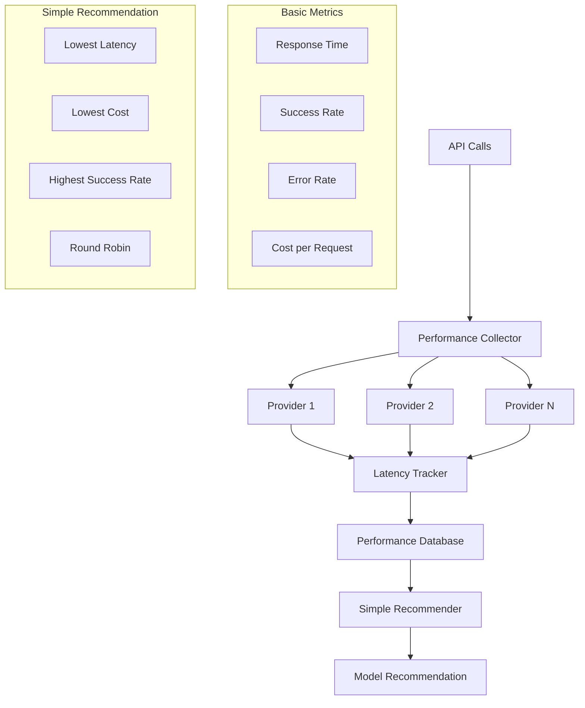

**Why start with basic tracking?** Simple to implement, validates core functionality, and provides immediate value. We can iterate on real-time processing, advanced recommendations, and outage handling.

**Why not jump to full real-time system?** Complex real-time systems are harder to debug, test, and deploy. Starting simple allows us to validate assumptions and gather feedback.

### Phase 2: Real-time Processing and Advanced Recommendations

As we scale, we need real-time processing and sophisticated recommendation algorithms:

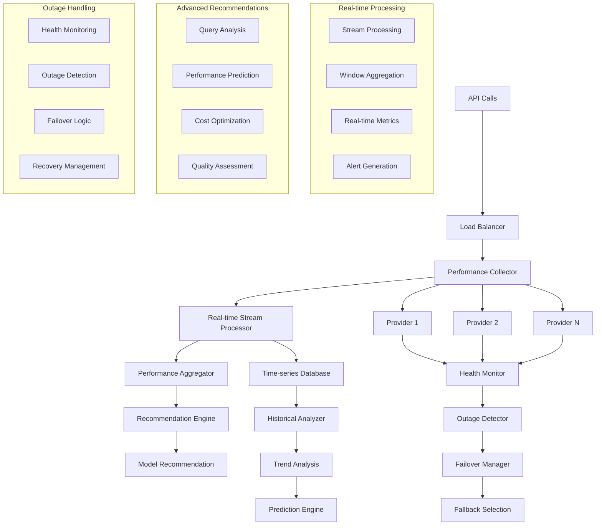

**Real-time Processing Strategy:**
- **Stream Processing**: Process performance data as it arrives
- **Window Aggregation**: Calculate metrics over sliding windows
- **Real-time Updates**: Update recommendations immediately
- **Alert Generation**: Proactive notification of issues

**Advanced Recommendation Features:**
- **Query Analysis**: Analyze query characteristics and requirements
- **Performance Prediction**: Predict expected performance for each provider
- **Cost Optimization**: Balance cost vs. performance requirements
- **Quality Assessment**: Consider accuracy and user satisfaction

### Phase 3: Global Scale with Advanced Analytics

Finally, we implement global scale with sophisticated analytics and optimization:

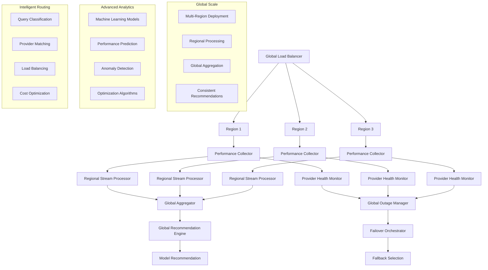

**Global Scale Strategy:**
- **Multi-Region**: Deploy across multiple geographic regions
- **Regional Processing**: Process data close to the source
- **Global Aggregation**: Combine data for comprehensive insights
- **Consistent Recommendations**: Ensure consistent recommendations across regions

**Advanced Analytics Features:**
- **Machine Learning**: Use ML models for performance prediction
- **Anomaly Detection**: Identify unusual performance patterns
- **Optimization Algorithms**: Continuously optimize recommendations
- **A/B Testing**: Test and validate recommendation strategies

## P4: Detailed Architecture

### Core Components

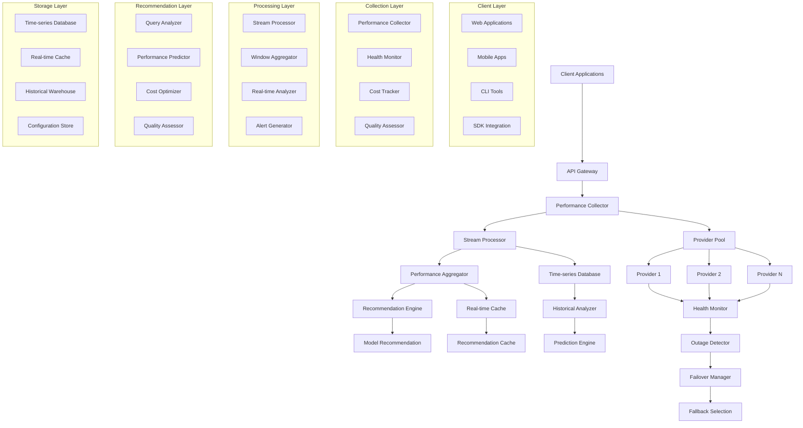

### Performance Collection System

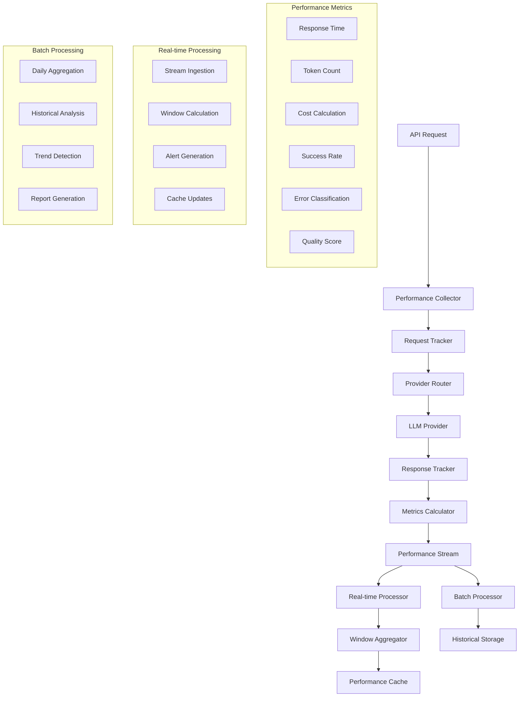

**Performance Collection Strategy:**
- **Real-time Tracking**: Track every API call in real-time
- **Multi-dimensional Metrics**: Capture latency, cost, quality, and success rate
- **Stream Processing**: Process data as it arrives
- **Batch Processing**: Aggregate data for historical analysis

**Why real-time + batch?** Real-time provides immediate insights, while batch processing handles complex aggregations efficiently.

### Recommendation Engine

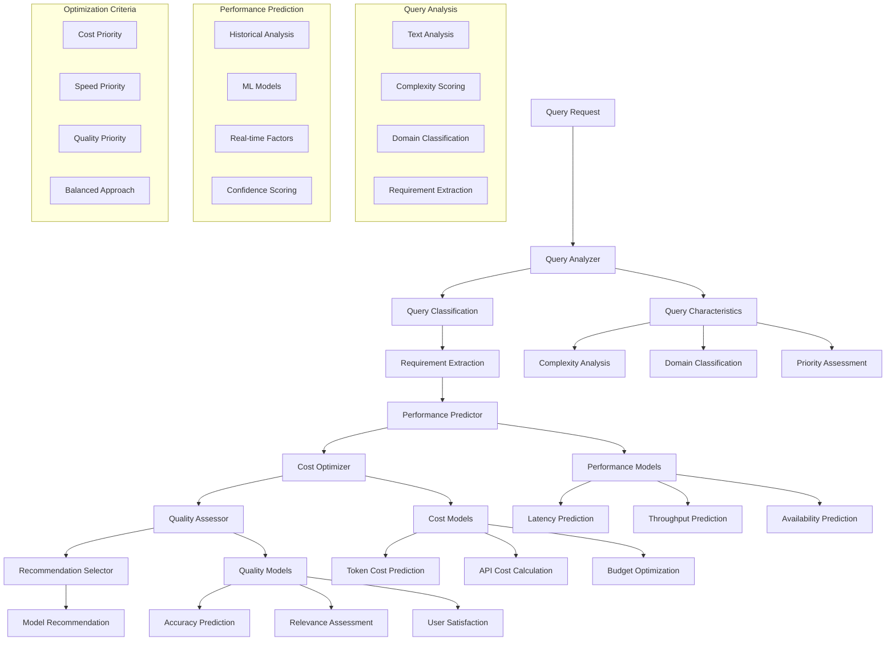

**Recommendation Strategy:**
- **Query Analysis**: Analyze query characteristics and requirements
- **Performance Prediction**: Predict expected performance for each provider
- **Cost Optimization**: Balance cost vs. performance requirements
- **Quality Assessment**: Consider accuracy and user satisfaction
- **Multi-criteria Optimization**: Support custom optimization goals

**Why multi-criteria optimization?** Different use cases have different priorities (cost vs. speed vs. quality).

### Outage Detection and Failover

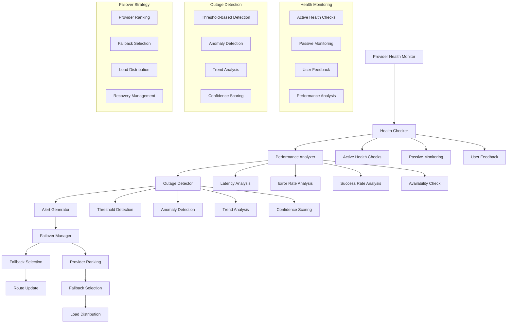

**Outage Detection Strategy:**
- **Active Monitoring**: Regular health checks to all providers
- **Passive Monitoring**: Monitor actual API call performance
- **Anomaly Detection**: Identify unusual performance patterns
- **Trend Analysis**: Detect gradual performance degradation

**Failover Strategy:**
- **Provider Ranking**: Maintain ranked list of providers
- **Fallback Selection**: Automatically select next best provider
- **Load Distribution**: Distribute load across healthy providers
- **Recovery Management**: Monitor recovery and restore normal routing

**Why automatic failover?** Ensures high availability even during provider outages.

### Real-time Processing Pipeline

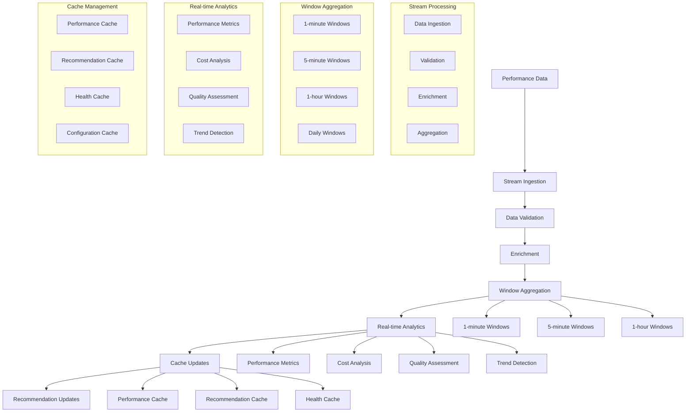

**Real-time Processing Strategy:**
- **Stream Ingestion**: Process data as it arrives
- **Window Aggregation**: Calculate metrics over multiple time windows
- **Real-time Analytics**: Generate insights in real-time
- **Cache Updates**: Update caches immediately for fast access

**Why multiple time windows?** Different metrics require different aggregation periods for optimal analysis.

## P5: Scaling Strategy

### Storage Schema

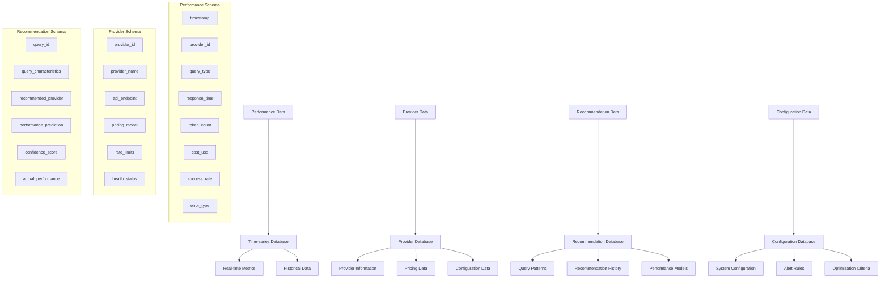

### Data Partitioning Strategy

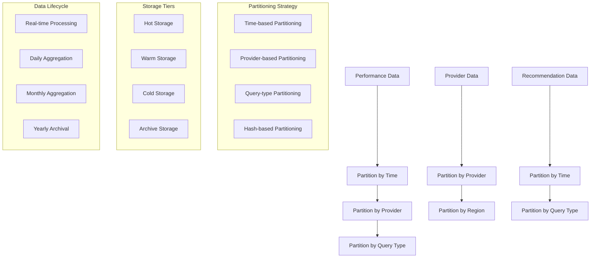

**Partitioning Strategy:**
- **Time-based**: Partition by date for efficient time-range queries
- **Provider-based**: Partition by provider for provider-specific analysis
- **Query-type**: Partition by query type for specialized analysis
- **Hash-based**: Distribute load across partitions

**Why partitioning?** Improves query performance and enables horizontal scaling.

## P5: Scaling Strategy

### Horizontal Scaling

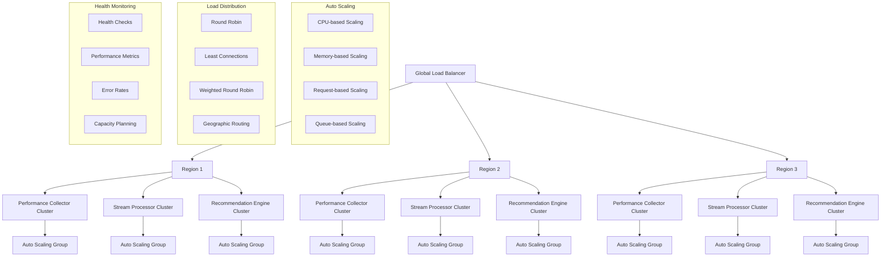

**Scaling Strategy:**
- **Auto Scaling**: Scale based on CPU, memory, and request volume
- **Load Balancing**: Distribute load across multiple instances
- **Geographic Distribution**: Deploy across multiple regions
- **Capacity Planning**: Proactive scaling based on usage patterns

**Why horizontal scaling?** Allows the system to handle increasing load without performance degradation.

### Data Scaling

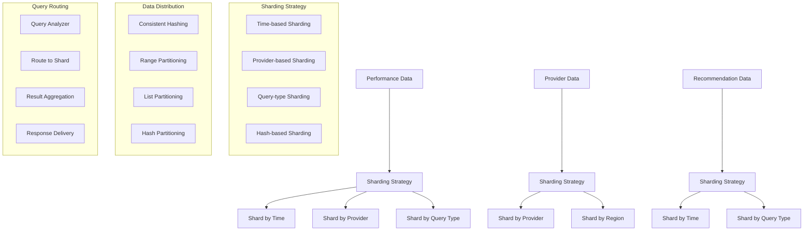

**Data Scaling Strategy:**
- **Sharding**: Distribute data across multiple databases
- **Replication**: Maintain multiple copies for availability
- **Caching**: Cache frequently accessed data
- **Compression**: Compress data to reduce storage costs

**Why data scaling?** Handles large volumes of performance and recommendation data efficiently.

## P6: Monitoring and Observability

### Metrics and Alerting

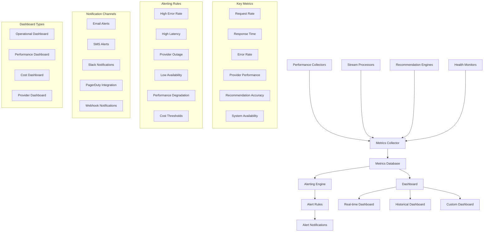

**Monitoring Strategy:**
- **Real-time Metrics**: Monitor system health in real-time
- **Historical Analysis**: Track trends and patterns over time
- **Alerting**: Proactive notification of issues
- **Dashboards**: Visual representation of system state

**Why comprehensive monitoring?** Enables proactive issue detection and resolution.

## Performance Optimization

### Caching Strategy

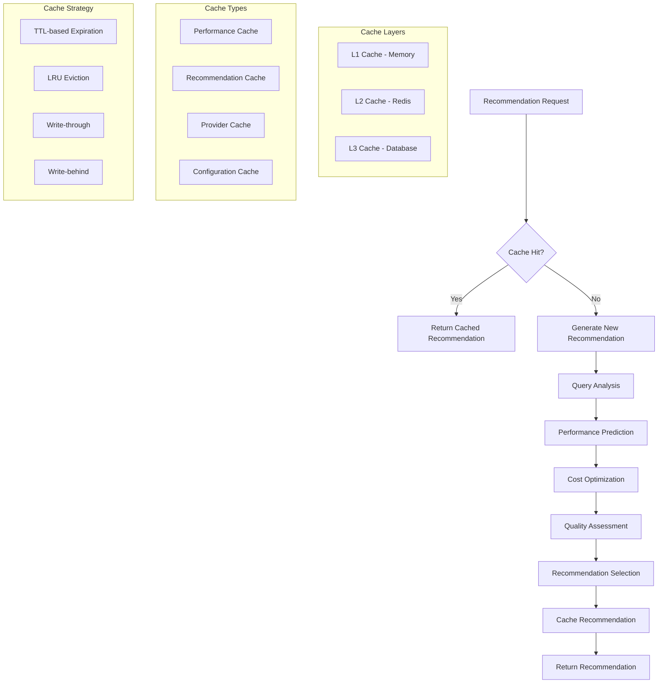

**Caching Strategy:**
- **Multi-level Caching**: L1 (memory), L2 (Redis), L3 (database)
- **Cache Types**: Performance, recommendations, providers, configuration
- **Cache Strategy**: TTL expiration, LRU eviction, write-through/behind
- **Cache Invalidation**: Smart invalidation based on data freshness

**Why multi-level caching?** Balances performance and consistency requirements.

### Query Optimization

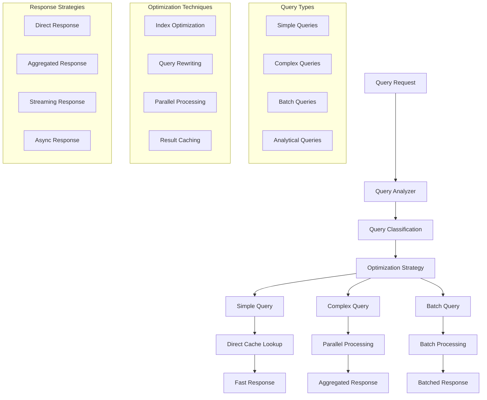

**Query Optimization Strategy:**
- **Query Classification**: Categorize queries by complexity and requirements
- **Optimization Techniques**: Index optimization, query rewriting, parallel processing
- **Response Strategies**: Direct, aggregated, streaming, async responses
- **Performance Tuning**: Continuously optimize based on usage patterns

**Why query optimization?** Ensures sub-100ms response times even for complex queries.

## P10: Follow-up Questions and Answers

### Q1: How do you ensure sub-100ms response time for model recommendations?

**A:** Sub-100ms response time is achieved through multiple optimization strategies:

1. **Multi-level Caching**: Cache recommendations at multiple levels (memory, Redis, database)
2. **Pre-computed Recommendations**: Pre-compute recommendations for common query patterns
3. **Parallel Processing**: Process query analysis, performance prediction, and cost optimization in parallel
4. **Optimized Algorithms**: Use efficient algorithms for recommendation generation
5. **Connection Pooling**: Maintain connection pools to external services

**Technical Implementation:**
- Redis cluster for fast cache access
- Pre-computed recommendation tables
- Parallel processing pipelines
- Optimized database queries with proper indexing

**Why these optimizations?** Ensures fast response times even under high load.

### Q2: How do you handle provider outages and automatic failover?

**A:** Provider outages are handled through a sophisticated monitoring and failover system:

1. **Health Monitoring**: Active and passive monitoring of all providers
2. **Outage Detection**: Threshold-based and anomaly-based detection
3. **Automatic Failover**: Immediate routing to healthy providers
4. **Load Distribution**: Distribute load across multiple healthy providers
5. **Recovery Management**: Monitor recovery and restore normal routing

**Technical Implementation:**
- Health check endpoints for each provider
- Real-time monitoring of response times and error rates
- Automatic failover with provider ranking
- Load balancing across healthy providers

**Why automatic failover?** Ensures high availability even during provider outages.

### Q3: How do you scale to millions of daily API calls?

**A:** Scaling to millions of daily API calls is achieved through:

1. **Horizontal Scaling**: Deploy across multiple regions and availability zones
2. **Auto Scaling**: Automatically scale based on demand
3. **Load Balancing**: Distribute load across multiple instances
4. **Data Partitioning**: Partition data for efficient processing
5. **Caching**: Cache frequently accessed data to reduce load

**Technical Implementation:**
- Kubernetes for container orchestration
- Auto-scaling groups based on CPU, memory, and queue length
- Load balancers for traffic distribution
- Sharded databases for data distribution

**Why horizontal scaling?** Allows the system to handle increasing load without performance degradation.

### Q4: How do you support custom evaluation criteria (cost vs. accuracy trade-offs)?

**A:** Custom evaluation criteria are supported through a flexible optimization framework:

1. **Multi-criteria Optimization**: Support multiple optimization objectives
2. **Weighted Scoring**: Allow users to define weights for different criteria
3. **Custom Metrics**: Support user-defined performance metrics
4. **A/B Testing**: Test different optimization strategies
5. **Feedback Loop**: Learn from user feedback to improve recommendations

**Technical Implementation:**
- Configurable scoring algorithms
- User-defined weight systems
- Custom metric definitions
- A/B testing framework

**Why flexible optimization?** Different use cases have different priorities and requirements.

### Q5: How do you maintain 99.9% availability?

**A:** 99.9% availability is maintained through:

1. **Multi-region Deployment**: Deploy across multiple geographic regions
2. **Redundancy**: Maintain redundant instances of all components
3. **Health Monitoring**: Continuous health checks and automatic failover
4. **Graceful Degradation**: Continue operation even with partial failures
5. **Disaster Recovery**: Comprehensive disaster recovery procedures

**Technical Implementation:**
- Multi-region deployment with active-active configuration
- Health monitoring with automatic failover
- Circuit breakers for graceful degradation
- Comprehensive backup and recovery procedures

**Why multi-region deployment?** Ensures availability even during regional outages.

### Q6: How do you handle the cold start problem for new providers?

**A:** Cold start for new providers is handled through:

1. **Initial Assessment**: Use historical data from similar providers
2. **Gradual Rollout**: Start with small percentage of traffic
3. **Performance Monitoring**: Closely monitor initial performance
4. **Adjustment**: Adjust recommendations based on actual performance
5. **Learning**: Continuously learn and improve recommendations

**Technical Implementation:**
- Similarity-based initial recommendations
- Canary deployment for new providers
- Enhanced monitoring for new providers
- Adaptive recommendation algorithms

**Why gradual rollout?** Minimizes risk while gathering performance data.

## Conclusion

This Multi-Model Performance Monitoring system provides:

1. **Real-time Monitoring**: Comprehensive performance tracking across 100+ providers
2. **Instant Recommendations**: Sub-100ms model recommendations based on query characteristics
3. **Automatic Failover**: Robust outage handling and automatic provider switching
4. **Custom Optimization**: Flexible criteria for cost vs. accuracy trade-offs
5. **High Scale**: Millions of daily API calls with horizontal scaling
6. **High Availability**: 99.9% uptime through multi-region deployment

The architecture evolves from basic performance tracking to a sophisticated real-time system, ensuring that each phase delivers value while building toward the final goal. The design prioritizes performance, reliability, and scalability while maintaining operational simplicity and cost efficiency.

Key architectural decisions focus on:
- **Real-time processing** with stream processing and window aggregation
- **Multi-level caching** for sub-100ms response times
- **Automatic failover** for high availability
- **Horizontal scaling** for millions of daily requests
- **Flexible optimization** to support diverse use cases
- **Comprehensive monitoring** for proactive issue detection

This solution enables applications to intelligently select optimal LLM providers based on real-time performance data, ensuring optimal cost, performance, and quality for each query. 