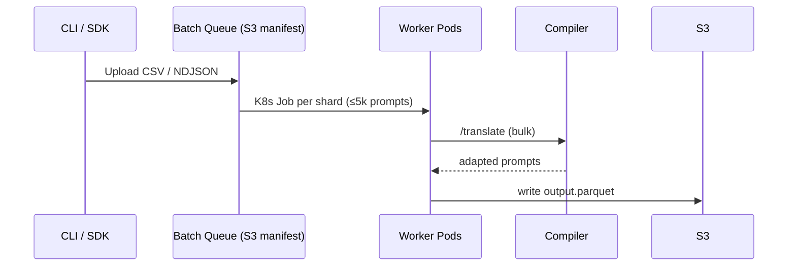

# Prompt Adaptation and Translation Service: System Design

*A backend service that **automatically rewrites prompts** from a *source* LLM style (e.g., GPT-4) into semantically consistent variants for **N target providers** (Claude, Gemini, Llama 3, etc.), while learning continually from user feedback, supporting batch migrations, and enabling A/B evaluation.*

---

## 1  Core Objectives & Constraints

| Axis | Target |
|------|--------|
| **Semantic Fidelity** | BLEU ≥ 0.85 & Judge-LLM ≥ 8 / 10 versus reference |
| **Latency (single prompt)** | p50 ≤ 60 ms, p95 ≤ 150 ms |
| **Throughput (batch)** | ≥ 10 k prompts/min on 8 vCPU node |
| **Online Learning Lag** | ≤ 15 min from feedback → updated weights |
| **Extensibility** | Add new model template via YAML + CI in < 30 min |
| **A/B Testing** | 1 → K variants, traffic split %, opt-in/opt-out |
| **SLA** | 99.9 % availability |

---

## P4: Detailed Architecture

```mermaid
flowchart TB
  subgraph Edge
    GW(API Gateway) --> AUTH(AuthN/OIDC)
  end

  AUTH --> ROUTE(Request Router)
  ROUTE --> CACHE[Prompt Cache Redis]
  CACHE -->|hit| RESP[Return Adapted Prompt]

  ROUTE -->|miss| COMP(Compiler Service)
  COMP --> PGE[Prompt Graph Engine]
  PGE -->|rewrite| RESP

  RESP --> METRIC(Metric Sink)

  subgraph Control & Learning
    KB[Prompt Pattern Knowledge Base]
    KB <-- PGE
    METRIC --> FEED[Feedback Ingest]
    FEED --> ONLINE(Online Learner)
    ONLINE --> KB
  end

  METRIC --> OLAP[ClickHouse Analytics]
  OLAP --> EXP[A/B Experiment Engine]
  EXP --> PGE

  style KB fill:#ffea8a
````

---

## 3  Request Lifecycle

1. **Client Request**

   ```json
   {
     "prompt": "Explain how DNS works.",
     "source_model": "gpt-4o",
     "targets": ["claude-4-sonnet","gemini-2-flash"],
     "weights": {"latency":0.3,"cost":0.1,"fidelity":0.6},
     "ab_test": {"variant_pct":30}
   }
   ```

2. **Router** calculates `cacheKey = sha256(prompt, targets, KB.version)`; checks Redis.

3. On **cache miss**, **Compiler Service**:

   * Looks up *source parse tree* (AST) via `Prompt DSL Parser`.
   * Queries **Knowledge Base** for *translation rules* to each target.
   * Applies **Prompt Graph Engine**: graph-based transforms preserve semantics & role ordering.

4. Returns list `[{model:"claude",prompt:"..."}, …]`.

5. **Metric Sink** logs latency, rule hits, A/B variant id.

6. As user rates outputs (thumbs up/down API or implicit dwell), **Feedback Ingest** saves JSON `{trace_id, score}`.

7. **Online Learner** (bandit / reinforcement finetune) updates rule weights; pushes to KB (append-only, versioned).

---

## 4  Knowledge Base Design

| Artifact              | Storage           | Purpose                                                            |
| --------------------- | ----------------- | ------------------------------------------------------------------ |
| **Template Graphs**   | Postgres JSONB    | Canonical trees of system / user / tool sections                   |
| **Rewrite Rules**     | Git-ops YAML → S3 | Deterministic patches (`prepend`, `replace`) with `version_semver` |
| **Empirical Metrics** | ClickHouse        | win-rate, latency, token delta per rule                            |

*Templates are *composable*; rules declare `applicability` (e.g., `task:code_gen` or `model_family:anthropic`).*

---

## 5  Compiler Service Internals

```text
Source Prompt  →  Parse (ANTLR grammar)  →  Prompt AST
                                ↓
                Rule Selector (context + KB metrics)
                                ↓
        Prompt Graph Transform (immutably clones tree)
                                ↓
     Validity Linter (token budget, policy)  →  Target Prompt
```

*Implemented in **Rust** for 20 µs parse hot-path; WASM plugin hooks allow custom rules.*

---

## 6  Online Learning Loop

| Stage            | Description                                                                            |
| ---------------- | -------------------------------------------------------------------------------------- |
| **Signal**       | Explicit rating `1–5` or implicit delta in downstream task metric                      |
| **Bandit Agent** | Context = `{source_model, target_model, prompt_len, domain}`; arms = rewrite\_rule ids |
| **Update**       | Thompson Sampling updates posterior; top-K rules re-ranked                             |
| **Deployment**   | Learner writes *rule\_weight* column → KB; Compiler selects by score                   |

*Feedback stream processed in **Kafka → Faust → Redis TTL features**.*

---

## 7  A/B Testing Framework

*Define experiment via REST:*

```json
POST /experiments
{
  "name":"claude_prompt_prefix_test",
  "population":"all",
  "variants": [
     {"id":"control", "rule":"default"},
     {"id":"new_prefix", "rule":"v2_pref"}
  ],
  "split": [70,30],
  "metric":"user_thumbs_up_rate",
  "duration":"7d"
}
```

* **Experiment Engine** tags incoming requests with `exp_id` & variant.
* **ClickHouse** materialized view computes real-time z-test; dashboard displays lift.
* **Auto-Promote** if p < 0.05 & lift > +1.5 %.

---

## 8  Batch Processing Path



*Throughput* \~130 k prompts/min on 10 × `WRK (8 CPU)`.

---

## 9  Storage, Caching & Scaling

| Component      | Store                 | Scaling Notes                  |
| -------------- | --------------------- | ------------------------------ |
| **Redis**      | Cluster, 3 shards     | 100 k QPS; TTL 10 min          |
| **Postgres**   | RDS Multi-AZ          | templates, rule metadata       |
| **ClickHouse** | 2 shards × 3 replicas | metrics, experiments           |
| **Kafka**      | 24 partitions         | feedback stream; 2 × producers |

Autoscaled via **K8s HPA** on `CPU + QPS` (Compiler) & `lag` (Kafka consumer).

---

## 10  Failure & Consistency Handling

* **Cache Fallback**: if Postgres unavailable, Compiler uses **last-known templates** kept in memory (snapshot file).
* **Rule Rollback**: Git commit revert + web-hook invalidates KB version; cache key ensures safety.
* **Batch Idempotency**: shard filename includes CRC; worker embeds `X-Idempotency-Key`.

---

## 11  Key Trade-Offs

| Decision              | Alternative            | Reason                                                 |
| --------------------- | ---------------------- | ------------------------------------------------------ |
| Graph-based transform | Regex / string replace | Maintains hierarchy, avoids prompt-injection fractures |
| Online bandit         | Full RLHF              | Simpler, faster convergence, needs no human labels     |
| Redis cache           | CDN edge               | Prompts may contain secrets; keep in-VPC               |
| Rust compiler         | Python                 | 5-10× latency improvement; single binary deploy        |
| Yaml rules in Git     | GUI DB                 | Code-reviewable, version-controlled                    |

---

## 12  Anticipated Questions

<details>
<summary>🔄 *How do you add a brand-new model tomorrow?*</summary>

1. Author `templates/<model>.yaml` with base prompt tokens & quirks.
2. Add mapping in `models.csv` (`family`, `max_tokens`, etc.).
3. Merge PR → CI lints & runs regression prompts.
4. Helm upgrade: Compiler hot-reloads KB version; no downtime.

</details>

<details>
<summary>🧠 *How does feedback avoid poisoning?*</summary>

* Weighted by user trust score; cap daily influence; outlier detection (MAD) kicks suspect events to quarantine table.\*

</details>

<details>
<summary>📈 *Can users enforce max cost per rewrite?*</summary>

Pass `max_cost_usd` field; Router filters out target models whose token estimate × price > budget before compilation.

</details>

---

## 13  Conclusion

By combining a **high-performance compiler**, a **versioned rule KB**, and a **bandit-driven online learner**—all fronted by low-latency caches—the service guarantees **semantically faithful prompt translations** at scale, supports batch migrations & controlled A/B rollouts, and continually improves as real-world feedback pours in.
