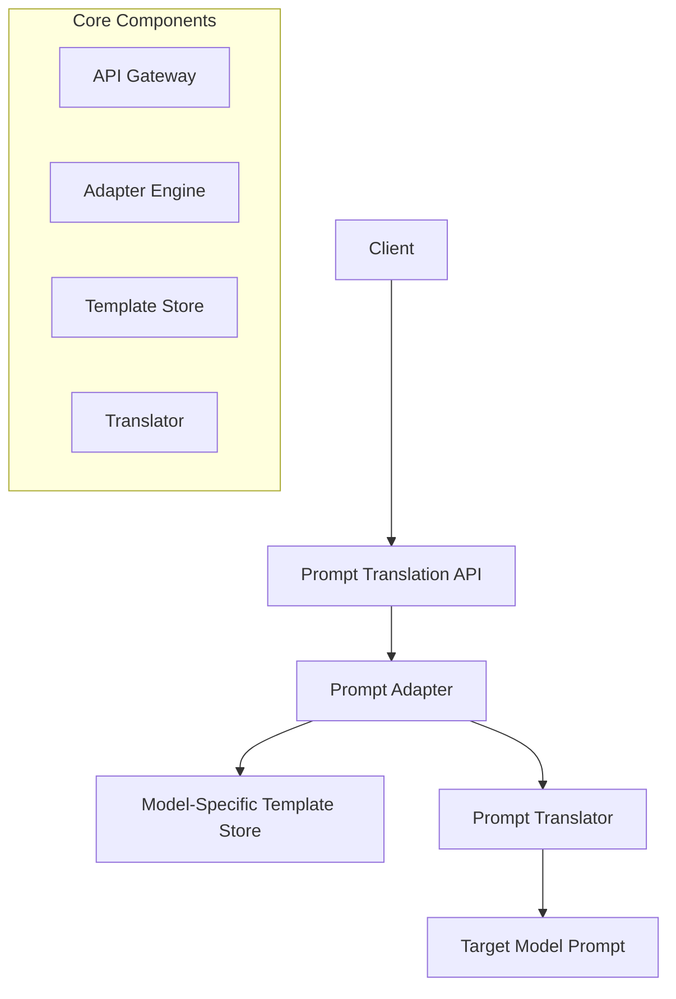
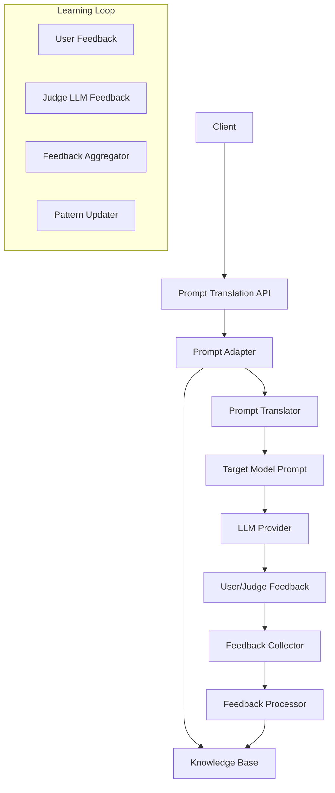
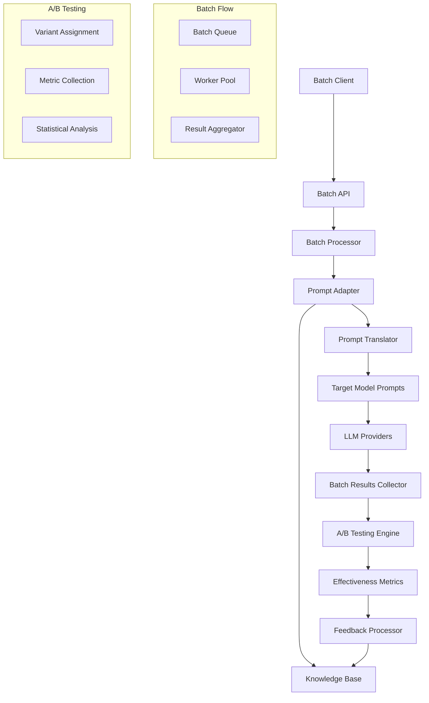
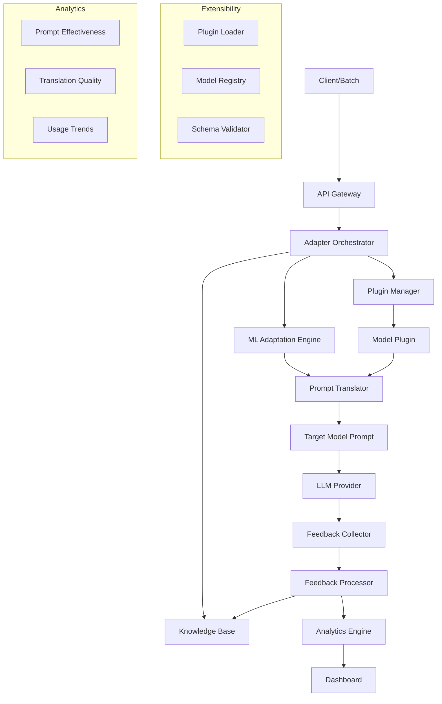
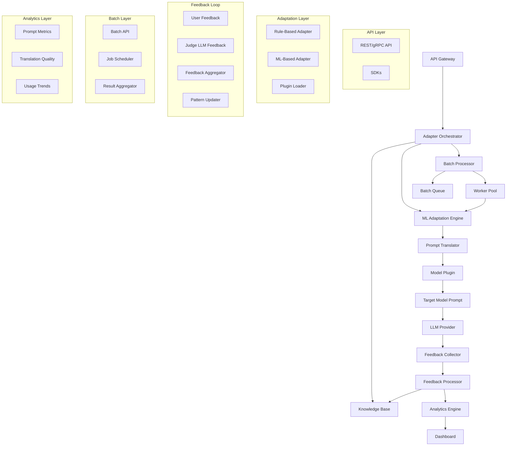
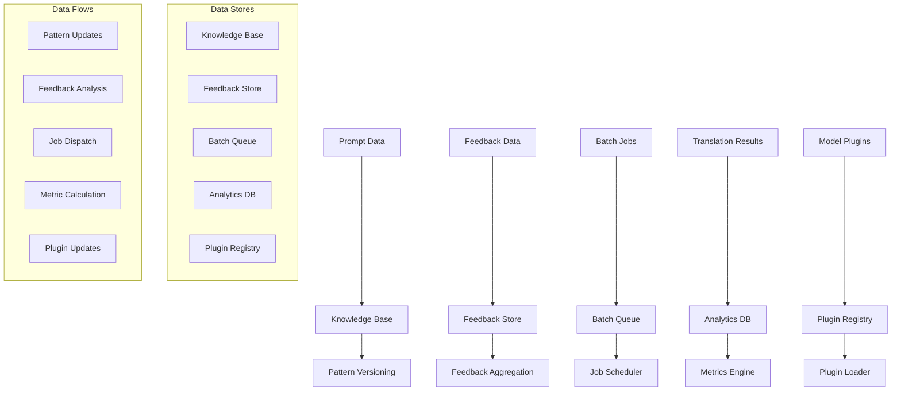

# Prompt Adaptation and Translation Service: System Design

## Problem Statement

Modern AI applications often need to support multiple LLM providers (OpenAI, Anthropic, Google, etc.), each with unique prompt formatting, capabilities, and quirks. Manually adapting prompts for each model is error-prone and does not scale. The goal is to design a service that:

- Accepts a prompt optimized for one model (e.g., GPT-4)
- Translates/adapts it for other models (Claude, Gemini, etc.)
- Maintains semantic consistency and performance
- Learns from user feedback to improve translation quality
- Maintains a knowledge base of model-specific prompt patterns
- Supports batch processing for large-scale prompt migration
- Provides A/B testing for prompt effectiveness

## Requirements Analysis

### Functional Requirements
- **Prompt Translation**: Convert prompts between model-specific formats
- **Semantic Consistency**: Ensure meaning and intent are preserved
- **Performance Optimization**: Adapt prompts for best results per model
- **Knowledge Base**: Store and update model-specific prompt patterns
- **Feedback Loop**: Learn from user/judge feedback to improve translations
- **Batch Processing**: Efficiently handle large prompt migration jobs
- **A/B Testing**: Compare prompt effectiveness across models/variants
- **API and SDK**: Expose REST/gRPC API and SDKs for integration

### Non-Functional Requirements
- **Latency**: <200ms for single prompt translation (p95)
- **Throughput**: 1000+ prompts/sec for batch jobs
- **Scalability**: Handle spikes in batch and real-time traffic
- **Reliability**: 99.9% uptime
- **Extensibility**: Add new models and prompt patterns easily
- **Security**: Protect user data and feedback

## Architecture Evolution

### Phase 1: Basic Prompt Translation API

Start with a simple API that translates prompts using static rules and templates.

**Why start simple?**
- Validates core need and integration
- Allows fast iteration and feedback
- Avoids premature complexity

**Why not ML-based translation first?**
- Rule/template-based is easier to debug and audit
- ML can be layered in after baseline is proven

### Phase 2: Feedback Loop and Knowledge Base

Add a feedback system and a knowledge base to learn and improve over time.

**Why a feedback loop?**
- Enables continuous improvement
- Adapts to model changes and new patterns
- Allows for human and LLM-as-judge feedback

**Why a knowledge base?**
- Centralizes model-specific prompt patterns
- Enables fast lookup and update
- Supports explainability and audit

### Phase 3: Batch Processing and A/B Testing

Add support for large-scale prompt migration and A/B testing.

**Why batch and A/B?**
- Enterprises need to migrate large prompt sets efficiently
- A/B testing is critical for measuring translation effectiveness
- Enables data-driven improvement

### Phase 4: Advanced Adaptation and Extensibility

Introduce ML-based adaptation, plugin support for new models, and advanced analytics.

**Why ML-based adaptation?**
- Handles complex, non-obvious translation cases
- Learns from large-scale feedback
- Adapts to evolving model behaviors

**Why plugin architecture?**
- Makes it easy to add new models/providers
- Supports custom logic per model
- Decouples core from model-specific code

## Detailed Architecture

### Core Components

### Knowledge Base

- Stores model-specific prompt templates, patterns, and quirks
- Versioned for auditability and rollback
- Supports fast lookup and update
- Can be extended with community/user-contributed patterns

### ML Adaptation Engine

- Learns translation mappings from feedback and usage data
- Uses semantic similarity, reinforcement learning, and prompt effectiveness metrics
- Can fall back to rule-based or template-based adaptation if confidence is low

### Plugin Architecture

- Each model/provider can have a plugin for custom adaptation logic
- Plugins are sandboxed and versioned
- Supports hot-reload for rapid updates

### Feedback Loop

- Collects explicit user feedback and implicit judge LLM scores
- Aggregates and analyzes feedback for pattern updates
- Supports A/B testing and variant tracking

### Batch Processing

- Accepts large prompt sets for migration
- Schedules and distributes jobs to worker pool
- Aggregates results and metrics for analysis

### A/B Testing Engine

- Assigns prompt variants to requests
- Collects effectiveness metrics (accuracy, user satisfaction, etc.)
- Performs statistical analysis to determine best variant

### Analytics and Dashboard

- Tracks prompt effectiveness, translation quality, and usage trends
- Provides insights for product and prompt engineers

## Data Architecture

## Scaling and Performance

- **Horizontal Scaling**: All stateless components can be scaled out
- **Batch Workers**: Auto-scale based on job queue depth
- **Knowledge Base**: Sharded and cached for low-latency access
- **Plugin Execution**: Sandboxed and distributed for safety and speed
- **Feedback Processing**: Stream/batch hybrid for real-time and historical learning

## Security and Compliance

- **Data Privacy**: All prompt and feedback data encrypted at rest and in transit
- **Access Control**: Role-based access for API, batch, and admin endpoints
- **Audit Logging**: All pattern and plugin changes are logged and versioned
- **Compliance**: GDPR, SOC-2, and enterprise requirements supported

## Follow-up Questions and Answers

### Q1: How do you ensure semantic consistency across models?
- Use semantic similarity scoring (embedding-based) to validate translations
- Human/LLM-in-the-loop review for low-confidence cases
- Continuous learning from feedback and A/B results

### Q2: How do you handle new or updated models?
- Plugin architecture allows rapid addition of new models
- Knowledge base can be updated with new patterns/templates
- ML engine can learn from early feedback and usage

### Q3: How do you support batch migration at scale?
- Batch jobs are queued and distributed to a scalable worker pool
- Results are aggregated and analyzed for quality
- System auto-scales workers based on queue depth

### Q4: How do you measure and improve translation quality?
- Collect explicit user feedback and implicit judge LLM scores
- Use A/B testing to compare variants
- Analyze metrics (accuracy, satisfaction, conversion, etc.)
- Update patterns and ML models based on results

### Q5: How do you support A/B testing for prompt effectiveness?
- Assign prompt variants to requests (random or stratified)
- Collect and analyze effectiveness metrics
- Use statistical analysis to determine best variant
- Roll out winning variants automatically or with human approval

### Q6: How do you ensure low-latency for real-time translation?
- Cache common translations and patterns
- Use fast, in-memory knowledge base lookups
- Optimize ML inference and plugin execution paths
- Auto-scale API and adaptation layers

## Conclusion

This Prompt Adaptation and Translation Service design enables organizations to seamlessly support multiple LLM providers, maintain prompt quality, and continuously improve through feedback and analytics. The architecture evolves from simple rule-based translation to a robust, extensible, and learning-driven platform, supporting both real-time and batch use cases, and empowering teams to deliver the best possible LLM experiences across providers. 