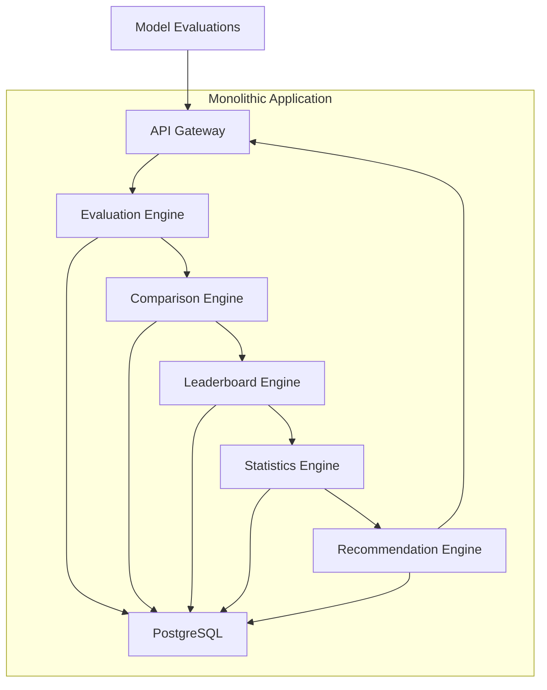
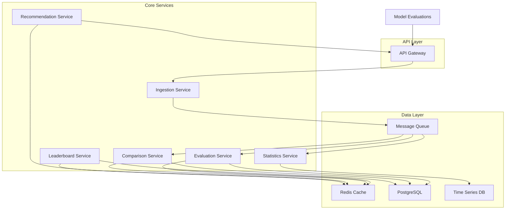
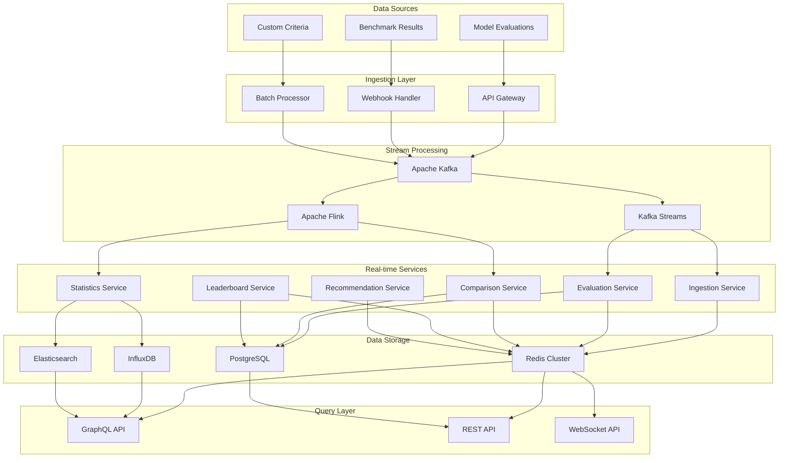
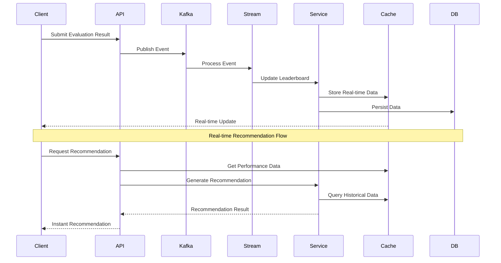
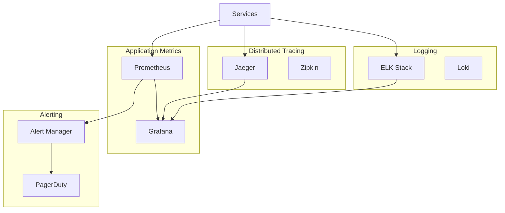

# Real-Time Model Performance Comparison System

## P1: Problem Statement

We need to design a system that continuously evaluates and compares model performance across different tasks and provides instant recommendations. The system must handle:

- Real-time ingestion of evaluation results from multiple models on the same tasks
- Dynamic leaderboards for different task categories
- Custom evaluation criteria and benchmarks
- Confidence intervals and statistical significance calculations
- Scale to evaluate hundreds of models across thousands of tasks
- Instant recommendations based on performance comparisons

## P2: Requirements Analysis

### Functional Requirements
- **Real-time Data Ingestion**: Accept evaluation results from multiple models simultaneously
- **Performance Comparison**: Compare models across different tasks and criteria
- **Leaderboard Management**: Maintain real-time rankings for different task categories
- **Custom Evaluation**: Support user-defined evaluation criteria and benchmarks
- **Statistical Analysis**: Calculate confidence intervals and statistical significance
- **Recommendation Engine**: Provide instant recommendations based on performance data
- **Multi-task Support**: Handle thousands of different task types

### Non-Functional Requirements
- **Latency**: Sub-second response times for recommendations
- **Throughput**: Handle hundreds of models and thousands of tasks
- **Availability**: 99.9% uptime for critical components
- **Scalability**: Horizontal scaling for data processing and storage
- **Consistency**: Eventual consistency acceptable for real-time updates
- **Reliability**: Fault tolerance and data durability

## P3: Architecture Evolution

### Phase 1: Simple Monolithic Approach

Let's start with a basic monolithic architecture to understand the core requirements.



**Problems with this approach:**
- Single point of failure
- Difficult to scale individual components
- Tight coupling between services
- Database becomes a bottleneck
- No real-time capabilities

### Phase 2: Microservices with Message Queue

Let's break down the monolith into microservices with asynchronous communication.



**Improvements:**
- Decoupled services
- Asynchronous processing
- Better scalability
- Fault isolation

**Remaining issues:**
- Message queue can become bottleneck
- Complex data consistency
- No real-time streaming capabilities

### Phase 3: Event-Driven Architecture with Stream Processing

Now let's implement a proper event-driven architecture with real-time stream processing.



## P4: Detailed Architecture

### Core Components

#### 1. Data Ingestion Layer

**API Gateway**
- Handles authentication and rate limiting
- Routes requests to appropriate services
- Provides unified interface for all clients
- Implements request/response transformation

**Webhook Handler**
- Accepts real-time evaluation results from external systems
- Validates incoming data format
- Transforms data into standardized events
- Handles retry logic for failed deliveries

**Batch Processor**
- Processes historical evaluation data
- Handles bulk imports from external sources
- Performs data validation and cleaning
- Generates events for processed data

#### 2. Stream Processing Layer

**Apache Kafka**
- Distributed event streaming platform
- Handles high-throughput message ingestion
- Provides fault tolerance and durability
- Supports multiple consumer groups

**Kafka Streams**
- Real-time stream processing
- Handles event transformation and enrichment
- Performs windowed aggregations
- Manages stateful processing

**Apache Flink**
- Complex event processing
- Handles statistical calculations
- Performs machine learning operations
- Manages complex workflows

#### 3. Core Services

**Ingestion Service**
- Validates incoming evaluation data
- Enriches data with metadata
- Routes events to appropriate topics
- Handles data quality checks

**Evaluation Service**
- Processes raw evaluation results
- Calculates performance metrics
- Applies custom evaluation criteria
- Generates standardized scores

**Comparison Service**
- Compares models across tasks
- Calculates relative performance
- Identifies performance trends
- Generates comparison matrices

**Leaderboard Service**
- Maintains real-time rankings
- Updates leaderboards on new data
- Handles different ranking algorithms
- Manages task category hierarchies

**Statistics Service**
- Calculates confidence intervals
- Performs statistical significance tests
- Generates performance distributions
- Handles outlier detection

**Recommendation Service**
- Analyzes performance patterns
- Generates model recommendations
- Considers task requirements
- Provides reasoning for recommendations

#### 4. Data Storage Layer

**Redis Cluster**
- Real-time leaderboards
- Caching frequently accessed data
- Session management
- Pub/sub for real-time updates

**InfluxDB**
- Time-series performance data
- Historical trend analysis
- Performance metrics storage
- Efficient time-range queries

**PostgreSQL**
- Relational data storage
- User management and permissions
- Configuration and metadata
- Audit logs and history

**Elasticsearch**
- Full-text search capabilities
- Complex query support
- Performance data indexing
- Analytics and reporting

#### 5. Query Layer

**GraphQL API**
- Flexible data querying
- Real-time subscriptions
- Complex relationship queries
- Client-specific data requirements

**REST API**
- Standard CRUD operations
- Simple data retrieval
- Integration with external systems
- Caching-friendly endpoints

**WebSocket API**
- Real-time updates
- Live leaderboard updates
- Instant notifications
- Interactive dashboards

### Data Flow Architecture



### Event Schema Design

```json
{
  "event_id": "uuid",
  "timestamp": "2024-01-01T00:00:00Z",
  "event_type": "model_evaluation",
  "model_id": "gpt-4",
  "task_id": "text-classification",
  "task_category": "nlp",
  "evaluation_metrics": {
    "accuracy": 0.95,
    "f1_score": 0.94,
    "precision": 0.96,
    "recall": 0.93
  },
  "custom_criteria": {
    "latency_ms": 150,
    "cost_per_token": 0.002,
    "energy_consumption": 0.5
  },
  "metadata": {
    "dataset_version": "v2.1",
    "evaluation_framework": "custom",
    "confidence_level": 0.95
  }
}
```

## P5: Scaling Strategies

### Horizontal Scaling

**Service Scaling**
- Stateless services can scale horizontally
- Load balancers distribute traffic
- Auto-scaling based on CPU/memory metrics
- Container orchestration with Kubernetes

**Data Storage Scaling**
- Redis Cluster for distributed caching
- Database read replicas for query scaling
- Time-series data partitioning
- Search index sharding

**Stream Processing Scaling**
- Kafka partitions for parallel processing
- Flink job scaling with more task managers
- Stream processing parallelism
- Event ordering within partitions

### Performance Optimization

**Caching Strategy**
- Multi-level caching (L1, L2, L3)
- Cache warming for popular queries
- Cache invalidation strategies
- Distributed cache coordination

**Database Optimization**
- Index optimization for query patterns
- Query optimization and monitoring
- Connection pooling
- Read/write separation

**Real-time Processing**
- Event batching for efficiency
- Stream processing optimizations
- Memory management
- Garbage collection tuning

## P6: Monitoring and Observability

### Metrics Collection



### Key Metrics

**Performance Metrics**
- Request latency (p50, p95, p99)
- Throughput (requests per second)
- Error rates and types
- Resource utilization

**Business Metrics**
- Number of active models
- Evaluation frequency
- Recommendation accuracy
- User engagement

**System Metrics**
- Kafka lag and throughput
- Database connection pool usage
- Cache hit rates
- Memory and CPU usage

## P7: Security Considerations

### Authentication and Authorization
- JWT-based authentication
- Role-based access control (RBAC)
- API key management
- OAuth2 integration

### Data Security
- Encryption at rest and in transit
- Data masking for sensitive information
- Audit logging for all operations
- GDPR compliance measures

### Infrastructure Security
- Network segmentation
- VPC and firewall rules
- Secrets management
- Regular security audits

## P8: Failure Handling and Resilience

### Circuit Breaker Pattern
- Prevents cascade failures
- Graceful degradation
- Automatic recovery
- Monitoring and alerting

### Retry Mechanisms
- Exponential backoff
- Dead letter queues
- Idempotency handling
- Retry limits and timeouts

### Data Consistency
- Event sourcing for audit trail
- CQRS pattern for read/write separation
- Eventual consistency model
- Conflict resolution strategies

## P9: Cost Optimization

### Resource Management
- Auto-scaling based on demand
- Spot instances for batch processing
- Reserved instances for predictable workloads
- Resource tagging for cost allocation

### Storage Optimization
- Data lifecycle management
- Compression for historical data
- Tiered storage (hot/warm/cold)
- Data retention policies

### Processing Optimization
- Efficient algorithms and data structures
- Batch processing where possible
- Caching to reduce computation
- Resource pooling

## P10: Follow-up Questions and Answers

### Q: How would you handle data consistency across multiple services?

**A:** We use an eventual consistency model with event sourcing. Each service maintains its own data store and communicates through events. For critical consistency requirements, we implement:
- Saga pattern for distributed transactions
- Event ordering within partitions
- Conflict resolution strategies
- Compensation actions for failures

### Q: What happens if the stream processing pipeline fails?

**A:** We implement multiple layers of resilience:
- Kafka provides durability and replay capability
- Flink checkpoints ensure state recovery
- Dead letter queues for failed events
- Monitoring and alerting for quick detection
- Manual intervention procedures for complex failures

### Q: How do you ensure real-time performance with high throughput?

**A:** We optimize for real-time performance through:
- In-memory caching for frequently accessed data
- Stream processing for real-time calculations
- Database read replicas for query scaling
- CDN for static content delivery
- Load balancing and auto-scaling

### Q: How would you handle custom evaluation criteria?

**A:** We implement a flexible evaluation framework:
- Plugin architecture for custom evaluators
- Configuration-driven evaluation rules
- Dynamic loading of evaluation modules
- Version control for evaluation criteria
- A/B testing for new evaluation methods

### Q: What's your strategy for handling hundreds of models and thousands of tasks?

**A:** We scale through:
- Horizontal partitioning by model/task categories
- Sharding strategies for data distribution
- Parallel processing pipelines
- Efficient indexing and query optimization
- Resource isolation and dedicated clusters

### Q: How do you ensure statistical significance in comparisons?

**A:** We implement robust statistical analysis:
- Confidence interval calculations
- Hypothesis testing frameworks
- Sample size determination
- Multiple comparison corrections
- Statistical power analysis

### Q: What monitoring and alerting would you implement?

**A:** We use a comprehensive monitoring stack:
- Application performance monitoring (APM)
- Infrastructure monitoring
- Business metrics tracking
- Real-time alerting for critical issues
- Dashboards for operational visibility

### Q: How would you handle data privacy and compliance?

**A:** We implement privacy-by-design:
- Data anonymization and pseudonymization
- Access controls and audit logging
- Data retention and deletion policies
- GDPR and CCPA compliance measures
- Regular privacy impact assessments

This architecture provides a robust, scalable, and real-time solution for model performance comparison while maintaining high availability, performance, and reliability. The event-driven approach ensures loose coupling between services, while the stream processing layer enables real-time analytics and recommendations. 